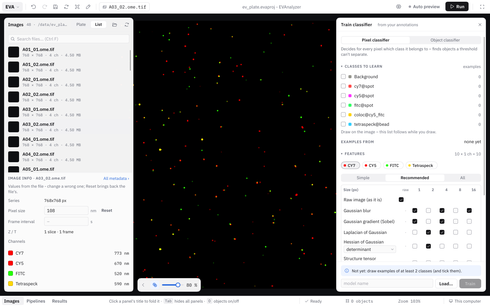

Unlike [AI Models](/ai/overview/), which run a **pretrained** deep-learning network you supply as a TorchScript export, **AI training** trains a lightweight classical machine-learning model - Random Forest, k-Nearest Neighbors, or a small neural network (MLP) - directly from examples you paint on your own images. No external model file is needed to get started; the model is built entirely from your annotations and saved as an `.evamodel` file.

Open it with **EVA › AI training…**. It opens as a sheet on the right, so the image and your annotations stay in view while you set it up.

The sheet - **Train classifier** _from your annotations_ - is built from foldable sections: **CLASSES TO LEARN**, **EXAMPLES FROM**, **FEATURES**, **MODEL** and **EXAMPLE OBJECTS**, with the model's name, **Load…** and **Train** in its footer.

## Two Kinds of Classifier

| Classifier Type       | Classifies                                                    | Feature source                                                | Comparable to                                                                                                    |
| --------------------- | ------------------------------------------------------------- | ------------------------------------------------------------- | ---------------------------------------------------------------------------------------------------------------- |
| **Pixel Classifier**  | Every pixel of an image, independently                        | Intensity and texture/edge filters computed around each pixel | ilastik-style pixel classification                                                                               |
| **Object Classifier** | Objects already extracted by a pipeline (or painted directly) | Shape and per-channel intensity metrics of each object        | A learned alternative/complement to [Classify Objects](/commands/object/classify-objects/)'s rule-based criteria |

A **Pixel Classifier** produces a segmentation mask - the same output shape [Threshold](/commands/segmentation/threshold/) produces - so it slots into a pipeline before [Connected Components](/commands/segmentation/connected-components/)/[Extract Objects](/commands/object/extract-objects/).
An **Object Classifier** instead scores objects that already exist in the pipeline cache, the same input [Classify Objects](/commands/object/classify-objects/) works from.

## Workflow

### 1. Provide examples with the painting tool

Both classifier types learn from objects you draw in [annotate mode](/guide/images/#annotating-the-image) (Rectangle, Ellipse, Polygon or the Brush), independent of any pipeline.

- **Pixel Classifier** - paint a few representative patches of each class you want to predict, **and paint a couple of background patches too**. The classifier needs negative examples of everything that _isn't_ a target class, not just positive examples of the classes themselves - a model trained only on "Nucleus" patches has never seen what a non-nucleus pixel looks like.
- **Object Classifier** - give whole objects a class: paint around them, or give the objects a segmentation pipeline found a class. The examples can also be checked and changed one by one under **EXAMPLE OBJECTS**.

:::tip[Background is always included]
`Background` is always included as a prediction target (index 0), even if left unchecked in **Classes to learn** - so painting background examples and assigning them the `Background` class is enough; you don't need to explicitly select it.
:::

### 2. Open AI training and pick the classifier

Open **EVA › AI training…** and pick **Pixel classifier** (_"Decides for every pixel which class it belongs to"_) or **Object classifier** (_"Sorts objects your pipeline already found into classes"_). **Load…** in the footer continues from a previously saved model instead: its settings are loaded and its path shown (**Loaded: …**).

### 3. Pick which classes to learn

**CLASSES TO LEARN** lists the project's classes, each with its number of examples. The list follows while you draw or classify objects - you don't need to reopen the sheet. Classes with examples are pre-checked; any class can be ticked ahead of labelling it.

**EXAMPLES FROM** says where the examples come from (_"This image + 2 more · 94"_). By default only the image shown is used; **EXAMPLE OBJECTS › Show the objects of other images too** adds the annotations of the other images, each image with a box to use it or not.

### 4. Check the examples

**EXAMPLE OBJECTS** lists every example object (_"Object #12 (area 340 px)"_). For each one:

- pick its class from the dropdown,
- untick **Train on this** to leave a bad or outlier annotation out of training without deleting it.

### 5. Pick the features

See [Pixel features](#pixel-features) and [Object features](#object-features) below. The head of **FEATURES** counts them - for a pixel classifier _"features per channel × channels"_ (e.g. _"12 × 2 ch = 24"_).

### 6. Choose the model

**MODEL** picks **Random Forest**, **K-Nearest Neighbors** or **Neural Network (MLP)**; its head shows the model in short (_"Random forest · 50 trees"_). **All model settings ›** shows every setting of the model - see [Choosing a Model](#choosing-a-model).

### 7. Train

Name the model in the footer and click **Train**. The footer says whether the examples are enough:

- _"Not yet: draw examples of at least 2 classes (and tick them)."_ - **Train** stays off.
- _"Spot has no examples - draw some or untick it."_ or _"Spot has 3 examples - it trains, but draw ~5 or more for a steadier model."_ - it trains, but warns.
- _"Ready: 3 classes, 94 examples from 2 images."_

The project must be saved first (the model is stored next to it). Training refuses a project whose z-stacks are set to **3D** (_"Training on z-stacks as volumes (3D) isn't supported yet"_). While training runs, the status shows its progress - the images and tiles read, and for MLP the train/validation loss per epoch; **Cancel** stops it. The sheet stays open afterwards, so you can change something and retrain.

### 8. Use the model in a pipeline

The trained model is saved to `<project>/models/<model name>.evamodel`, and **RESULT** says what was trained (_"50 tree(s), trained on 2 340 sample(s)."_).

- If a pipeline already uses the model, it reloads it, and with **Auto preview** on the [preview](/guide/pipelines/#live-preview) shows the new result right away.
- If no pipeline uses it yet, **Add to pipeline** adds one named _"AI · <model name>"_: for a pixel classifier an [AI Pixel Classifier](/commands/ai-segmentation/pixel-classifier/) on the first trained channel, followed by Connected Components and Extract Objects; for an object classifier an [AI Object Classifier](/commands/object/ai-object-classifier/) whose input classes are the classes the enabled pipelines give objects - so objects an earlier step removed stay removed. The new pipeline is shown and previewed; **Undo** removes it again.

You can also add an AI Pixel Classifier or AI Object Classifier step yourself and point it at the file.

### Z-stacks and time-lapses

Each example is trained on the image an analysis would use it on, by the project's [z-stack setting](/guide/images/#z-stack):

- **Slice** (the planes one by one): each example on its own plane of its frame. Examples drawn while a projection was shown are left out.
- A projection (**Max**, **Min**, **Avg**, **Sum**, **Mid**): each example on that projection of its frame - the examples drawn on single planes as well as those drawn on the projection.

An annotation remembers whether it was drawn on a plane or on a projection, and the image shows it only where it belongs: one drawn on a plane on that plane and on the projections of its frame; one drawn on a projection only on the projections. So for a z-stack analysed as a Max projection, draw your examples on the Max view.

## Choosing a Model

| Algorithm                                           | Good default when...                                                                                                | Key defaults                                                                                                                                                                                      |
| --------------------------------------------------- | ------------------------------------------------------------------------------------------------------------------- | ------------------------------------------------------------------------------------------------------------------------------------------------------------------------------------------------- |
| **[Random Forest](/ai/random-forest/)**             | You want a robust first try - insensitive to feature scale, tolerates noisy or redundant features well              | 50 trees, max depth 20 (capped deliberately - a pixel classifier re-walks every tree for _every pixel of every image_ at inference time, so depth/tree-count trade accuracy for prediction speed) |
| **[k-Nearest Neighbors](/ai/k-nearest-neighbors/)** | Classes form simple, well-separated clusters in feature space                                                       | k = 5, Euclidean distance, distance-weighted voting, Cover Tree search                                                                                                                                                |
| **[Neural Network (MLP)](/ai/neural-network-mlp/)** | You have a larger, more varied set of labeled examples and a feature set too complex for a simple decision boundary | Hidden layers `64, 32`, ReLU, 200 epochs, Adam optimizer (learning rate 0.001)                                                                                                                    |

For MLP, watch the per-epoch status banner: if validation loss climbs while training loss keeps falling, the model is overfitting - add more/more varied examples, or shrink the hidden-layer sizes, rather than just training longer. A validation split is only computed once there are at least 25 total training samples; below that, only training loss is shown.

See [Random Forest](/ai/random-forest/), [k-Nearest Neighbors](/ai/k-nearest-neighbors/), and [Neural Network (MLP)](/ai/neural-network-mlp/) for a detailed look at how each algorithm actually works.

The MLP always holds back 20 % of the examples for its validation loss; no balancing of classes or normalising of features is done. (The earlier **TRAINING OPTIONS** section, whose settings the training never used, is no longer shown.)

## Pixel features

**FEATURES** for a pixel classifier has three parts:

- **The channels** - a chip per image channel; tick one or more. Every feature is computed on each ticked channel, so a model can learn from several channels at once. The model remembers the channels by number (and their names, for information); applying it to an image that lacks one of them fails with _"… needs image channel N, which this image doesn't have"_.
- **Simple | Recommended | All** - presets for the table below. Editing the table by hand leaves all three unpicked.
- **The table** - one row per kind of feature, one column per **Size (px)**. Tick a cell to use that feature at that size; rows with options (Hessian, structure tensor, rank filter) pick which one in a dropdown beside their name.

| Row | Captures | Options |
| --- | --- | --- |
| **Raw image (as it is)** | the pixel's own intensity, unfiltered - one box, no sizes | |
| **Gaussian blur** | the intensity smoothed over the size | |
| **Gaussian gradient (Sobel)** | edges: where the intensity changes | |
| **Laplacian of Gaussian** | spots and blobs: round bright or dark specks | |
| **Hessian of Gaussian** | lines and ridges: fibres, membranes, cell borders | determinant, eigenvalue 1, eigenvalue 2 |
| **Structure tensor** | texture: how aligned the pattern is | coherence, eigenvalue 1, eigenvalue 2 |
| **Rank filter** | median / mean / min / max around the pixel | median, mean, min, max |

**Size:** _Gaussian σ = size / 2, rank filter radius = size_. The table starts with the sizes 1, 2, 4, 8 and 16 px; **+ size** adds one (up to 16 px, at most 10 columns), a click on a size's head removes it (one always stays). The blur, gradient, Laplacian and Hessian rows smooth with that Gaussian first, then apply their filter; the structure tensor uses it as its own scale.

| Preset | Ticks |
| --- | --- |
| **Simple** | Raw image; Gaussian blur at 1 and 4; Gaussian gradient at 1 |
| **Recommended** | Raw image; Gaussian blur at 1, 4 and 16; Gaussian gradient at 1 and 4; Laplacian of Gaussian at 2 and 4; Hessian of Gaussian at 2; Rank filter at 4 |
| **All** | Every cell of every row at the default sizes |

A few rules of thumb (the same approach ilastik's pixel classification is built around):

- **Combine a few filter types across several sizes**, rather than many filter types at one size - small sizes pick up fine detail, larger ones add regional context.
- **Pick the channels that tell the classes apart.** Each ticked channel multiplies the number of features.
- **Colour (RGB) images are supported.** On an RGB image every feature is computed separately on the red, green and blue planes, so the classifier sees the colour information. A model trained on colour images can only be applied to colour images, and one trained on grayscale images only to grayscale images - EVAnalyzer refuses to apply it to the other kind. All training images of one model must therefore be of the same kind; a mixed set is refused before training starts.
- More features cost more inference time (every pixel of every image needs every feature computed) without necessarily improving accuracy - start small and add features only where the classifier is actually confusing two classes.

## Object features

**FEATURES** for an object classifier has a preset - **Shape only**, **Recommended** or **All** - and two parts:

- **SIZE & SHAPE** - **Area**, **Perimeter**, **Circularity**, **Solidity**, **Aspect ratio**, **Roundness**, **Max Feret**, **Min Feret**, **Eccentricity**, **Major axis**, **Minor axis**, **Compactness**, **Orientation** and **Touches edge**.
- **BRIGHTNESS** - a table of statistics × channels: **Mean**, **Median**, **Std dev** (_how uneven_), **Min / Max**, **Quartiles**, **MAD** (_uneven, robust to specks_), **Sum** (_grows with size_), **Ring mean** (_the surroundings_) and **Contrast to ring** (_stands out_). Click a channel or statistic to tick its column or row.

The ring statistics are measured in a ring around each object - every pixel at most **Ring width** px from it (default 5 px, neighbouring objects included). **Ring mean** is the mean intensity of the ring, **Contrast to ring** the object's mean minus the ring's. **Ring width** is shown as soon as a ring statistic is ticked.

**Shape only** ticks Area, Perimeter, Circularity, Solidity, Aspect ratio, Max Feret and Eccentricity; **Recommended** adds Mean, Median and Std dev of every channel; **All** ticks everything.

The intensities are measured on the image itself - under each object on the image an analysis uses it on (its own plane of its frame, or with a z-projection that projection of its frame - see [Z-stacks and time-lapses](#z-stacks-and-time-lapses)), every channel at full resolution - the same way the [AI Object Classifier](/commands/object/ai-object-classifier/) step measures them, so training and the pipeline see the same values. With shape features alone no image is read. An image that can't be read is reported and its objects skipped.

_Class and position are never used._ Including the class would leak the training label itself, and position would teach the model _where_ an object is instead of _what it looks like_, a classic overfitting trap.

Pick a handful of features that actually distinguish your classes rather than checking everything - e.g. Circularity + Solidity to separate round vesicles from irregular debris, or a channel's Mean or Contrast to ring to separate marker-positive from marker-negative objects. Fewer, meaningful features generalize better from a limited set of hand-labelled examples.
