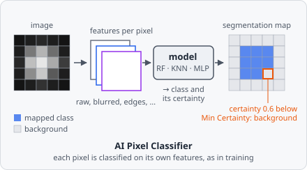

The **AI Pixel Classifier** command applies a pixel classifier trained via the app's [Train Classifier dialog](/ai/training/) as a segmentation step. It recomputes the exact feature recipe baked into the model at training time, classifies every pixel of the image independently, and writes the result into the segmentation map - the same output shape [Threshold](/commands/segmentation/threshold/) produces, so downstream steps like [Connected Components](/commands/segmentation/connected-components/) and [Extract Objects](/commands/object/extract-objects/) don't need to care which one ran.



Available in builds with the `ai` Cargo feature enabled - see [AI Models](/ai/overview/).

## Parameters

| Parameter | Description |
| ------------------------- | -------------------------------------------------------------------------------------------------------------- |
| **Model Path** | Path to a trained pixel classifier `.evamodel` file, saved from the [Train Classifier](/ai/training/) dialog |
| **Segmentation Mapping** | Maps each of the model's predicted classes to one of this project's segmentation classes |
| **Min Certainty** | Pixels the model is less sure about than this become background. `0` (default): off. Range 0-1 - see [Min Certainty](#min-certainty) |

The model's own classes are a snapshot taken at training time and aren't guaranteed to line up with this project's segmentation class numbers - **Segmentation Mapping** is the bridge between the two. It's a repeatable list of `Segmentation Class → Object Class ID` pairs, one entry per model class you want to map through.

:::note[Unmapped classes become background]
A predicted class with no matching **Segmentation Mapping** entry is written as `Background` - the same convention [Threshold](/commands/segmentation/threshold/) uses for pixels outside every configured intensity range. Mapping only the classes you care about is a deliberate simplification, not an oversight; you don't need an entry for every class the model was trained on.
:::

## Min Certainty

The model gives each pixel a class and a certainty between 0 and 1:

| Model             | Certainty                                                      |
| ----------------- | -------------------------------------------------------------- |
| **Random Forest** | The share of trees voting for the class                        |
| **KNN**           | The share of the neighbours voting for the class               |
| **MLP**           | The probability of the class                                   |

With **Min Certainty** above 0, every pixel with a lower certainty becomes background, whatever its class. Use it to drop the unsure pixels at the edges of objects or in noise; `1` keeps only the pixels the model is completely sure about (e.g. every tree agrees).

## Input image

A model trained on the image the step gets (the current image, e.g. after preprocessing steps) is applied to the image the step gets.

A model trained on chosen **image channels** reads those channels of the current tile by their number, whatever image the step gets - the preprocessing steps before it don't change its input. Its features are computed on each of the channels in turn. If the image doesn't have one of the channels, the step fails with a message naming the channel.

The command errors if **Model Path** doesn't exist, if it points at a model trained as an **Object Classifier** instead of a **Pixel Classifier**, or if the image's colour type (grey or RGB) differs from the one the model was trained on.

## Example

A pixel classifier `nuclei-px.evamodel` was trained on two classes: `Background` and `Nucleus`.

```
Model Path:            models/nuclei-px.evamodel
Segmentation Mapping:  Nucleus → 1
```

Pixels predicted as `Nucleus` are written to segmentation class `1`; pixels predicted as `Background` (left unmapped) fall back to segmentation class `0`. A typical follow-up pipeline: **AI Pixel Classifier** → [Connected Components](/commands/segmentation/connected-components/) → [Extract Objects](/commands/object/extract-objects/) → [Classify Objects](/commands/object/classify-objects/).
