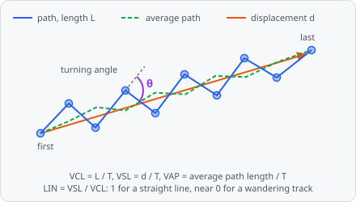

**Measure Track Motion** measures how each track of a tracking step moved: its path and displacement, how far it got from its start, the speeds and ratios of computer-assisted sperm analysis (**CASA**: VCL, VSL, VAP, LIN, STR, WOB, ALH, BCF) as the WHO laboratory manual (2021) defines them, its turning angle and its mean squared displacement (**MSD**: α and D). Use it to tell directed from random or confined motion, straight swimmers from circling ones, or to compare the speed of tracks between wells.

In a project file it is `MEASURE_TRACK_MOTION`.

It is a [dataset step](/guide/pipelines/#dataset-steps): it runs once after every image has been analysed, on the stored objects of all frames. Add it after the tracking step whose tracks it measures - [Track LAP](/commands/dataset/track-lap/), [Track Kalman](/commands/dataset/track-kalman/), [Track Overlap](/commands/dataset/track-overlap/) or [Track Nearest Neighbor](/commands/dataset/track-nearest-neighbor/):

**Track LAP** (or another tracker) → **Measure Track Motion**

The values are stored per track. [Results › Tracks](/guide/results/#tracks) shows them as columns - the speed and straightness of a track are its VCL and LIN, so without this step they stay empty - together with each track's path from its start and its MSD over the lag. [Results › Paths](/guide/results/#paths) draws all tracks from their start and plots LIN against the turning angle or MSD α.

## Parameters

| Parameter | Description |
| --- | --- |
| **ID** | The step's ID, unique in the project. Its values' names in the results start with it (e.g. `motion_01`). |
| **Objects** | The tracked objects measured. A tracking step for this class must come before. |
| **Min Step** | Steps shorter than this are joined with the next ones before the turning angle is taken - jitter of the centre isn't turning. The path and the speeds use every step. Default 1, range 0-100000. |
| **Unit** | Unit of **Min Step**: **px** (default) or **nm**. |
| **Average Over** | The average path (for VAP, STR, WOB, ALH, BCF): each position is the mean of the positions this many before and after it. Default 2, range 0-100. |
| **Drift Reference** | Objects that don't move by themselves (e.g. immotile cells, beads), tracked too: their median step is the image's drift and is taken away first - see [Drift correction](#drift-correction). Unset (default): no drift correction. |

Without **Objects** the step stops with an error: Measure Track Motion: choose the tracked objects. **Min Step** in nm needs the pixel size of the image; without it the step stops with an error.

## Measurements

Sixteen values per track, in pixels and time points (frames):

| Measurement | Unit | Description |
| --- | --- | --- |
| **Path length** | px | The sum of all steps, $L$. |
| **Displacement** | px | From the first to the last position, $d$. |
| **Max distance from start** | px | The farthest any position is from the first. |
| **VCL (curvilinear speed)** | px/frame | Path length over time, $L / T$. |
| **VSL (straight-line speed)** | px/frame | Displacement over time, $d / T$. |
| **VAP (average path speed)** | px/frame | Length of the average path over time. |
| **LIN (linearity)** | - | VSL / VCL: 1 a straight line, near 0 wandering (0-1). |
| **STR (straightness)** | - | VSL / VAP. |
| **WOB (wobble)** | - | VAP / VCL. |
| **ALH (lateral head amplitude)** | px | Twice the mean distance of a position from its average path position. |
| **BCF (beat-cross frequency)** | 1/frame | How often the track crosses its average path, per time point. |
| **Turning angle (mean)** | degrees | The mean angle from one step to the next, + counter-clockwise on the image (-180 to 180). |
| **Turning angle (mean absolute)** | degrees | The mean of the angles' absolute values (0-180). |
| **Angular speed** | degrees/frame | The summed turning angles over time. |
| **MSD alpha** | - | The exponent $\alpha$ of the MSD: a random walk gives about 1, a straight line 2, a track that stays in a bounded area less than 1. |
| **MSD D** | px²/frame | The coefficient $D$ of the MSD. |

With a **Drift Reference**, two more values per image and time point: **Drift X** and **Drift Y** (px), how far the image moved since the first time point.

The results can show the lengths, speeds and rates in µm and per minute or second instead - see [Results › Tracks](/guide/results/#tracks).

A value a track can't have is left out: a track with one time point has only its path length, displacement and max distance (all 0); the MSD needs a long enough track (see [MSD](#mean-squared-displacement)). Running the analysis again replaces the step's values.

## How it works

The step works image by image and per Z-plane. A track's position at a time point is the centre of its object's bounding box; if a track has two objects at one time point, the first counts.

### Path, displacement and speeds

With the positions $p_1, \dots, p_N$ of a track at the time points $t_1 < \dots < t_N$ and $T = t_N - t_1$:

$$
L = \sum_{i=1}^{N-1} |p_{i+1} - p_i| \qquad d = |p_N - p_1| \qquad \text{VCL} = \frac{L}{T} \qquad \text{VSL} = \frac{d}{T}
$$

A gap - time points without the object - is one straight step, and its time counts in $T$.

### Average path, VAP, ALH and BCF

Each position of the **average path** is the mean of the positions up to $w$ = **Average Over** before and after it, as many on both sides:

$$
\bar{p}_i = \frac{1}{2h+1} \sum_{j=i-h}^{i+h} p_j \qquad h = \min(w,\ i-1,\ N-i)
$$

So near the ends fewer positions are averaged, and the first and last position stay where they are. VAP is the length of the average path over $T$, and

$$
\text{LIN} = \frac{\text{VSL}}{\text{VCL}} \qquad \text{STR} = \frac{\text{VSL}}{\text{VAP}} \qquad \text{WOB} = \frac{\text{VAP}}{\text{VCL}} \qquad \text{ALH} = \frac{2}{N} \sum_{i=1}^{N} |p_i - \bar{p}_i|
$$

A ratio whose divisor is 0 is left out. For BCF, each position lies on one side of the average path's direction there (from $\bar{p}_i$ to $\bar{p}_{i+1}$; at the last position the step before). Every change of side is a crossing; positions on the average path, or where it doesn't move, are skipped. BCF is the number of crossings over $T$.

### Turning angle

The steps are taken from position to position, but a step shorter than **Min Step** (or of length 0) is joined with the next ones until it is long enough. The turning angle is between each step $\vec{a}$ and the next $\vec{b}$:

$$
\theta = -\operatorname{atan2}(a_x b_y - a_y b_x,\ \vec{a} \cdot \vec{b})
$$

in degrees, positive for a turn counter-clockwise as seen on the image (y points down). **Turning angle (mean)** is the mean of $\theta$ - near 0 for random turns, one sign for a track circling one way -, **Turning angle (mean absolute)** the mean of $|\theta|$, and **Angular speed** $\sum \theta / T$. A track needs at least two steps for an angle.

### Mean squared displacement

$\text{MSD}(n)$ is the mean squared distance between the positions $n$ time points apart, over all pairs where the track has both positions. The lags $n$ go up to $T/4$, spaced evenly on a log scale - 1, then each 1.25 times the one before, rounded: 1, 2, 3, 4, 5, 6, 7, 9, 12, … - so the noisy long lags of a long track don't outnumber the short ones. Lags without a pair or with an MSD of 0 are left out.

A straight line is fitted by least squares through $\ln \text{MSD}(n)$ over $\ln n$, with slope $\alpha$ and intercept $b$:

$$
\text{MSD}(n) = 4 D\, n^{\alpha} \qquad D = \frac{e^{b}}{4}
$$

The fit needs at least 10 positions, $T/4 \ge 2$ and at least 2 lags; otherwise the track has no MSD alpha and MSD D.

### Drift correction

With a **Drift Reference**, the tracks of that class (in the same image and Z-plane) give the drift of the image - stage movement or flow. For each time point, the drift step is the median of the reference tracks' steps from the time point before, separately in x and y; only steps of one time point count. Summed up from the first time point, this is the drift, which is subtracted from every position of the measured tracks before anything is measured. Before the references' first time point the drift is 0, after their last it stays at its last value. A time point without a reference step adds nothing.

## References

- World Health Organization, _WHO laboratory manual for the examination and processing of human semen_, sixth edition, Geneva, 2021.

## Limitations

- All values are in pixels and time points, measured in 2D within one Z-plane.
- Positions are the centres of the objects' bounding boxes.
- The drift reference class has to be tracked too (by its own tracking step before this one).
- Only project classes can be measured, not the internal classes of a [module](/guide/modules/#internal-classes).
