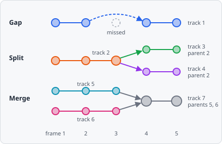

**Track Kalman** links the objects of a time-lapse into **tracks** by the globally best assignment, predicting each track's next position from its velocity - for objects moving in a direction (directed motion, e.g. vesicles transported along microtubules). Like [Track LAP](/commands/dataset/track-lap/), it closes gaps and, if switched on, detects merges and splits. Every tracked object gets a **Track ID**, shown as a column in the [results](/guide/results/#list-view).

It is a [dataset step](/guide/pipelines/#dataset-steps): it runs once after every image has been analysed, on the stored objects of all frames.

The tracks it makes are shown in [Results › Tracks](/guide/results/#tracks): a row per track with its time points, speed and straightness, its trail on the image and - with merges and splits - its parent and child tracks.

## Parameters

| Parameter | Description |
| --- | --- |
| **Object Class** | The object class to track. |
| **Unit** | Unit of the distances: **nm** (default) or **px**. |
| **Initial Max Distance** | How far a new track's second object may be from its first - the fastest an object moves per frame. Default 15000. |
| **Max Distance** | How far an object may be from where its track predicts it - also the farthest a merge or split partner may be. Default 5000. |
| **Max Gap Frames** | How many frames in a row an object may be missing and its track still continue. 0: no gap closing. Default 2, range 0-100. |
| **Max Gap Distance** | How far an object may be from where its track predicts it after a gap. Default 10000. |
| **Position Noise** | _(advanced)_ How exactly an object's position is known (its standard deviation) - the larger, the more the predictions follow the velocity rather than the last position. Default 200. |
| **Velocity Noise** | _(advanced)_ How much the velocity changes from one frame to the next (standard deviation) - the larger, the faster a track follows a turn. Default 1000. |
| **Merging** | Detect two objects merging into one (e.g. vesicle fusion). Off by default. |
| **Splitting** | Detect one object splitting into two (e.g. a vesicle budding off). Off by default. |
| **Merge Split Amount** | _(advanced)_ What a merge adds up and a split divides: **Area** or **Intensity** (default **Intensity**) - see [Merge Split Amount](#merge-split-amount). |
| **Channel** | _(advanced)_ The channel of the intensity, if **Merge Split Amount** is **Intensity**. |

With an impossible value the step stops with an error: The maximum distances must be greater than 0; **Position Noise** must be greater than 0, **Velocity Noise** at least 0.

## How it works

Per image and Z-plane, tracking runs in two steps, both solved as a global **linear assignment problem** (Jaqaman et al., 2008), so every link competes with all others instead of being taken closest first:

1. **Frame to frame:** the tracks ending in frame _t_ are linked to the objects of frame _t_ + 1 so that the summed cost is smallest, each object once. A link costs the squared distance to the position the track predicts. Every track carries a Kalman filter per axis with a constant-velocity model: per frame the position moves by the velocity, the velocity changes at random by **Velocity Noise**, and the measured positions are off by **Position Noise**. A new track has no velocity yet: its second object is looked for within **Initial Max Distance** around the first.
2. **Gaps, merges and splits:** a track's end is linked to another track's start up to **Max Gap Frames** missing frames later (gap closing). With **Merging**, a track's end can also run into the middle of another track in the next frame; with **Splitting**, a track's start can come out of the middle of another one in the frame before. Gap closing predicts across the missing frames. Merges and splits are scored as in Track LAP - by distance, without prediction - see [Merge Split Amount](#merge-split-amount).

Not linking costs 1.05 times the highest cost a link may have, so any possible link beats no link, and the links only compete with each other.

What the links make of the tracks:

- A closed gap continues the track.
- A **merge** ends both tracks and starts a new one, with both as its parents.
- A **split** ends the track and starts two - its continuation and the new object - each with the old track as parent.

The parents are stored with the tracks and shown in [Results › Tracks](/guide/results/#tracks) as lineage (divisions and fusions). Positions are the centres of the objects' bounding boxes. Track IDs are unique across tracking steps: a second tracking step for another class continues after the IDs the first one gave. Objects that are not tracked have no Track ID.

### Merge Split Amount

A merge adds two objects up and a split divides one - **Merge Split Amount** says what, to tell a true merge or split from objects that only pass close by:

| Merge Split Amount | For |
| --- | --- |
| **Area** | Objects that keep their size (e.g. cells). |
| **Intensity** | The summed intensity of **Channel** (mean × area): for spots below the resolution limit (e.g. vesicles), whose brightness adds up but whose size doesn't. |

## References

- Jaqaman K. et al., "Robust single-particle tracking in live-cell time-lapse sequences," _Nature Methods_, vol. 5, pp. 695-702, 2008. [doi:10.1038/nmeth.1237](https://doi.org/10.1038/nmeth.1237)
- Jonker R. & Volgenant A., "A shortest augmenting path algorithm for dense and sparse linear assignment problems," _Computing_, vol. 38, pp. 325-340, 1987. [doi:10.1007/BF02278710](https://doi.org/10.1007/BF02278710)
- Kalman R. E., "A New Approach to Linear Filtering and Prediction Problems," _Journal of Basic Engineering_, vol. 82, pp. 35-45, 1960. [doi:10.1115/1.3662552](https://doi.org/10.1115/1.3662552)

## Limitations

- Only project classes can be tracked, not the internal classes of a [module](/guide/modules/#internal-classes).
