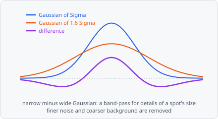

**Difference of Gaussians** (DoG) enhances spots of one size: a slightly blurred copy of the image minus a more blurred one keeps the details of a spot's size and removes finer noise and coarser background and structures. Bright spots become positive peaks, dark spots negative ones, and flat background becomes 0.

A typical spot pipeline:

**Difference of Gaussians** → [Find Maxima](/commands/segmentation/find-maxima/) → [Extract Objects](/commands/object/extract-objects/)

It is a preprocessing step: its result replaces the image for the steps after it. Measure intensities on the original channel, not on this image. In a project file it is `DIFFERENCE_OF_GAUSSIANS`.

## When to use

As [Laplacian of Gaussian](/commands/edge-detection/laplacian-of-gaussian/): to find small spots of about one size on an uneven background. The DoG approximates the LoG and gives values in the same units, so a Find Maxima cut-off found for one works for the other. For objects of different sizes, use [Bandpass](/commands/image-processing/bandpass/), where both σ are free.

## Parameters

| Parameter | Description |
| --- | --- |
| **Sigma** | The scale σ of the spots to enhance - the narrower Gaussian; the wider one is 1.6 σ. As a guide, σ ≈ spot radius / √2 (1.4 for spots of 4 px radius). Smaller details count as noise, larger ones as background. Default 1.5, range 0.1-1000. |
| **Unit** | Unit of **Sigma**: **px** (default) or **nm**. Without a pixel size, nm are taken as pixels. |

## How it works

The image is smoothed with the discrete Gaussian (Lindeberg 1998, appendix A.4.1) at σ and at 1.6 σ, and the result is

$$
\frac{L(\sigma) - L(1.6\,\sigma)}{0.6}
$$

The ratio 1.6 is the narrowest band-pass that still keeps the filter sensitive (Marr & Hildreth 1980, appendix B). Since $G(k\sigma) - G(\sigma) \approx (k - 1)\,\sigma^2 \nabla^2 G$ (Lowe 2004, sect. 3), dividing by $k - 1 = 0.6$ gives the units of the scale-normalized Laplacian of Gaussian, with bright spots positive.

## Limitations

- 2D only: each plane is filtered on its own.
- On a whole slide the filter runs per tile, mirrored at the tile's borders like [Gaussian Blur](/commands/image-processing/gaussian-blur/). Small images are one tile and not affected.

## References

- Marr D. & Hildreth E., "Theory of Edge Detection," _Proceedings of the Royal Society of London. Series B_, vol. 207, pp. 187-217, 1980. [doi:10.1098/rspb.1980.0020](https://doi.org/10.1098/rspb.1980.0020)
- Lowe D. G., "Distinctive Image Features from Scale-Invariant Keypoints," _International Journal of Computer Vision_, vol. 60, pp. 91-110, 2004. [doi:10.1023/B:VISI.0000029664.99615.94](https://doi.org/10.1023/B:VISI.0000029664.99615.94)
- Lindeberg T., "Feature Detection with Automatic Scale Selection," _International Journal of Computer Vision_, vol. 30, pp. 79-116, 1998. [doi:10.1023/A:1008045108935](https://doi.org/10.1023/A:1008045108935)

The step cites all three; see [Citation](/citation/#citing-the-algorithms-you-used) for exporting the citations of a project.
