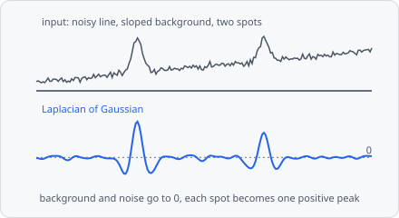

**Laplacian of Gaussian** (LoG) enhances spots of one size. It keeps the details of the size you give with **Sigma** and removes finer noise and coarser background and structures. Bright spots become positive peaks, dark spots negative ones, and flat or evenly sloped background becomes 0. It is the standard spot filter before [Find Maxima](/commands/segmentation/find-maxima/).

A typical spot pipeline:

**Laplacian of Gaussian** → [Find Maxima](/commands/segmentation/find-maxima/) → [Extract Objects](/commands/object/extract-objects/)

It is a preprocessing step: its result replaces the image for the steps after it. Measure intensities on the original channel, not on this image. In a project file it is `LAPLACIAN_OF_GAUSSIAN`.

## When to use

Use it to find small, round spots (vesicles, foci, particles) of about one size, especially on an uneven background or when spots are close together. Compared to a [Gaussian Blur](/commands/image-processing/gaussian-blur/) before Find Maxima, it also removes the background, so one Find Maxima cut-off fits the whole image. [Difference of Gaussians](/commands/edge-detection/difference-of-gaussians/) gives nearly the same result; [Wavelet Spots](/commands/edge-detection/wavelet-spots/) suits spots of a few different sizes. For objects of different sizes, use [Bandpass](/commands/image-processing/bandpass/).

## Parameters

| Parameter | Description |
| --- | --- |
| **Sigma** | The scale σ of the spots to enhance. A Gaussian spot of standard deviation σ responds most. As a guide, σ ≈ spot radius / √2 (1.4 for spots of 4 px radius). Smaller details count as noise, larger ones as background. Default 1.5, range 0.1-1000. |
| **Unit** | Unit of **Sigma**: **px** (default) or **nm**. Without a pixel size, nm are taken as pixels. |

## How it works

The image is smoothed with the discrete Gaussian of variance $t = \sigma^2$ (Lindeberg 1998, appendix A.4.1) - unlike a sampled Gaussian it is exact also for small spots (σ < 1 px). The second derivatives $L_{xx}$ and $L_{yy}$ of the smoothed image $L$ are taken with the differences $L(x+1) - 2L(x) + L(x-1)$. The result is the scale-normalized Laplacian, negated so bright spots are positive:

$$
-t \, (L_{xx} + L_{yy})
$$

The factor $t$ (Lindeberg's scale normalization, γ = 1) keeps the response of a spot independent of the scale, so results with different **Sigma** values are comparable.

## Limitations

- 2D only: each plane is filtered on its own.
- On a whole slide the filter runs per tile, mirrored at the tile's borders like [Gaussian Blur](/commands/image-processing/gaussian-blur/). Small images are one tile and not affected.
- Tuned to one size: much larger objects lose their inside (only their rim responds).

## References

- Lindeberg T., "Feature Detection with Automatic Scale Selection," _International Journal of Computer Vision_, vol. 30, pp. 79-116, 1998. [doi:10.1023/A:1008045108935](https://doi.org/10.1023/A:1008045108935)

The step cites it; see [Citation](/citation/#citing-the-algorithms-you-used) for exporting the citations of a project.
