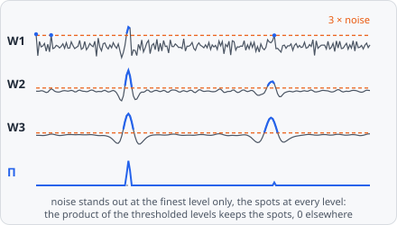

**Wavelet Spots** enhances spots by combining several levels of detail. The image is split into wavelet planes, from the finest details to coarser ones. A spot stands out of the noise at several levels at once, noise only at one - so the product of the levels keeps the spots and drops the noise. The result is positive at bright spots and exactly 0 everywhere else (background, dark spots, what stands out at one level only). It follows Olivo-Marin (2002).

A typical spot pipeline:

**Wavelet Spots** → [Find Maxima](/commands/segmentation/find-maxima/) → [Extract Objects](/commands/object/extract-objects/)

It is a preprocessing step: its result replaces the image for the steps after it. Measure intensities on the original channel, not on this image. In a project file it is `WAVELET_SPOTS`.

## When to use

For small spots on a noisy background, especially when the spots are not all of one size (up to about 2^**Levels** px). It needs no spot size, only how many levels to combine, and its noise threshold adapts to each image. For spots of one known size, [Laplacian of Gaussian](/commands/edge-detection/laplacian-of-gaussian/) or [Difference of Gaussians](/commands/edge-detection/difference-of-gaussians/) are the simpler choice.

Since everything that is not 0 already stands out at every combined level, [Find Maxima](/commands/segmentation/find-maxima/) with **Cutoff** **Manual** and **Min Quality** 0 keeps every spot; raise **Min Quality** to keep only the stronger ones (the paper's detection level).

## Parameters

| Parameter | Description |
| --- | --- |
| **Levels** | How many levels are computed: **2**, **3** (default), **4** or **5**. Level i holds details of about 2^i pixels, so 3 suits spots up to about 8 px. |
| **First Level** | The finest level that is combined; the levels below it are skipped. Level 1 is mostly noise: **2** gives fewer false spots for spots of 4 px and more. Default 1 (the paper), range 1-5, at most **Levels**. |
| **Noise Factor** | A level counts at a pixel only where it is at least this many times its noise; 3 in the paper. Default 3, range 0-20. |
| **Noise** | _(advanced)_ How the noise of each level is estimated. **Per Level** (default, the paper): from each level on its own - where spots or other structures fill much of the image, the coarser levels count them as noise and their threshold rises. **Finest Level**: from the finest level, which holds the least structure, scaled to the other levels as Gaussian noise passes through the transform - steadier with many spots or a structured background. |
| **Output** | The unit of the result. **Product** (default): the paper's product of the combined levels, the image's intensities to the power of their number. **Intensity**: its geometric mean (the product's m-th root, m the number of combined levels) - the same spots and maxima in the image's units, so Find Maxima's cut-off and prominence don't change with the number of levels. |

## How it works

1. **À trous transform** (Starck & Murtagh 1994; Olivo-Marin 2002, sect. 2): $A_0$ is the image; $A_i$ is $A_{i-1}$ smoothed with the B3-spline kernel $[1, 4, 6, 4, 1] / 16$ whose taps lie $2^{i-1}$ pixels apart, mirrored at the borders. The wavelet plane of level $i$ is $W_i = A_{i-1} - A_i$, for $i = 1$ to **Levels**.
2. **Thresholding** (sect. 3): $W_i$ is kept where $W_i \ge k\,\sigma_i$ and set to 0 elsewhere, with $k$ = **Noise Factor**. **Noise** Per Level: $\sigma_i = \text{MAD} / 0.67$, the median absolute deviation of $W_i$ (the paper). Finest Level: $\sigma_1$ so, and $\sigma_i = \sigma_1 \cdot n_i / n_1$, with $n_i$ the noise of plane $i$ for white noise of standard deviation 1 (the norm of the plane's impulse response; Starck & Murtagh scale the noise to the planes the same way).
3. **Product** (sect. 3): the result is $P = \prod_i W_i$ of the thresholded planes, for $i$ = **First Level** to **Levels**. With **Output** Intensity it is $P^{1/m}$, $m$ the number of combined levels.

With **Output** Product its values are the image's intensities to the power of $m$, so they differ greatly from the image's values; with Intensity they are in the image's units. The paper's last step, keeping $P$ above a detection level, is left to Find Maxima's cut-off.

## Limitations

- 2D only: each plane is filtered on its own.
- Dark spots are not found: the result is 0 for them.
- On a whole slide the filter runs per tile, mirrored at the tile's borders, and the noise of each level is measured per tile. Small images are one tile and not affected.

## References

- Olivo-Marin J.-C., "Extraction of Spots in Biological Images Using Multiscale Products," _Pattern Recognition_, vol. 35, pp. 1989-1996, 2002. [doi:10.1016/S0031-3203(01)00127-3](https://doi.org/10.1016/S0031-3203(01)00127-3)
- Starck J.-L. & Murtagh F., "Image Restoration with Noise Suppression Using the Wavelet Transform," _Astronomy and Astrophysics_, vol. 288, pp. 342-348, 1994. [ADS](https://ui.adsabs.harvard.edu/abs/1994A%26A...288..342S)

The step cites both; see [Citation](/citation/#citing-the-algorithms-you-used) for exporting the citations of a project.
