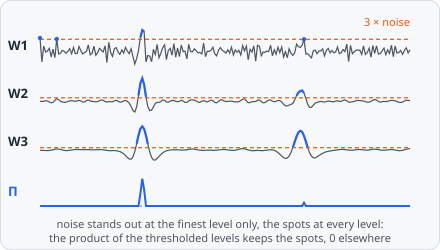

**Wavelet Spots** enhances spots by combining several levels of detail. The image is split into wavelet planes, from the finest details to coarser ones. A spot stands out of the noise at several levels at once, noise only at one - so the product of the levels keeps the spots and drops the noise. The result is positive at bright spots and exactly 0 everywhere else (background, dark spots, what stands out at one level only). It follows Olivo-Marin (2002).

A typical spot pipeline:

**Wavelet Spots** → [Find Maxima](/commands/segmentation/find-maxima/) → [Extract Objects](/commands/object/extract-objects/)

It is a preprocessing step: its result replaces the image for the steps after it. Measure intensities on the original channel, not on this image. In a project file it is `WAVELET_SPOTS`.

## When to use

For small spots on a noisy background, especially when the spots are not all of one size (up to about 2^**Levels** px). It needs no spot size, only how many levels to combine, and its noise threshold adapts to each image. For spots of one known size, [Laplacian of Gaussian](/commands/edge-detection/laplacian-of-gaussian/) or [Difference of Gaussians](/commands/edge-detection/difference-of-gaussians/) are the simpler choice.

Since everything that is not 0 already stands out at every level, [Find Maxima](/commands/segmentation/find-maxima/) with **Cutoff** **Manual** and **Min Quality** 0 keeps every spot; raise **Min Quality** to keep only the stronger ones (the paper's detection level).

## Parameters

| Parameter | Description |
| --- | --- |
| **Levels** | How many levels are combined: **2**, **3** (default), **4** or **5**. Level i holds details of about 2^i pixels, so 3 suits spots up to about 8 px. |
| **Noise Factor** | A level counts at a pixel only where it is at least this many times its noise; 3 in the paper. Default 3, range 0-20. |

## How it works

1. **À trous transform** (Starck & Murtagh 1994; Olivo-Marin 2002, sect. 2): $A_0$ is the image; $A_i$ is $A_{i-1}$ smoothed with the B3-spline kernel $[1, 4, 6, 4, 1] / 16$ whose taps lie $2^{i-1}$ pixels apart, mirrored at the borders. The wavelet plane of level $i$ is $W_i = A_{i-1} - A_i$, for $i = 1$ to **Levels**.
2. **Thresholding** (sect. 3): $W_i$ is kept where $W_i \ge k\,\sigma_i$ and set to 0 elsewhere, with $k$ = **Noise Factor** and the noise $\sigma_i = \text{MAD} / 0.67$, the median absolute deviation of $W_i$.
3. **Product** (sect. 3): the result is $\prod_i W_i$ of the thresholded planes.

Its values are the image's intensities to the power of **Levels**, so they are much smaller than the image's values.

## Limitations

- 2D only: each plane is filtered on its own.
- Dark spots are not found: the result is 0 for them.
- On a whole slide the filter runs per tile, mirrored at the tile's borders, and the noise of each level is measured per tile. Small images are one tile and not affected.

## References

- Olivo-Marin J.-C., "Extraction of Spots in Biological Images Using Multiscale Products," _Pattern Recognition_, vol. 35, pp. 1989-1996, 2002. [doi:10.1016/S0031-3203(01)00127-3](https://doi.org/10.1016/S0031-3203(01)00127-3)
- Starck J.-L. & Murtagh F., "Image Restoration with Noise Suppression Using the Wavelet Transform," _Astronomy and Astrophysics_, vol. 288, pp. 342-348, 1994. [ADS](https://ui.adsabs.harvard.edu/abs/1994A%26A...288..342S)

The step cites both; see [Citation](/citation/#citing-the-algorithms-you-used) for exporting the citations of a project.
