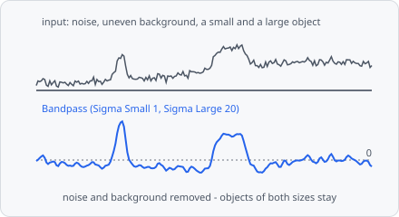

**Bandpass** removes details finer than **Sigma Small** (noise) and structures coarser than **Sigma Large** (uneven background) and keeps everything in between. Unlike the spot filters ([Laplacian of Gaussian](/commands/edge-detection/laplacian-of-gaussian/), [Difference of Gaussians](/commands/edge-detection/difference-of-gaussians/)) it is not tuned to one size: objects of different sizes stay.

The result is in the image's intensity units around 0: bright objects positive, the removed background 0 (values can be negative). Follow it with a [Threshold](/commands/segmentation/threshold/) or [Find Maxima](/commands/segmentation/find-maxima/):

**Bandpass** → [Threshold](/commands/segmentation/threshold/) | [Find Maxima](/commands/segmentation/find-maxima/)

It is a preprocessing step: its result replaces the image for the steps after it. Measure intensities on the original channel, not on this image. In a project file it is `BANDPASS`.

## When to use

Use it to flatten an uneven background and reduce noise in one step, before a threshold, when the objects are of different sizes. With **Sigma Large** 0 it is a plain blur, with **Sigma Small** 0 a background subtraction. For whole-image illumination differences (vignetting), [Illumination Correction](/commands/image-processing/illumination-correction/) is the better tool; for spots of one size, [Laplacian of Gaussian](/commands/edge-detection/laplacian-of-gaussian/).

## Parameters

| Parameter | Description |
| --- | --- |
| **Sigma Small** | σ of the narrower Gaussian: details finer than about this are smoothed away (noise). 0: no smoothing. Default 1, range 0-10000. |
| **Sigma Large** | σ of the wider Gaussian, subtracted: structures coarser than about this are removed (uneven background). Must be larger than **Sigma Small**; 0: nothing removed. Default 15, range 0-10000. |
| **Unit** | Unit of both σ: **px** (default) or **nm**. Without a pixel size, nm are taken as pixels. |

Choose **Sigma Large** a little larger than the largest object, so the objects are not removed with the background.

## How it works

The result is

$$
L(\sigma_\text{small}) - L(\sigma_\text{large})
$$

with $L$ the image smoothed with the discrete Gaussian (Lindeberg 1998, appendix A.4.1). A Gaussian low-pass times a Gaussian high-pass in the frequency domain is the difference of two Gaussians in the image, so no Fourier transform is needed. It is the band-pass that the difference of Gaussians is in Marr & Hildreth (1980, appendix B), here with two independent σ instead of their ratio 1.6. With **Sigma Large** 0 the second term is left out; with **Sigma Small** 0 the first term is the image itself.

If **Sigma Large** is not 0 and not larger than **Sigma Small**, the band is empty and the step fails with an error.

## Limitations

- 2D only: each plane is filtered on its own.
- On a whole slide the filter runs per tile, mirrored at the tile's borders like [Gaussian Blur](/commands/image-processing/gaussian-blur/). With a large **Sigma Large** the tile borders can show. Small images are one tile and not affected.

## References

- Lindeberg T., "Feature Detection with Automatic Scale Selection," _International Journal of Computer Vision_, vol. 30, pp. 79-116, 1998. [doi:10.1023/A:1008045108935](https://doi.org/10.1023/A:1008045108935)
- Marr D. & Hildreth E., "Theory of Edge Detection," _Proceedings of the Royal Society of London. Series B_, vol. 207, pp. 187-217, 1980. [doi:10.1098/rspb.1980.0020](https://doi.org/10.1098/rspb.1980.0020)

The step cites both; see [Citation](/citation/#citing-the-algorithms-you-used) for exporting the citations of a project.
