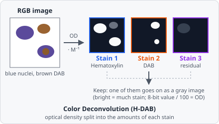

**Color Deconvolution** separates a brightfield RGB image into its stains - Hematoxylin, DAB, Eosin or stains of your own - and keeps one of them as a gray image: how much of the stain each pixel holds. It is Ruifrok & Johnston's colour deconvolution, written from their paper.

## When to use

Use it on immunohistochemistry or histology slides before a [Threshold](/commands/segmentation/threshold/) or a measurement. For IHC, **Stain 2** of **H-DAB** is the DAB (brown) signal: threshold it, or measure the DAB per nucleus found on **Stain 1**. A [Color Filter](/commands/image-processing/color-filter/) picks pixels by their hue; colour deconvolution instead gives each pixel an amount of each stain, even where two stains overlap.

The step needs an RGB image. A gray image (a single channel) stops the step with an error.

## Parameters

| Parameter | Description |
| --- | --- |
| **Stains** | The stains on the slide. **H-DAB** (default): Hematoxylin and DAB. **H&E**: Hematoxylin and Eosin. **H-E-DAB**: Hematoxylin, Eosin and DAB. **Custom**: your own stain vectors. |
| **Stain 1 Red / Green / Blue** … **Stain 3 Red / Green / Blue** | Only with **Custom**: the optical density of each stain in red, green and blue (0 to 1), e.g. measured on a single-stained slide. The defaults are Hematoxylin (0.650, 0.704, 0.286) and DAB (0.268, 0.570, 0.776). Stain 3 all 0 (default): the residual. |
| **Keep** | The stain the step passes on: **Stain 1 (Hematoxylin)** (default), **Stain 2 (DAB / Eosin)** or **Stain 3 (DAB in H-E-DAB / residual)**. |
| **Background (white)** | Advanced. The brightness of empty glass (no tissue), 0 to 255 whatever the image's bit depth (default 255). Lower it when the scanner's background isn't pure white. |

### The stains of each preset

| Stains | Stain 1 | Stain 2 | Stain 3 |
| --- | --- | --- | --- |
| **H-DAB** | Hematoxylin | DAB | residual |
| **H&E** | Hematoxylin | Eosin | residual |
| **H-E-DAB** | Hematoxylin | Eosin | DAB |

The stain vectors are the ones measured by Ruifrok & Johnston (table 1 of the paper); **H&E** uses their Hematoxylin and Eosin vectors for H&E.

## How it works

Light passing a stain is absorbed by the Beer-Lambert law, so in optical density the stains add up. Each pixel's intensity $I_c$ in red, green and blue (0 to 1) is turned into an optical density against the background $w$ = **Background (white)** / 255:

$$
\text{OD}_c = -\log_{10}\frac{I_c}{w}
$$

A pixel brighter than the background counts as background (OD 0); a pixel darker than 1/255 of it counts as 1/255 (OD 2.41), so black pixels stay finite.

Each stain is a vector of the optical densities it gives in red, green and blue, scaled to length 1. The three vectors are the rows of a matrix $M$; a pixel's stain amounts are its optical densities times the inverse:

$$
(a_1, a_2, a_3) = (\text{OD}_R, \text{OD}_G, \text{OD}_B) \cdot M^{-1}
$$

With only two stains, the third vector is the one perpendicular to both - the **residual**: what neither stain explains. It is high where the stain vectors don't fit the slide.

The kept amount is divided by 2.55 and clipped to 0 to 1: 0 is no stain, 1 is an optical density of 2.55 or more. On the 0 to 255 scale of an 8-bit image, the value divided by 100 is the optical density (100 = OD 1.0). Real stains rarely go past OD 2.5 (nearly black).

## Limitations

- Stains with the same colour (or a custom stain that is all 0) can't be told apart: the step stops with an error.
- The preset vectors are measured values; stains on your slides may differ. A bright **Stain 3** in **H-DAB** or **H&E** shows where they don't fit - measure your own on single-stained slides and use **Custom**.
- The output is an amount of stain, not a calibrated concentration: the optical density of DAB is not strictly proportional to the antigen.

## Reference

Ruifrok, A. C. & Johnston, D. A. (2001). Quantification of histochemical staining by color deconvolution. _Analytical and Quantitative Cytology and Histology_ 23(4), 291-299.
