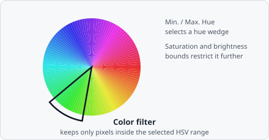
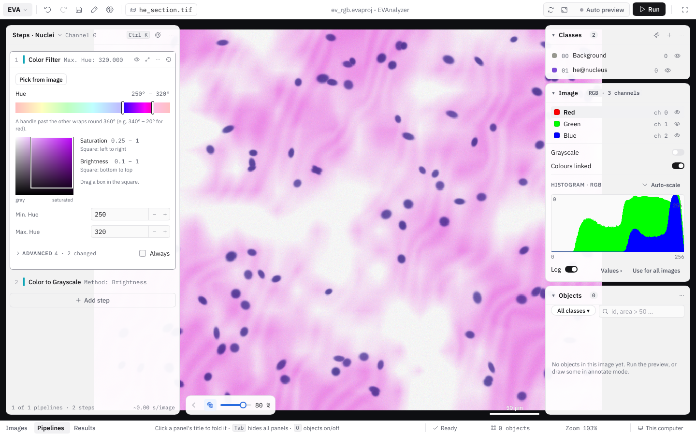

The **Color Filter** command keeps only pixels whose colour falls within a defined HSV (Hue–Saturation–Value) range. The result is a gray image: a kept pixel gets its brightness (the HSV value), every other pixel 0.

HSV separates colour into a wedge of hue (which colour), a ring of saturation (how vivid vs. washed-out), and brightness - so "select the purple stain" becomes one contiguous slice of the wheel, rather than a scattered region in RGB's red/green/blue axes. That's what makes HSV the natural space for chroma-key-style colour isolation.

## When to use

Use this command on RGB colour images to isolate a specific stain colour before greyscale processing. For example, extracting a haematoxylin (blue/purple) stain from an H&E image. The step needs an RGB image; a gray image stops it with an error.

To turn the whole colour image into gray without picking a colour, use [Color to Grayscale](/commands/image-processing/color-to-grayscale/); to get the amount of each stain, even where two overlap, use [Color Deconvolution](/commands/image-processing/color-deconvolution/).

## Parameters

| Parameter                             | Description                                                     |
| ------------------------------------- | --------------------------------------------------------------- |
| **Min. Hue / Max. Hue**               | Hue range, 0°–360° (default 0° – 360°: every hue)               |
| **Min. Sat. / Max. Sat.**             | _(advanced)_ Saturation range, 0.0–1.0 (default 0 – 1)          |
| **Min. Brightness / Max. Brightness** | _(advanced)_ Value (brightness) range, 0.0–1.0 (default 0 – 1) |

### HSV overview

| Component | Description |
|---|---|
| **Hue** | The colour angle on the colour wheel (0° = red, 120° = green, 240° = blue) |
| **Saturation** | Colour purity (0 = grey, 1 = fully saturated) |
| **Value** | Brightness (0 = black, 1 = full brightness) |

## Colour range editor

The step's card in the pipeline shows the range as a picture above the numbers:

- **Hue** - a colour bar with two handles; the part left out is dimmed. Drag the nearer handle. A handle dragged past the other wraps round 360° (e.g. _340° – 20°_ for red).
- **Saturation × brightness** - a square, saturation from left (gray) to right (saturated), brightness from bottom to top, in the colour of the middle of the kept hues. The kept range is a box: drag a new box in the square.
- **Pick from image** - the button turns into _Picking - click the image_; each click on the (colour) image adds the colour under the cursor (_3 picks_), and the range becomes the smallest one around all picked colours, with a little room (10° of hue, 0.05 of saturation and brightness). Nearly gray picks leave the hue open. **Start over** forgets the picks; clicking the button again stops picking.

The values are set when you release the mouse; they stay editable as numbers in the step's settings.

## Notes

Pixels with hue spanning the red wrap-around (near 0° / 360°) can be captured by setting Min. Hue to a value close to 360° and Max. Hue to a value near 0°; EVAnalyzer handles the circular wrap automatically.
