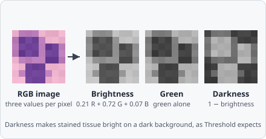

**Color to Grayscale** turns a colour (RGB) image into a gray image: one value per pixel instead of red, green and blue. Most commands that follow - [Threshold](/commands/segmentation/threshold/), [Hessian](/commands/edge-detection/hessian/), [Find Maxima](/commands/segmentation/find-maxima/), … - need one value per pixel. A gray image passes through unchanged, so the same pipeline works for colour and gray images.

## When to use

Use it at the start of a pipeline on RGB images - brightfield slides, histology, photos - before a segmentation. On brightfield slides the objects are darker than the empty glass: **Darkness** makes them bright on a dark background, as Threshold expects.

To separate stains (Hematoxylin, DAB, Eosin), use [Color Deconvolution](/commands/image-processing/color-deconvolution/) instead; to keep only one colour range, use [Color Filter](/commands/image-processing/color-filter/).

## Parameters

| Parameter  | Description                                                                         |
| ---------- | ----------------------------------------------------------------------------------- |
| **Method** | How the red, green and blue of a pixel become one gray value (default **Brightness**) |

### Methods

| Method         | Gray value                                                                                                       |
| -------------- | ---------------------------------------------------------------------------------------------------------------- |
| **Brightness** | The brightness as the eye sees it: 0.2126 R + 0.7152 G + 0.0722 B (ITU-R BT.709) - the same value the intensities of a colour image are measured with |
| **Red**        | The red channel alone                                                                                            |
| **Green**      | The green channel alone - often the best contrast in H&E                                                         |
| **Blue**       | The blue channel alone                                                                                           |
| **Average**    | (R + G + B) / 3                                                                                                  |
| **Maximum**    | The brightest of R, G and B per pixel - the HSV value that [Color Filter](/commands/image-processing/color-filter/) uses |
| **Darkness**   | 1 − brightness: stained tissue bright on a dark background - for brightfield slides                              |

## Notes

- The output is a gray image from 0 to 1, whatever the bit depth of the image.
- With **Brightness**, a threshold on the gray image and a measurement of the colour image use the same values.
