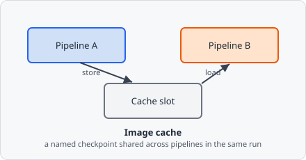

The **Image Cache** command saves or loads an intermediate image to/from a numbered memory slot.

Pipelines in EVAnalyzer normally run independently, each seeing only its own image data - Image Cache is the one mechanism that lets one pipeline hand a processed image to another, so a channel-specific preprocessing result (a background estimate, a mask) can be reused elsewhere instead of being recomputed.

## Parameters

| Parameter   | Description                                                                                           |
| ----------- | ----------------------------------------------------------------------------------------------------- |
| **Mode**    | _Store_ - save the current image to the cache; _Load_ - replace the current image with a cached image |
| **Address** | The slot - see [Kinds of slots](#kinds-of-slots)                                                      |

## Kinds of slots

| Kind             | Readable by                                                                                                                       |
| ---------------- | --------------------------------------------------------------------------------------------------------------------------------- |
| **Memory**       | The steps of this pipeline.                                                                                                       |
| **Shared**       | This pipeline and every pipeline after it - also as a pipeline's [image source](/guide/pipelines/#image-source) (**Shared memory slot**). |
| **Component memory** | Only inside a [component](/guide/command-groups/#memory-slots-in-components): the slots of one use of the component.          |

## When to use

Use Image Cache when you need to:

- Re-use an intermediate processing result in a later pipeline step or a different pipeline.
- Pass a pre-processed image to [Image Math](/commands/image-processing/image-math/) as the second operand.

### Example: background-subtracted signal available for measurement

1. Pipeline A: process the DAPI channel → **Store** to **Shared** slot 1.
2. Pipeline B (after A): after thresholding the Cy5 channel, use **Image Math** with **Shared** slot 1 to create a masked image.

## Notes

**Memory** slots are freed at the end of their pipeline, **Shared** slots once every pipeline has run on the image (tile), **Component memory** when the component ends. Nothing persists between images.
