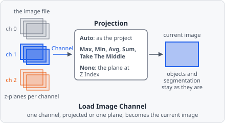

The **Load Image Channel** command replaces the current image with another channel of the same image. The following steps work on the loaded channel.

Use it

- as the **first step of a pipeline without an image source** (image source **None** in the pipeline dialog), or
- to **switch channels within a pipeline** - for example a [module](/guide/modules/) that detects nuclei in one channel and cells in another.

## Parameters

| Parameter      | Description                                                                                                              |
| -------------- | ------------------------------------------------------------------------------------------------------------------------ |
| **Channel**    | The image channel to load.                                                                                               |
| **Projection** | _(optional)_ How the channel's z-planes are combined - see [Projection](#projection). Default **Auto**.                  |
| **Z Index**    | _(optional)_ With **Projection** **None**: the z-plane loaded (0 = the first). Default 0.                                |

The objects, the segmentation and the memory slots of the pipeline are not touched - only the image is replaced.

## Projection

| Projection          | The channel is loaded …                                                                 |
| ------------------- | --------------------------------------------------------------------------------------- |
| **Auto**            | as the project's [z-stack setting](/guide/images/#z-stack) does - the same as every other channel |
| **Max Intensity**, **Min Intensity**, **Avg Intensity**, **Sum Intensity** | as the maximum, minimum, mean or sum of its z-planes, pixel by pixel |
| **Take The Middle** | as its middle z-plane                                                                  |
| **None**            | as the single z-plane **Z Index**                                                      |

Any choice other than **Auto** is meant for a project that analyses one projection or one plane. If the project analyses the z-planes one by one, the pipeline runs once per plane - but on the same loaded image every time, so its objects repeat for every plane.

Objects found on a different projection than the project's are still drawn over the project's image, and annotations are matched to the project's z-planes.

## Notes

- In a module, the channel of a Load Image Channel step becomes a module parameter when the module is created, so every use of the module can pick its own channel.
- Before an analysis starts, EVAnalyzer checks that every image has the channels the pipelines load. An image without the channel fails with a message naming the channels it does have.
- [Focus mode](/guide/pipelines/#focus-mode) shows the channels a pipeline loads with this command, too.
