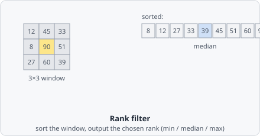

The **Rank Filter** collects pixel intensities in a circular neighbourhood, sorts them by value, and replaces the centre pixel with the value at a chosen rank - the lowest (Min), middle (Median), or highest (Max).

Because it works by sorting rather than averaging, a single extreme outlier in the window (a hot pixel, a cosmic ray hit) can't drag the result away from the bulk of the data the way it would with a mean filter - it just gets sorted to one end and ignored (for Median) or becomes the answer itself (for Min/Max).

## Filter types

| Type         | Output                                                                     | Common use                                                   |
| ------------ | -------------------------------------------------------------------------- | ------------------------------------------------------------ |
| **Median**   | Middle value                                                               | Impulse noise removal while preserving edges                 |
| **Min**      | Lowest value                                                               | Background estimation; erosion-like effect on bright objects |
| **Max**      | Highest value                                                              | Dilation-like effect; filling small gaps in bright regions   |
| **Mean**     | Average of the window (not a rank - a round box blur)                      | Smoothing; blurs edges                                       |
| **Outliers** | The median, but only where the pixel differs from it by more than the threshold; otherwise the pixel stays | Removing hot pixels without touching the rest of the image |

## When to use

- **Median** - the most common choice for salt-and-pepper or impulse noise removal before thresholding.
- **Min / Max** - morphological-style operations when you need a non-linear, non-Gaussian effect.

## Parameters

| Parameter       | Description                                    |
| --------------- | ---------------------------------------------- |
| **Radius**      | Radius of the circular neighbourhood in pixels; 1 is about a 3 × 3 square |
| **Filter Type** | _Median_ (default), _Min_, _Max_, _Mean_ or _Outliers_ |
| **Outliers**    | With _Outliers_: how far a pixel may differ from the median of its window before it is replaced |

Larger radius values affect a wider neighbourhood and produce a stronger effect. Unlike convolution-based filters, rank filters are non-linear and cannot be described by a kernel matrix.

## How it works

The window is the circular neighbourhood of ImageJ's rank filters. At the image border the edge pixels are repeated. Pixels without a value (NaN) are left out of the window; a window with none left gives NaN. Colour images are filtered channel by channel.

For an even number of values, **Median** takes the upper of the two middle values (rank _n_/2, counted from 0).

**Median** and **Outliers** keep a histogram of the window and slide it along each row: one step to the right only takes out the window's left edge and adds its new right edge, instead of sorting every window again. This makes large radii much faster and gives exactly the same values as sorting. It is used when the image holds whole gray values, or values scaled to 0..1 from up to 16 bits; otherwise every window is sorted on its own.
