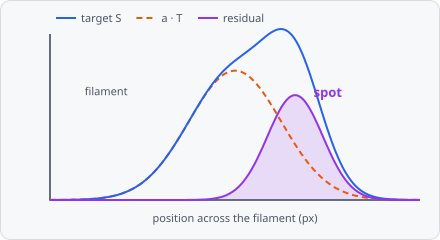
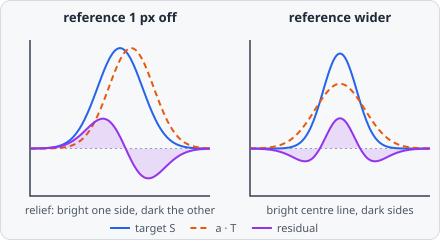
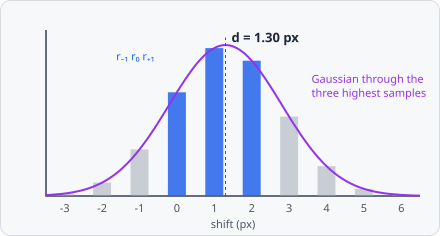
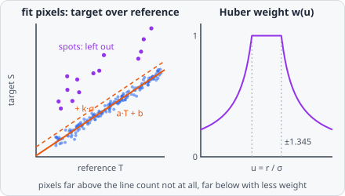
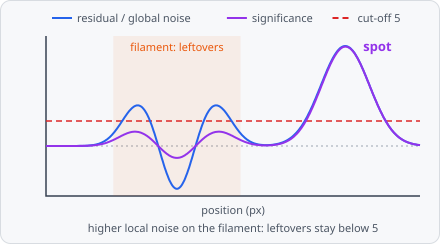

**Subtract Reference Channel** removes a signal from the image with the help of a second channel that shows only that signal: the **reference**. A typical case is a spot channel in which filaments, debris or the autofluorescence of the tissue bleed through. A second channel shows that structure alone. The step scales that channel to how bright the structure is in the spot channel, shifts it onto the spot channel and subtracts it. What is left is the spots.

$$
\text{residual}(x) = S(x) - \big(a \cdot T(x - d) + b\big)
$$

$S$ is the image to correct (the **target**), $T$ the reference, $a$ a scale factor, $b$ an offset and $d$ the shift between the two channels. You can set $a$, $b$ and $d$ by hand, or let the step estimate them from each image.



A typical spot pipeline:

**Subtract Reference Channel** → [Threshold](/commands/segmentation/threshold/) or [Wavelet Spots](/commands/edge-detection/wavelet-spots/) → [Connected Components](/commands/segmentation/connected-components/)

It is a preprocessing step, usually the first of the pipeline: its result replaces the image for the steps after it. It also measures per image what it estimated, like a [measurement step](/guide/pipelines/#measurement-steps) (see [Measurements](#measurements)). This is linear unmixing (Zimmermann 2005) with the factor fitted on every image, as in the subtraction of an autofluorescence image (van de Lest et al. 1995). In a project file it is `SUBTRACT_REFERENCE_CHANNEL`.

## When to use

- A signal you don't want lies on top of the signal you measure, and a second channel shows the unwanted signal alone: filaments, debris or autofluorescence in a spot channel, bleed-through of a bright dye into a weak one.
- The two channels may differ in brightness, and may be shifted against each other by a few pixels (chromatic shift, a second camera).

:::caution[The factor assumes the signals are independent]
Estimating $a$ from the image assumes the target's own signal is **not correlated** with the reference. If the target binds the reference structure (e.g. a protein that sits on the filaments), the fit counts that signal as bleed-through and removes it. Then measure the factor on single-stain controls and use **Factor** **Fixed**.
:::

For a background without a reference channel, use [Median Subtract](/commands/image-processing/median-subtract/) or [Rolling Ball](/commands/image-processing/rolling-ball/). For a known shift alone, use [Translate Image](/commands/image-processing/translate-image/).

## Parameters

| Parameter | Description |
| --- | --- |
| **ID** | Names the step's measurements in the results (e.g. `reference_01`). |
| **Target** | The image to correct. **Current Image** (default): the pipeline's image at this step. **Channel**: an image channel as it was read. |
| **Reference Channel** | The channel that shows only the signal to remove. Default channel 1. |
| **Camera Offset** | _(advanced)_ The camera's black level, subtracted from both channels first. **None** (default) or **Manual**, with one offset for the **Target** and one for the **Reference** (default 100 each). |
| **Saturation** | _(advanced)_ The level from which a pixel counts as saturated. **Auto** (default): the image's largest value (255 for 8 bit, 65535 for 16 bit). **Manual**: a **Level**. **Off**: no pixel counts as saturated. Saturated pixels are left out of all estimates, see [Saturated pixels](#saturated-pixels-and-the-border). |
| **Background** | The slowly varying background, removed from both channels. **Median** (default): the median over a circle of **Radius** px (default 30), as [Median Subtract](/commands/image-processing/median-subtract/). **Rolling Ball**: a ball of **Radius** px, as [Rolling Ball](/commands/image-processing/rolling-ball/). **None**. The radius should be a little larger than the structures. |
| **Alignment** | How the reference is shifted onto the target, see [Alignment](#alignment). **Auto** (default), **Fixed** or **None**. |
| **Interpolation** | _(advanced)_ How the shifted reference is interpolated. **Cubic** (default): Keys' bicubic. **Linear**: bilinear, a little smoother. |
| **Target Extra Sigma** | _(advanced)_ An extra Gaussian blur (σ, px) of the target, when it is sharper than the reference. Default 0 (off), 0-20. |
| **Reference Extra Sigma** | _(advanced)_ An extra Gaussian blur (σ, px) of the reference, when it is sharper than the target. Default 0 (off), 0-20. |
| **Smoothing Sigma** | The Gaussian blur (σ, px) of both channels, the same for both. It keeps noise from biasing the factor low. Default 1, 0-20 (0 = off). |
| **Factor** | How the scale factor $a$ is set, see [Factor](#factor). **Robust Fit** (default), **Fixed** or **Exposure Ratio**. |
| **Factor Scale** | Multiplies $a$ after it is set, for fine tuning. Default 1 (unchanged), 0-100. |
| **Estimation Scope** | _(advanced)_ The area the shift and the factor are estimated over. **Image** (default) or **Tile**. See [Tiles and volumes](#tiles-and-volumes). |
| **Edge Tolerance** | _(advanced)_ The reference's local maximum over this radius (px) is subtracted instead of the reference. It tolerates a small leftover shift or a width mismatch. Default 0 (off), 0-10. |
| **Only Brighter Reference** | Subtract only where the reference is brighter than its background. Dark cracks or holes in the reference then subtract nothing, instead of brightening the result. Default on. It needs a **Background**: without one the reference is never below 0. |
| **Clip Negative** | Set negative values of the result to 0. Default on. |
| **Output** | What the step puts out. **Residual** (default): the target without the reference's signal. **Scaled Reference**: $a \cdot T(x - d) + b$, what was subtracted, to inspect the estimate. **Significance**: the residual in units of its local noise, see [Significance](#significance). |

### Alignment

| Mode | Settings |
| --- | --- |
| **Auto** | The shift is estimated on every image by phase correlation. **Max Shift** (default 5 px): a larger estimated shift is not believed. **Min Quality** (default 0.3, 0-1): below this alignment quality the estimate is not believed. **Fallback Dx**, **Fallback Dy** (default 0): the shift used when the estimate is not believed. |
| **Fixed** | A fixed shift of the reference: **Dx** to the right (+) or left (−), **Dy** down (+) or up (−), in px with fractions, -100 to 100. |
| **None** | The reference is not shifted. |

### Factor

| Mode | Settings |
| --- | --- |
| **Robust Fit** | Fitted on every image: a robust line through the pixels where the reference shows structure, with the spots (bright in the target only) left out. **Noise Factor** (default 4): fit pixels have a reference above its median + this × its noise. **Min Percentile** (default 50): they are also above this percentile of the reference. **Outlier K** (default 3): pixels this many times the noise above the line are left out. **Fit Offset** (default on): fit $b$ too, otherwise the line goes through 0. **Min R2** (default 0.5): below this R² the fallback is used. **Fallback** (default 1): the factor used when the fit fails. **Min Value**, **Max Value** (default 0 and 100): a fitted factor outside this range uses the fallback. |
| **Fixed** | A fixed **Factor** $a$, e.g. measured on single-stain controls. $b = 0$. |
| **Exposure Ratio** | From the exposure times: $a = \text{Calibration} \cdot t_\text{target} / t_\text{reference}$, with **Calibration** the factor at equal exposure times and **Exposure Target Ms**, **Exposure Reference Ms** the exposure times in ms. $b = 0$. The signal of a camera grows linearly with the exposure time. |

## How it works

The order of the steps is fixed: every step changes what the next one sees.

1. **Camera offset** subtracted from both channels.
2. **Background** removed from both channels.
3. **Alignment**: the shift $d$ is estimated, and the reference is shifted onto the target.
4. **Sharpness matching**: the extra blur of the sharper channel.
5. **Smoothing**: the same Gaussian on both channels.
6. **Factor**: $a$ and $b$ are set or fitted, then $a$ is multiplied by **Factor Scale**.
7. **Subtraction**, and with **Output** Significance the division by the local noise.

The steps run on each image plane on its own. In the formulas below, $S$ and $T$ always mean the target and the reference as the steps before have left them.

### The model

Assume the target holds the spots plus some of the reference's structure, linearly, and that the reference is shifted by $d = (d_y, d_x)$:

$$
S(x) = a \cdot T(x - d) + b + \text{spots}(x) + \text{noise}(x)
$$

Once $a$, $b$ and $d$ are known, subtracting $a \cdot T(x - d) + b$ leaves $\text{spots}(x) + \text{noise}(x)$. All the steps serve to make this model hold: the camera offset and the background make "no light" 0 in both channels, the alignment makes $T(x - d)$ lie on $S$, the blurs make the structure equally wide in both, and the smoothing reduces the noise that would bias $a$.

### 1-2. Camera offset and background

The camera offset $o$ is subtracted: $S \leftarrow S - o_S$, $T \leftarrow T - o_T$. Then the background is removed from each channel: $S \leftarrow S - B(S)$, $T \leftarrow T - B(T)$.

With **Median**, $B$ is the median over a circle of radius $r$. From $r = 8$ px on, it is computed on a reduced image, because a slowly varying background doesn't need every pixel: the plane is reduced to the medians of blocks of $f \times f$ px with $f = \min(\lfloor r / 8 \rfloor, 4)$, the median is taken there with radius $r / f$, and the result is scaled back to every pixel bilinearly. That is about $f^3$ times less work and stays within 2 % of the full median on the tests. With **Rolling Ball**, $B$ is the ball's surface (ball, no pre-smoothing).

After this step a pixel of the background is about 0 in both channels, so $b$ only has to absorb what is left.

### 3. Alignment

The shift comes before the fit. If the reference is off by even one pixel, the subtraction leaves the difference of two shifted profiles, $a\,(T(x) - T(x - \delta)) \approx a\,\delta\, T'(x)$: the derivative of the structure, bright on one side and dark on the other. It looks like a relief. The fit then also compensates by lowering $a$.



**Auto** estimates $d$ by phase correlation (Kuglin & Hines 1975), to a fraction of a pixel (as Guizar-Sicairos et al. 2008, with a Gaussian peak instead of an upsampled DFT).

**Preparing the channels.** Each channel is prepared the same way, on its central 1024 × 1024 px at most:

1. A band-pass in the frequency domain, $H(f) = G_{1}(f)\,\big(1 - G_{20}(f)\big)$, with the Gaussian's frequency response $G_\sigma(f) = e^{-2\pi^2\sigma^2|f|^2}$ ($f$ in cycles per pixel). It removes a background of σ = 20 px and smooths with σ = 1 px.
2. Clipped to its 1st to 99.5th percentile, so a few bright beads or spots don't dominate.
3. Its mean subtracted, and multiplied by a 2D Hann window $w(n) = \tfrac12 - \tfrac12\cos\!\big(2\pi n / (N - 1)\big)$ per axis, so the image's borders don't make a false peak at shift 0.

**The cross-power spectrum.** A shift in space is a phase ramp in frequency: if $S(x) = T(x - d)$, then $F_S(f) = F_T(f)\, e^{-2\pi i\, f \cdot d}$. With the Fourier transforms $F_S$ and $F_T$ of the prepared channels, the normalized cross-power spectrum keeps only the phase difference. The step weights it with a Gaussian of σ = 1.5 px:

$$
R(f) = G_{1.5}(f)\; \frac{F_S(f)\, F_T^*(f)}{\big|F_S(f)\, F_T^*(f)\big|} \;\approx\; G_{1.5}(f)\, e^{-2\pi i\, f \cdot d}
$$

Transformed back, a pure phase ramp is a single spike at $d$. With the weight, it becomes a sampled Gaussian of σ = 1.5 px, centred exactly at $d$, even when $d$ lies between pixels. Its shape is known, so its centre can be found exactly.

**The sub-pixel peak.** Let $r_{-1}, r_0, r_{+1}$ be the correlation at the highest pixel and its two neighbours along one axis, and $\ell_k = \ln r_k$. The logarithm of a Gaussian is a parabola, so the parabola through the three $\ell_k$ finds the centre:

$$
\delta = \frac{\ell_{-1} - \ell_{+1}}{2\,(\ell_{-1} - 2\ell_0 + \ell_{+1})}, \qquad -\tfrac12 \le \delta \le \tfrac12
$$

and the shift along that axis is the highest pixel's position plus $\delta$ (wrapped to $-N/2 \dots N/2$). If one of the samples is not positive, the parabola goes through the values themselves. On the tests the error is below 0.02 px.



**Alignment quality.** The parabolas also give the height of the Gaussian's top, $\ln A = \ell_0 + \Delta_y + \Delta_x$ with $\Delta = -\frac{(\ell_{-1} - \ell_{+1})^2}{8\,(\ell_{-1} - 2\ell_0 + \ell_{+1})}$ per axis. The quality is that height as a part of the highest one possible, which is reached when every frequency is exactly in phase:

$$
q = \frac{A}{\sum_f G_{1.5}(f)} \in [0, 1]
$$

It is 1 for identical images and near 0 for unrelated ones. The estimate is used when $q \ge$ **Min Quality** and $|d_y|, |d_x| \le$ **Max Shift**. Otherwise, and on a tile smaller than 16 px, the fallback shift is used and **Fallback used** is set.

**Sign.** $d$ is the shift to apply to the reference so it lies on the target, in the convention of [Translate Image](/commands/image-processing/translate-image/): $T_\text{aligned}(y, x) = T(y - d_y, x - d_x)$, positive $d_y$ moves the content down, positive $d_x$ to the right. **Fixed** uses the same convention.

**Shifting.** The reference is shifted with Keys' cubic convolution (Keys 1981), $a_K = -\tfrac12$ (Catmull-Rom), or bilinearly with **Interpolation** Linear:

$$
W(s) = \begin{cases} (a_K + 2)|s|^3 - (a_K + 3)|s|^2 + 1 & |s| \le 1 \\ a_K|s|^3 - 5a_K|s|^2 + 8a_K|s| - 4a_K & 1 < |s| < 2 \\ 0 & \text{else} \end{cases}
$$

The shift is the same for every pixel, so are the weights: each axis needs one kernel of 4 taps, applied first along the rows, then along the columns. The strip the shift empties at the border repeats the edge pixel.

### 4. Sharpness matching

If the reference shows the structure wider than the target does (a different focus, a different wavelength), the scaled reference is too low in the structure's centre and too high on its flanks. The residual then has a bright centre line with dark sides. An extra blur of the sharper channel fixes it. Blurs add in quadrature: a structure of width $\sigma_S$ blurred with $\sigma_e$ is $\sqrt{\sigma_S^2 + \sigma_e^2}$ wide. For a target of $\sigma_S$ and a reference of $\sigma_T > \sigma_S$, **Target Extra Sigma** $= \sqrt{\sigma_T^2 - \sigma_S^2}$ matches them.

### 5. Smoothing both: regression dilution

A least-squares slope of $S$ over $T$ is biased toward 0 when $T$ is noisy (regression dilution). With the spread $\operatorname{var}(T_\text{true})$ of the reference's true values and noise of variance $\sigma_n^2$ on $T$:

$$
\mathbb{E}[\hat a] \approx a \cdot \frac{\operatorname{var}(T_\text{true})}{\operatorname{var}(T_\text{true}) + \sigma_n^2}
$$

A Gaussian of σ px divides the variance of white noise by about $4\pi\sigma^2$, about 12.6 for σ = 1, while structures a few pixels wide hardly change. Both channels get the same smoothing, so their structures stay equally wide.

All the blurs use the discrete Gaussian (Lindeberg 1990), exact also below 1 px.

### 6. The factor

**Fixed** and **Exposure Ratio** set $a$ directly, with $b = 0$. **Robust Fit** fits $a$ and $b$ in three parts.



**Which pixels are fitted.** Only pixels where the reference clearly shows structure say anything about $a$. A pixel is a fit pixel when its reference value lies above the structure level $L$ and above 0:

$$
L = \max\!\big(\operatorname{med}(T) + k_n \cdot 1.4826 \cdot \operatorname{MAD}(T),\; P_p(T)\big)
$$

with $k_n$ = **Noise Factor** and $P_p$ the **Min Percentile**. $\operatorname{MAD}$ is the median absolute deviation; $1.4826 \cdot \operatorname{MAD}$ estimates the noise σ of normal noise, even with structure in the image.

**The start.** The median ratio $a_0 = \operatorname{med}(S_i / T_i)$, and with **Fit Offset** $b_0 = \operatorname{med}(S_i - a_0 T_i)$, over the fit pixels.

**Iteratively reweighted least squares** (a Huber M-estimate, Huber 1964). Each iteration:

1. The residuals $r_i = S_i - (a T_i + b)$ and their robust scale $\sigma = 1.4826 \cdot \operatorname{med}_i\,|r_i - \operatorname{med}(r)|$.
2. **Spots out**: pixels with $r_i > k_o \sigma$, $k_o$ = **Outlier K**, are left out of this iteration. Only the positive side counts: a spot is bright in the target but not in the reference.
3. **Huber weights** for the rest, with $u_i = r_i / \sigma$:

$$
w_i = \begin{cases} 1 & |u_i| \le 1.345 \\ 1.345 / |u_i| & \text{else} \end{cases}
$$

   1.345 gives 95 % of least squares' efficiency for normal noise, while a single far-off pixel can't pull the line.

4. The weighted line, from the 2 × 2 normal equations (sums over the kept pixels):

$$
\begin{pmatrix} \sum w T^2 & \sum w T \\ \sum w T & \sum w \end{pmatrix} \begin{pmatrix} a \\ b \end{pmatrix} = \begin{pmatrix} \sum w S T \\ \sum w S \end{pmatrix}
$$

   so $a = \dfrac{\sum w \sum wST - \sum wT \sum wS}{\sum w \sum wT^2 - (\sum wT)^2}$ and $b = \dfrac{\sum wT^2 \sum wS - \sum wT \sum wST}{\sum w \sum wT^2 - (\sum wT)^2}$. Without **Fit Offset**: $b = 0$ and $a = \sum wST / \sum wT^2$.

The loop stops when $a$ and $b$ change by less than $10^{-6}$ (relative), after 20 iterations at most. Then, over the pixels within $k_o \sigma$ of the line:

$$
R^2 = 1 - \frac{\sum_i (S_i - a T_i - b)^2}{\sum_i (S_i - \bar S)^2}
$$

**When the fit is not believed.** With fewer than 1000 pixels in the fit, $R^2 <$ **Min R2**, or $a$ outside **Min Value** to **Max Value**, the step uses the **Fallback** factor with $b = 0$ and sets **Fallback used**. A reference without structure ends up here, not in an error.

In every mode, $a$ is then multiplied by **Factor Scale**.

### Saturated pixels and the border

A saturated pixel (at or above the **Saturation** level in the target or the reference, before any step) doesn't show how bright it really is, so it would bend the line. It is left out of the fit, and so are its neighbours as far as the blurs and the shift spread its value: $\lceil 3 \max(\sigma_{S,\text{tot}}, \sigma_{T,\text{tot}}) \rceil + m$ px, with $\sigma_{\cdot,\text{tot}} = \sqrt{\sigma_\text{extra}^2 + \sigma_\text{smoothing}^2}$. A shifted reference has a border strip that only repeats its edge pixels; the strip $m = \lceil \max(|d_y|, |d_x|) \rceil + 1$ px wide is left out too.

### 7. Subtraction

With **Edge Tolerance** $\rho > 0$, the reference is first replaced by its local maximum over a circle of radius $\rho$: $T \leftarrow \max_{|u| \le \rho} T(x + u)$. That widens the structure by $\rho$ on each side, so a fringe left by a small leftover shift is subtracted too, at the cost of subtracting a little too much at the structure's edges.

Then:

$$
\hat S(x) = a \cdot \max\!\big(T(x),\, 0\big) + b, \qquad \text{residual}(x) = \max\!\big(S(x) - \hat S(x),\, 0\big)
$$

The $\max(T, 0)$ is **Only Brighter Reference**. After the background is removed, a reference below 0 is a dark crack or hole, not light that bled through. Subtracting it would add light, and dark cracks would become bright lines. Without it, $\hat S = a T + b$. The outer $\max(\cdot, 0)$ is **Clip Negative**.

Note that $S$ and $T$ are the channels after the background removal and the blurs: the residual is background-free and smoothed like them.

**Output** Scaled Reference puts out $\hat S$.

### Significance

Where target and reference don't see the structure the same way (e.g. focused differently), one factor can't remove it everywhere: small leftovers stay on the structure. Bright regions also have more photon noise. To a cut-off for the whole image, both look like spots. **Output** Significance divides the residual by its local noise, so a cut-off means the same everywhere:

1. $\sigma_g$: the residual's robust noise, $1.4826 \cdot \operatorname{MAD}$ over the usable pixels (the residual is not clipped for this).
2. The local baseline $m(x)$: the residual's median over a circle of radius 10 px. Spots, being small, don't move a median. The deviation is $\Delta(x) = \text{residual}(x) - m(x)$.
3. The local noise, from the negative deviations only, over a 21 × 21 px window $N(x)$:

$$
\sigma_\text{loc}(x) = \max\!\left(\sqrt{\,2 \cdot \frac{1}{|N(x)|}\sum_{u \in N(x)} \min\!\big(\Delta(u), 0\big)^2},\; \tfrac12 \sigma_g\right)
$$

   Noise is symmetric, so for noise alone $\mathbb{E}[\min(\Delta, 0)^2] = \sigma^2 / 2$, hence the factor 2. Spots only add light, so they don't raise their own noise. The photon noise of a bright region and the relief of a leftover (dark on one side) do.

4. The significance:

$$
z(x) = \frac{\Delta(x)}{\sigma_\text{loc}(x)}
$$

   set to 0 where negative with **Clip Negative**.

$z = 5$ means five times the noise right there: on the structure, on a bright region and on dark background alike. Beside the structure the values spread by about 1. A [Threshold](/commands/segmentation/threshold/) at 5 (Manual, Absolute) or [Wavelet Spots](/commands/edge-detection/wavelet-spots/) then detects the spots with one cut-off.



The window, 21 × 21 px, is about 3.4 µm at 160 nm per pixel: enough pixels for a steady estimate, small enough to follow the brightness and the edges of the structure. The median is computed on the residual quantized to 65536 levels, exact to $(\max - \min) / 65535$, a small part of the noise.

## Reading the residual

Set **Output** to **Residual** or **Scaled Reference** and look at the structure:

| What you see | Cause | Fix |
| --- | --- | --- |
| A relief: bright on one side of the structure, dark on the other | The shift is off | **Alignment** Auto, or a **Fixed** shift; check **Alignment quality** |
| A bright centre line with dark sides | The reference shows the structure wider than the target | Raise **Target Extra Sigma** |
| A dark centre line with bright sides | The target shows the structure wider than the reference | Raise **Reference Extra Sigma** |
| The whole structure left over, or dark | The factor is too low or too high | **Factor Scale**; check **R²** and **Fallback used** |
| Bright lines where the reference has dark cracks | **Only Brighter Reference** is off | Turn it on |
| A thin fringe along the structure after aligning | A leftover shift below a pixel | **Edge Tolerance** 1 |

## Measurements

The step measures per image what it corrected with, named after its **ID** (e.g. **reference_01 · Factor**). [Exclude Image](/commands/measure/exclude-image/) can use them, e.g. to leave out images where **Fallback used** is above 0.5.

| Measurement | Meaning |
| --- | --- |
| **Factor** | $a$, after **Factor Scale**. |
| **Offset** | $b$ (intensity). |
| **Shift X**, **Shift Y** | $d_x$, $d_y$ in px. |
| **Alignment quality** | $q$ of the phase correlation; only with Alignment Auto. |
| **R²** | Of the robust fit; only with Factor Robust Fit. |
| **Fit pixel fraction** | The part of the image's pixels in the final fit. |
| **Saturated fraction** | The part of the pixels that are saturated. |
| **Fallback used** | 1 if the shift or the factor fell back on a plane, else 0. |
| **Residual noise** | The median local noise $\sigma_\text{loc}$; only with Output Significance. |

A value that doesn't apply (no quality without Auto alignment) is empty. On a volume each value is the median over the planes; on an image split into tiles, the median over the tiles. **Fallback used** is 1 if any plane fell back.

## Tiles and volumes

- **Volumes** are corrected plane by plane, each plane with its own shift and factor.
- The step runs per tile. Up to 4096 px a tile is the whole image, so the estimates are for the whole image. On a larger image each tile has its own estimates for now: **Estimation Scope** Image logs a warning that it estimates per tile. The shift fills the tile's borders with their edge pixels, without the neighbouring tiles.
- The phase correlation uses the central 1024 × 1024 px of a larger tile: the shift is one for the whole tile.

## In a project file

Spots in the current image, the structure to remove in channel 4, everything else at its default:

```json
{ "type": "SUBTRACT_REFERENCE_CHANNEL", "id": "reference", "referenceChannel": 4 }
```

A fixed factor from single-stain controls and a fixed shift:

```json
{
  "type": "SUBTRACT_REFERENCE_CHANNEL",
  "id": "reference",
  "referenceChannel": 4,
  "alignment": { "type": "FIXED", "dx": -0.8, "dy": 1.3 },
  "factor": { "type": "FIXED", "factor": 0.37 }
}
```

The other settings are `target` (`{"type": "CURRENT_IMAGE"}` or `{"type": "CHANNEL", "channel": 2}`), `cameraOffset`, `saturation`, `background` (`{"type": "MEDIAN", "radius": 30}`), `interpolation`, `targetExtraSigma`, `referenceExtraSigma`, `smoothingSigma`, `factorScale`, `estimationScope`, `edgeTolerance`, `onlyBrighterReference`, `clipNegative` and `output` (`"RESIDUAL"`, `"SCALED_REFERENCE"`, `"SIGNIFICANCE"`). See the [project file schema](/fundamentals/project-schema/).

## Limitations

- Grey images only: label images and colour images are refused with an error.
- The target and the reference must have the same size and number of planes.
- The model is linear: one factor and one offset per image (per tile on large images). A bleed-through that varies across the image leaves leftovers; Output Significance keeps them from counting as spots.
- A shift as large as the tile stops the step with an error.

## References

- van de Lest C. H. A., Versteeg E. M. M., Veerkamp J. H. & van Kuppevelt T. H., "Elimination of autofluorescence in immunofluorescence microscopy with digital image processing," _Journal of Histochemistry & Cytochemistry_, vol. 43, pp. 727-730, 1995. [doi:10.1177/43.7.7608528](https://doi.org/10.1177/43.7.7608528)
- Zimmermann T., "Spectral imaging and linear unmixing in light microscopy," _Advances in Biochemical Engineering/Biotechnology_, vol. 95, pp. 245-265, 2005.
- Kuglin C. D. & Hines D. C., "The phase correlation image alignment method," _Proc. IEEE Int. Conf. on Cybernetics and Society_, pp. 163-165, 1975.
- Guizar-Sicairos M., Thurman S. T. & Fienup J. R., "Efficient subpixel image registration algorithms," _Optics Letters_, vol. 33, pp. 156-158, 2008. [doi:10.1364/OL.33.000156](https://doi.org/10.1364/OL.33.000156)
- Keys R., "Cubic convolution interpolation for digital image processing," _IEEE Transactions on Acoustics, Speech, and Signal Processing_, vol. 29, pp. 1153-1160, 1981. [doi:10.1109/TASSP.1981.1163711](https://doi.org/10.1109/TASSP.1981.1163711)
- Huber P. J., "Robust estimation of a location parameter," _The Annals of Mathematical Statistics_, vol. 35, pp. 73-101, 1964. [doi:10.1214/aoms/1177703732](https://doi.org/10.1214/aoms/1177703732)
- Lindeberg T., "Scale-space for discrete signals," _IEEE Transactions on Pattern Analysis and Machine Intelligence_, vol. 12, pp. 234-254, 1990.

The step cites van de Lest, Zimmermann, and - depending on its settings - Guizar-Sicairos (Alignment Auto), Keys (a shift with Cubic) and Huber (Robust Fit); see [Citation](/citation/#citing-the-algorithms-you-used) for exporting the citations of a project.
