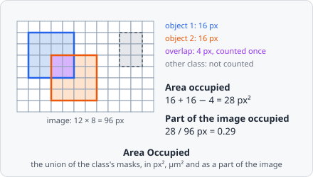

**Area Occupied** measures how much of the image the objects of one class cover: the covered area in pixels, in µm² (when the pixel size is known) and as a part of the image (0 to 1). Where objects of the class overlap, the shared pixels count once.

It is a [measurement step](/guide/pipelines/#measurement-steps): it runs once per image plane, after all objects of the image are found, and gives one value per plane - not one per object.

## Parameters

| Parameter        | Description                                                                                                         |
| ---------------- | ------------------------------------------------------------------------------------------------------------------- |
| **ID**           | The step's ID, unique in the project. It is given automatically (`area_occupied_01`, …) and starts the names of its values in the results. |
| **Object Class** | The objects whose area is measured. It must be set.                                                                 |

## Measurements

Three values per image plane:

| Measurement                    | Unit | Description                                                                   |
| ------------------------------ | ---- | ----------------------------------------------------------------------------- |
| **Area occupied**              | px²  | The number of pixels at least one object of the class covers.                |
| **Area occupied**              | µm²  | The same area in µm². No value when the image has no pixel size.              |
| **Part of the image occupied** | 0-1  | The covered pixels divided by the pixels of the image.                        |

The two **Area occupied** values differ by their unit; in the measurement pickers they read _"area_occupied_01 · Area occupied (px²)"_ and _"(µm²)"_.

## How it works

Only the pixels of the objects' masks are counted, not their bounding boxes: a hole in an object is not covered. The masks are merged row by row, so a pixel covered by several objects counts once:

$$
A = \Big|\bigcup_{o \in \text{class}} \text{mask}(o)\Big|, \qquad
A_{\mu m^2} = A \cdot \frac{s_x \, s_y}{10^6}, \qquad
\text{Part} = \frac{A}{N_{\text{image}}}
$$

with $s_x, s_y$ the pixel size in nm and $N_{\text{image}}$ the number of pixels analysed: all tiles of the image (in a preview, the part that is shown).

## Results

The values belong to the image plane, not to an object. In the [List view](/guide/results/#list-view) they are under **Columns › Measurements**, named _"area_occupied_01 · Area occupied"_. With **A row per: Images** each image shows its own value; with **A row per: Objects** each object row shows the value of its image plane. In the [Plate view](/guide/results/#plate-view) a well gets the statistic over its images' values; [images left out](/guide/results/#leaving-images-out) are not counted.

The export option **Measurements - one row per value** writes `measurements.csv` / `.xlsx` with one row per value (image, plane, step, measurement, unit, key, value) - see [Exporting Results](/guide/results/#exporting-results).

## Limitations

- One class per step. To measure several classes, add a step for each.
- Values are per plane; there is no total over a z-stack or a time-lapse.
