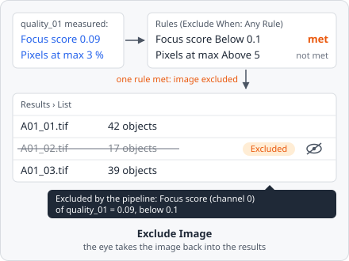

**Exclude Image** leaves an image out of the results when its measurements say it is bad. Each rule compares a measurement of an earlier step - for example the focus score of [Measure Image Quality](/commands/measure/image-quality/) - with a value. When the rules are met, the image is still analysed to the end, but it is marked as **Excluded** in the results, with the reason. You can check it by hand and take it back in if it is fine.

It is a [measurement step](/guide/pipelines/#measurement-steps). Put it after the steps whose values it reads.

## Parameters

| Parameter        | Description                                                                                          |
| ---------------- | ---------------------------------------------------------------------------------------------------- |
| **Exclude When** | **Any Rule** (default): one rule met is enough. **All Rules**: every rule must be met.               |
| **Rules**        | The rules, each with the three settings below. Without a rule the step does nothing.                 |

Each rule:

| Setting         | Description                                                                                                       |
| --------------- | ----------------------------------------------------------------------------------------------------------------- |
| **Measurement** | The measurement, picked from the values the project's measurement steps make, e.g. _"quality_01 · Focus score (channel 0)"_. It must have one value per image (an image measurement), not one per object. |
| **Comparison**  | **Below**: met when the measurement is smaller than the value (e.g. a focus score too low). **Above**: met when it is larger (e.g. too many saturated pixels). |
| **Value**       | The limit, in the measurement's unit (e.g. % for _Pixels at the maximum_).                                        |

## How it works

The rules are checked on every image plane, after the steps before it have measured the plane. Below and Above are strict: a value equal to the limit does not meet the rule. A measurement without a value (e.g. the power log-log slope of a flat image, or the µm² of an image without pixel size) meets no rule.

If one plane meets the rules, the whole image is excluded. Its objects and measurements are still stored - nothing is lost.

The step stops the analysis of the image with an error when a rule has no measurement, when the measurement is not made before this step, or when it is a measurement per object.

### The reason

The reason lists the rules that were met, e.g.

> Focus score (channel 0) of quality_01 = 0.09, below 0.1

Several met rules are joined with `;`. A second Exclude Image step that excludes the image adds its reason. In a z-stack or time-lapse the reason names the first plane that met the rules, e.g. _"t 0, z 3: … (and 2 more planes)"_.

## In the results

An excluded image is treated like an [image left out by hand](/guide/results/#leaving-images-out):

- In the [List view](/guide/results/#list-view) its rows are dimmed and struck through, with an **Excluded** badge at the right; hovering it shows _"Excluded by the pipeline: …"_ with the reason. An image left out by hand shows **Left out** instead.
- It is left out of every aggregated value - the well's value in the plate view, and the plate/well exports - and skipped by exports that cover all images.
- The eye at the row's right (**Take this image back into the results**) takes it back in. To take several back in at once, tick their rows and click **Take back in** (or **Leave out**) in the bar above the table.

Taking an image back in by hand removes the reason: if you later leave it out again, it shows **Left out**. The setting is stored in the results database.

## Limitations

- Only image measurements can be used, not measurements per object (e.g. the values of [Measure Object Colocalization](/commands/measure/measure-colocalization/)).
- The rules of one step combine with either Any Rule or All Rules. For mixed logic, use several Exclude Image steps: each one can exclude the image on its own.
