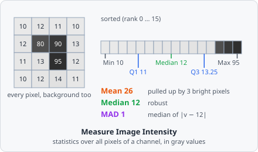

**Image Intensity** measures the brightness of one channel over the whole image: total, mean, standard deviation, minimum, maximum, median, lower and upper quartile and the median absolute deviation. It uses every pixel of the image, the background too - unlike the [intensity metrics](/fundamentals/metrics/#intensity-metrics) of an object, which use only the object's pixels.

It is a [measurement step](/guide/pipelines/#measurement-steps): it runs once per image plane, after all tiles of the image are read, and gives one set of values per plane.

## Parameters

| Parameter   | Description                                                                                                  |
| ----------- | ------------------------------------------------------------------------------------------------------------ |
| **ID**      | The step's ID, unique in the project. It is given automatically (`intensity_01`, …) and starts the names of its values in the results. |
| **Channel** | The channel to measure.                                                                                      |

## Measurements

Nine values per image plane, all in gray values (like the objects' intensities). Each name ends with the channel, e.g. _"Mean intensity (channel 0)"_.

| Measurement                                | Unit       | Description                                                       |
| ------------------------------------------ | ---------- | ----------------------------------------------------------------- |
| **Total intensity**                        | gray value | The sum of all pixels.                                            |
| **Mean intensity**                         | gray value | The mean of all pixels.                                           |
| **Standard deviation of intensity**        | gray value | How far the pixels spread around the mean.                        |
| **Minimum intensity**                      | gray value | The darkest pixel.                                                |
| **Maximum intensity**                      | gray value | The brightest pixel.                                              |
| **Median intensity**                       | gray value | Half the pixels are darker, half brighter.                        |
| **Lower quartile intensity**               | gray value | A quarter of the pixels are darker.                               |
| **Upper quartile intensity**               | gray value | A quarter of the pixels are brighter.                             |
| **Median absolute deviation of intensity** | gray value | The median distance of the pixels to the median - a spread that a few bright pixels do not change. |

## How it works

Over the $n$ pixels $v_i$ of the channel as it is loaded from the image - filters earlier in the pipeline do not change it. An RGB image is turned into its luminance first.

$$
\text{Total} = \sum_i v_i, \qquad
\text{Mean} = \frac{\text{Total}}{n}, \qquad
\sigma = \sqrt{\frac{1}{n}\sum_i (v_i - \text{Mean})^2}
$$

The standard deviation is that of the population: all pixels are measured, not a sample of them.

The median and quartiles are taken from a histogram of the pixels, one bin per gray value (above 16 bits, 65 536 bins over the range). Between two pixels they are interpolated linearly, as NumPy's `percentile` does: the quantile $q$ lies at rank $q\,(n-1)$ of the sorted pixels.

$$
\text{MAD} = \operatorname{median}_i \, |v_i - \operatorname{median}(v)|
$$

Pixels that are not numbers are left out. An image without pixels gets no values.

## Results

The values belong to the image plane, not to an object. In the [List view](/guide/results/#list-view) they are under **Columns › Measurements**, named _"intensity_01 · Mean intensity (channel 0)"_. With **A row per: Images** each image shows its own value; with **A row per: Objects** each object row shows the value of its image plane. In the [Plate view](/guide/results/#plate-view) a well gets the statistic over its images' values; [images left out](/guide/results/#leaving-images-out) are not counted.

The export option **Measurements - one row per value** writes them with one row per value - see [Exporting Results](/guide/results/#exporting-results).

Use them, for example, to normalise the objects' intensities by the image's background (the median of a sparse image), or with [Exclude Image](/commands/measure/exclude-image/) to leave out images that are too dark.
