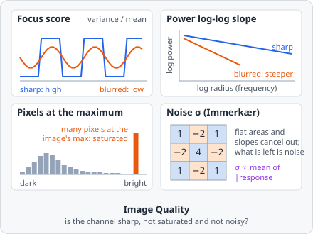

**Measure Image Quality** measures how usable one channel of the image is: whether it is sharp, not noisy and not over- or underexposed. The focus score, the power log-log slope and the percentages of pixels at the maximum and minimum are those of CellProfiler's MeasureImageQuality - the same image gives the same numbers. The noise is Immerkær's estimate.

It is a [measurement step](/guide/pipelines/#measurement-steps): it runs once per image plane, after all tiles of the image are read. Use its values with [Exclude Image](/commands/measure/exclude-image/) to leave bad images out of the results.

## Parameters

| Parameter   | Description                                                                                                 |
| ----------- | ----------------------------------------------------------------------------------------------------------- |
| **ID**      | The step's ID, unique in the project. It is given automatically (`quality_01`, …) and starts the names of its values in the results. |
| **Channel** | The channel to measure.                                                                                     |

## Measurements

Five values per image plane. Each name ends with the channel, e.g. _"Focus score (channel 0)"_.

| Measurement               | Unit       | Range    | Description                                                                 |
| ------------------------- | ---------- | -------- | --------------------------------------------------------------------------- |
| **Focus score**           | -          | ≥ 0      | The variance of the pixels over their mean. Low: blurry (or empty).         |
| **Power log-log slope**   | -          | mostly < 0 | How fast fine detail fades in the power spectrum. More negative: blurrier. |
| **Pixels at the maximum** | %          | 0-100    | The part of the pixels at the image's brightest value. High: saturated.     |
| **Pixels at the minimum** | %          | 0-100    | The part of the pixels at the image's darkest value. High: clipped to black. |
| **Noise σ**               | gray value | ≥ 0      | The standard deviation of the noise.                                        |

## How it works

The channel is measured as it is loaded from the image - filters earlier in the pipeline do not change it. The pixels are taken as values from 0 to 1 (the gray value divided by the bit depth's maximum, e.g. 255 for 8 bits), as CellProfiler does. An RGB image is turned into its luminance first.

### Focus score

The variance of all $n$ pixels divided by their mean - CellProfiler's normalised variance:

$$
\text{Focus score} = \frac{\frac{1}{n}\sum_i (v_i - \bar v)^2}{\bar v}
$$

A sharp image has strong local differences and so a high variance; blurring evens them out. A black image scores 0. The score also depends on the content (how much of the image is covered), so compare it between images of the same kind.

### Power log-log slope

The 2D Fourier transform of the image (minus its mean) gives the power at each spatial frequency. The power is summed in rings of the same radius $r$ (in frequency steps), and a straight line is fitted through $\log(\text{power})$ over $\log r$, for $r$ from 2 up to (not including) an eighth of the image's shorter side - the lowest frequencies and the noisy highest ones are left out. The slope of that line is the value.

Blurring removes high frequencies, so the power drops faster and the slope gets more negative. The spectrum uses at most 4096 × 4096 pixels from the middle of the image. An image without any variation, or one too small for at least two rings (shorter side under 32 pixels), gets no value (CellProfiler gives 0 there).

### Pixels at the maximum and minimum

$$
\text{Pixels at the maximum} = 100 \cdot \frac{\#\{i : v_i = \max v\}}{n}
$$

and the same for the minimum. The maximum is the image's own brightest value, not the bit depth's: a saturated image has many pixels at the same top value. In an ordinary image only a few pixels share the maximum, so the value is close to 0.

### Noise

Immerkær's fast noise estimate: every pixel with all 8 neighbours in its tile is filtered with the mask below, which cancels smooth structures (it is the difference of two Laplacians) and leaves the noise:

$$
M = \begin{bmatrix} 1 & -2 & 1 \\ -2 & 4 & -2 \\ 1 & -2 & 1 \end{bmatrix}, \qquad
\sigma = \sqrt{\frac{\pi}{2}} \cdot \frac{1}{6\,N} \sum |I * M|
$$

with $N$ the number of filtered pixels. The result is given in gray values (multiplied by the bit depth's maximum). Edges add a little to it; in an image with many sharp edges it is somewhat too high.

## Results

The values belong to the image plane, not to an object. In the [List view](/guide/results/#list-view) they are under **Columns › Measurements**, named _"quality_01 · Focus score (channel 0)"_. With **A row per: Images** each image shows its own value; with **A row per: Objects** each object row shows the value of its image plane. In the [Plate view](/guide/results/#plate-view) a well gets the statistic over its images' values; [images left out](/guide/results/#leaving-images-out) are not counted. The two percentages have a fixed range (0-100), so their colour scales stay comparable between plates.

The export option **Measurements - one row per value** writes them with one row per value - see [Exporting Results](/guide/results/#exporting-results).

## Choosing thresholds

There are no fixed limits: they depend on the microscope, the stain and the content. Run the analysis on a set of images, add the value as a column and look at the images at the low end (focus score, slope) or the high end (pixels at the maximum). Then use the value where the images turn bad as the rule of an [Exclude Image](/commands/measure/exclude-image/) step.
