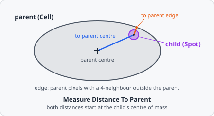

**Measure Distance To Parent** measures how far each child (e.g. a spot) lies from the parent [Relate Objects](/commands/object/relate-objects/) linked it to (e.g. its cell): from the child's centre to the parent's centre, and from the child's centre to the nearest pixel of the parent's edge. These are the child-parent distances of CellProfiler's RelateObjects.

Use it, for example, to tell spots near the nucleus from spots near the cell membrane. It needs a [Relate Objects](/commands/object/relate-objects/) step before it in the pipeline.

## Parameters

| Parameter    | Description                                                                                                   |
| ------------ | ------------------------------------------------------------------------------------------------------------- |
| **ID**       | The step's ID, unique in the project. Its values' names in the results start with it (e.g. `parent_distance_01`). |
| **Children** | The children measured (e.g. spots).                                                                           |
| **Parent**   | The class of their parent, as linked by Relate Objects (e.g. Cell).                                           |

## Measurements

Two values per child, in pixels:

| Measurement                    | Description                                                         |
| ------------------------------ | ------------------------------------------------------------------- |
| **Distance to parent centre**  | From the child's centre to the parent's centre.                    |
| **Distance to parent edge**    | From the child's centre to the nearest edge pixel of the parent.    |

Each value also names the parent it was measured to: in the [List View](/guide/results/#list-view), the column **… · object** next to it holds the parent's object ID.

## How it works

The centre of an object is its centre of mass: the mean position of its pixels, not weighted by intensity.

$$
d_{\text{centre}} = \sqrt{(x_c - x_p)^2 + (y_c - y_p)^2}
$$

with $(x_c, y_c)$ the child's centre and $(x_p, y_p)$ the parent's.

The parent's **edge pixels** are its pixels with at least one of their 4 neighbours (up, down, left, right) outside the parent. A neighbour beyond the image border doesn't count, so a parent cut off by the border has no edge along it. The distance to the edge is the shortest straight-line distance from the child's centre to the centre of an edge pixel.

The distance to the edge has no sign: it is the same whether the child's centre lies inside or outside the parent.

A child without a parent of the chosen class (not linked, or its parent no longer exists) has no value.
