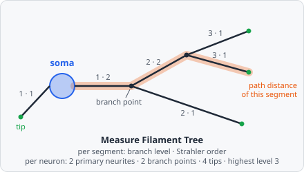

**Measure Filament Tree** measures the trees [Trace Filaments](/commands/object/trace-filaments/) traced. For every segment it measures where it sits in its tree: its branch level, its Strahler order, the path distance from the soma, its length and its straightness. For every neuron it adds the totals to its soma: the total length, the number of primary neurites, branch points and tips, the highest branch level and the longest path.

Use it to compare how much and how far neurons branch. It needs a Trace Filaments step before it in the pipeline. With these values, [Results › Trees](/guide/results/#trees) lists the neurons with their length, primary neurites, branch points and tips, and draws each neuron's tree as a dendrogram, coloured by branch level or Strahler order.

In a project file it is `MEASURE_FILAMENT_TREE`.

## Parameters

| Parameter    | Description                                                                                                  |
| ------------ | ------------------------------------------------------------------------------------------------------------ |
| **ID**       | The step's ID, unique in the project. Its values' names in the results start with it (e.g. `tree_01`).       |
| **Segments** | The segments measured: the **Output Class** of Trace Filaments.                                              |
| **Somata**   | The somata: the **Seeds** of Trace Filaments. The per-neuron values go on them.                              |

## Measurements

Five values per segment:

| Measurement                     | Unit     | Description                                                                                         |
| ------------------------------- | -------- | --------------------------------------------------------------------------------------------------- |
| **Branch level**                | count    | 1 for a segment that starts at the soma, one more for every branch point on the way to it.          |
| **Strahler order**              | count    | 1 at the tips, one more where two or more branches of the highest order meet (Strahler 1957).       |
| **Path distance from the soma** | px       | The length along the tree from the soma to the segment's far end.                                   |
| **Segment length**              | px       | The length of the segment.                                                                          |
| **Segment straightness**        | fraction | The straight distance between the segment's two ends divided by its length (0-1, 1 = straight).     |

Six values per neuron, on its soma:

| Measurement                     | Unit  | Description                                                    |
| ------------------------------- | ----- | -------------------------------------------------------------- |
| **Neuron total length**         | px    | The sum of the lengths of all its segments.                    |
| **Neuron primary neurites**     | count | The number of segments that start at the soma.                 |
| **Neuron branch points**        | count | The number of segments that split into two or more.            |
| **Neuron tips**                 | count | The number of segments that end in a tip.                      |
| **Neuron highest branch level** | count | The highest branch level of its segments.                      |
| **Neuron longest path**         | px    | The longest path distance from the soma to a tip.              |

## How it works

The tree is read from the segments' links: each segment's parent of the **Segments** class is the next segment towards the soma, its parent of the **Somata** class its soma. Trace Filaments sets both.

**Length.** As in [Measure Object Skeleton](/commands/measure/measure-object-skeleton/): a step to a straight neighbour is 1 px, to a diagonal one $\sqrt{2}$ px; a diagonal step that a straight neighbour of both pixels bridges isn't counted. The straightness divides the distance between the segment's two end pixels (those with one neighbour) by its length, at most 1. A segment that doesn't have exactly two ends, or has no length, has no straightness.

**Branch level and path distance** go down from the soma: a root segment has level 1 and path distance its length; each child adds 1 to the level and its length to the distance.

$$
d_{\text{path}}(s) = \sum_{t \,\in\, \text{path from the soma to } s} \text{length}(t)
$$

**Strahler order** goes up from the tips. A segment without children has order 1. Otherwise, with $k$ the highest order of its children:

$$
\text{order} = \begin{cases} k & \text{if one child has order } k \\ k + 1 & \text{if two or more children have order } k \end{cases}
$$

**Per neuron**, the segments linked to the same soma are summed up. A soma without segments gets no neuron values.

Segments whose links loop back on themselves (only possible when the links don't come from Trace Filaments) get no branch level, Strahler order or path distance.

## Limitations

- Lengths are in pixels.
- The step from a branch point to the first pixel of each branch belongs to neither segment, so each segment's length is up to $\sqrt{2}$ px short of the traced path.
- [Results › Trees](/guide/results/#trees) doesn't know which classes Trace Filaments used: it takes the class linked to parents of its own class as the segments, and the most common other parent class of the root segments as the somata. If [Relate Objects](/commands/object/relate-objects/) also links the segments to a third class, and that class is more common among the root segments, Trees can pick it as the somata.
