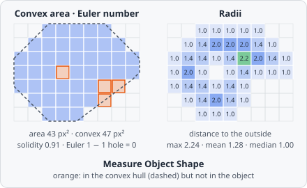

**Measure Object Shape** adds the shape values of CellProfiler's MeasureObjectSizeShape that objects don't carry anyway: the convex area and CellProfiler's solidity, the Euler number, and the radii. Area, perimeter, Feret diameters, axes and the other [object metrics](/fundamentals/metrics/) are always measured and need no step.

It is a step of its own because the radii need a distance transform of every object, too slow to pay for in every analysis.

## Parameters

| Parameter   | Description                                                                                          |
| ----------- | ---------------------------------------------------------------------------------------------------- |
| **ID**      | The step's ID, unique in the project. Its values' names in the results start with it (e.g. `shape_01`). |
| **Objects** | The objects measured.                                                                                |

## Measurements

Six values per object:

| Measurement                | Unit | Description                                                                 |
| -------------------------- | ---- | --------------------------------------------------------------------------- |
| **Convex area**            | px²  | The number of pixels whose centre lies in (or on) the object's convex hull. |
| **Solidity (convex area)** | 0-1  | Area / convex area.                                                          |
| **Euler number**           | -    | The number of pieces minus the number of holes; 1 for a solid object.     |
| **Max radius**             | px   | The largest distance of a pixel to the outside: about the radius of the largest disk that fits in. |
| **Mean radius**            | px   | The mean distance of the pixels to the outside.                            |
| **Median radius**          | px   | The median distance of the pixels to the outside.                          |

## How it works

### Convex area and solidity

The convex hull is taken around the midpoints of the pixels' edges (the points half a pixel left, right, above and below each pixel's centre), as scikit-image's `convex_hull_image`, which CellProfiler uses. The **Convex area** is the number of pixels whose centre lies inside or on this hull. It is a pixel count, never smaller than the area.

$$
\text{Solidity} = \frac{A}{A_{\text{convex}}}
$$

1 means convex; bays, notches and holes lower it. This solidity matches CellProfiler's. It differs slightly from the [Solidity](/fundamentals/metrics/) every object carries, which divides by the area of the hull polygon around the pixel corners. For small objects the two can differ noticeably.

### Euler number

The number of connected pieces minus the number of holes, with pixels connected through their 8 neighbours (so holes through 4). An object is usually one piece, so 1 means no hole, 0 one hole, -1 two holes. It is computed from the 2 × 2 pixel patterns of the mask (Gray's bit quads), as scikit-image's `euler_number`:

$$
E = \frac{Q_1 - Q_3 - 2\,Q_D}{4}
$$

with $Q_1$ the 2 × 2 windows with one object pixel, $Q_3$ those with three, and $Q_D$ those with two diagonal ones.

### Radii

The radius of a pixel is its exact Euclidean distance (from pixel centre to pixel centre) to the nearest pixel that is not part of the object. A pixel on the outline therefore has radius 1. Holes count as outside. The image border does not: the object is measured as if it were surrounded by background. **Max**, **Mean** and **Median radius** are taken over all the object's pixels; with an even number of pixels the median is the mean of the two middle values.

The **Max radius** is about the radius of the largest disk that fits into the object, so it gives half the thickness of elongated objects independent of their length.
