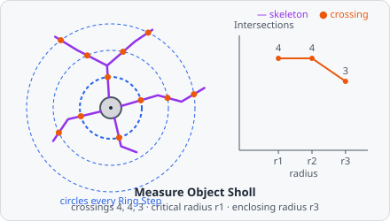

**Measure Object Sholl** does a Sholl analysis (Sholl 1953) of skeletons: it draws concentric circles around a centre (usually the soma) at a fixed step and counts, per circle, how often the skeleton crosses it. This shows how much a neuron branches at which distance from its soma. The crossings per circle are a **profile**, a curve over the radius; the summary values follow Ferreira et al. 2014.

Use it on the skeletons of [Skeletonize Objects](/commands/object/skeletonize-objects/). To centre the circles on the soma, link the skeletons to their somata with [Relate Objects](/commands/object/relate-objects/) first and choose the soma class as **Centre From**.

In a project file it is `MEASURE_OBJECT_SHOLL`.

## Parameters

| Parameter        | Description                                                                                                                                         |
| ---------------- | --------------------------------------------------------------------------------------------------------------------------------------------------- |
| **ID**           | The step's ID, unique in the project. Its values' names in the results start with it (e.g. `sholl_01`).                                             |
| **Objects**      | The skeletons measured (the skeleton class of Skeletonize Objects).                                                                                 |
| **Centre From**  | The class of the centres (e.g. the somata), linked to the skeletons as their parents by Relate Objects: the circles are around its centre. Unset (default): around the skeleton's own centre. |
| **Ring Step**    | The distance between two circles (0.1 to 100000, default 10).                                                                                       |
| **First Radius** | The radius of the first circle (default 0: one step).                                                                                               |
| **Last Radius**  | The radius of the last circle (default 0: up to the farthest skeleton pixel). Set it to compare neurons at the same radii.                          |
| **Unit**         | Unit of the radii and the step: **px** (default) or **nm**. Without a pixel size, nm are taken as pixels.                                           |

## Measurements

A profile and five values per skeleton:

| Measurement                      | Unit  | Description                                                                                         |
| -------------------------------- | ----- | --------------------------------------------------------------------------------------------------- |
| **Intersections**                | count | The profile: the number of crossings of each circle, one value per radius.                          |
| **Max intersections**            | count | The most crossings of any circle.                                                                   |
| **Critical radius**              | px    | The radius of the first circle with the most crossings.                                             |
| **Enclosing radius**             | px    | The largest radius still crossed.                                                                   |
| **Mean intersections**           | count | The mean crossings of the circles from the first up to the enclosing radius.                        |
| **Sholl regression coefficient** | -     | $k$ of the semi-log method: how fast the crossings per area fall with the radius (see below).      |

The radii are in pixels, also when **Unit** is nm. A skeleton that crosses no circle has 0 max and mean intersections and no other summary value.

### The profile

A profile is a measurement with several values per object, each at a position: here the number of crossings at each radius. Each circle is one row in the results, its radius stored as the row's position. It holds a value for every circle out to the last radius, zeros included, so averages over neurons stay right.

As a profile is no single number, the List View and the other charts don't offer it as a column. The **Profile** chart of the [results](/guide/results/#profiles) draws it: a line per class, image, well or plate, or the curve of the selected skeleton on top. In the measurements export it has a `position` column with the radius. The summary values are ordinary values, in the List View like any other. In the pipeline editor's measurement preview, the profile shows the number of radii and objects instead of a value.

## How it works

The skeleton is thinned once more first, so it is 1 pixel wide. The centre is the centre of mass of the skeleton's parent of the **Centre From** class, or of the skeleton itself when **Centre From** is unset or the skeleton has no such parent.

The circles have the radii

$$
r_i = r_{\text{first}} + i \cdot \Delta r, \qquad r_i \le r_{\text{last}}
$$

with $\Delta r$ the **Ring Step**.

**Crossings** are counted on the skeleton as a line, not by pixels in a ring (a 1-pixel ring could be jumped by a diagonal step). The skeleton is a set of steps between neighbouring pixels $p, q$ (straight or diagonal; a diagonal step that a straight neighbour of both pixels bridges isn't one, as in [Measure Object Skeleton](/commands/measure/measure-object-skeleton/)). With $d$ the distance of a pixel's centre to the centre, the circle $r$ crosses the step if

$$
d(p) < r \le d(q)
$$

**Summary values** (Ferreira et al. 2014), with $N(r)$ the crossings of circle $r$:

- **Max intersections** is the highest $N(r)$; the **critical radius** the first radius it is at.
- The **enclosing radius** is the largest $r$ with $N(r) > 0$.
- **Mean intersections** is the mean of $N(r)$ over all circles up to the enclosing radius, circles without crossings in between included.
- The **Sholl regression coefficient** $k$ comes from the semi-log method: a least-squares line through the circles with crossings,

$$
\ln \frac{N(r)}{\pi r^2} = -k \cdot r + m
$$

It needs at least two circles with crossings.

## Limitations

- Radii and crossings are 2D: circles, not spheres.
- One centre per skeleton: a skeleton that spans several neurons (touching neurites) is analysed around one soma only. [Trace Filaments](/commands/object/trace-filaments/) splits touching neurons.
