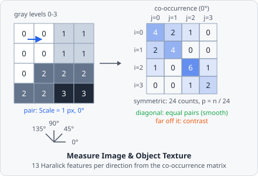

**Measure Texture** measures the texture of one channel with Haralick's features: how the gray levels of pixel pairs a fixed distance apart go together. Contrast is high where neighbouring pixels differ a lot, the angular second moment where few pairs repeat over and over (smooth or regular), entropy where the pairs are all different. It gives the 13 features for the whole image and, optionally, for each object of a class. The values are those of CellProfiler's MeasureTexture (which uses mahotas), value for value.

It is a [measurement step](/guide/pipelines/#measurement-steps): it runs once per image plane, after all tiles of the image are read and all objects are found.

## Parameters

| Parameter         | Description                                                                                       |
| ----------------- | ------------------------------------------------------------------------------------------------- |
| **ID**            | The step's ID, unique in the project. It is given automatically (`texture_01`, …) and starts the names of its values in the results. |
| **Channel**       | The channel measured.                                                                             |
| **Scale [px]**    | How far apart the two pixels of a pair are, in pixels (1 to 1000, default 3) - about the size of the texture's grain. |
| **Gray levels**   | The gray levels the 8-bit values are rescaled to (2 to 256, default 256). Fewer are faster and less noisy; more see finer differences. |
| **Directions**    | **Mean of the directions** (default): one value per feature, the mean over 0°, 45°, 90° and 135°. **Each direction**: one value per feature and direction - four times as many values. |
| **Per object of** | The objects of this class get values of their own as well. Unset (default): the whole image only.  |

## Measurements

Each name ends with the channel and the scale, e.g. _"Contrast (channel 0, scale 3)"_. With **Each direction** the angle is added (_"Contrast 45° (channel 0, scale 3)"_); with **Per object of** set, every value also comes per object (_"Contrast per object (channel 0, scale 3)"_). None of them has a unit.

| Measurement                              | Range    | High when …                                                       |
| ---------------------------------------- | -------- | ----------------------------------------------------------------- |
| **Angular second moment**                | 0 to 1   | few pairs repeat over and over: smooth or very regular.           |
| **Contrast**                             | ≥ 0      | neighbouring pixels differ a lot.                                 |
| **Correlation**                          | -1 to 1  | the gray levels of a pair depend linearly on each other.          |
| **Variance**                             | ≥ 0      | the gray levels spread widely.                                    |
| **Inverse difference moment**            | 0 to 1   | the pairs have (nearly) equal gray levels: homogeneous.           |
| **Sum average**                          | ≥ 0      | the pairs are bright.                                             |
| **Sum variance**                         | ≥ 0      | the brightness of the pairs varies a lot.                         |
| **Sum entropy**                          | ≥ 0      | the sums of the pairs are spread over many values.                |
| **Entropy**                              | ≥ 0      | the pairs are all different: irregular, complex.                  |
| **Difference variance**                  | ≥ 0      | the differences of the pairs are unevenly distributed.            |
| **Difference entropy**                   | ≥ 0      | the differences of the pairs are spread over many values.         |
| **Information measure of correlation 1** | -1 to 0  | (closer to -1) the two pixels of a pair depend on each other.     |
| **Information measure of correlation 2** | 0 to 1   | the two pixels of a pair depend on each other.                    |

## How it works

### Gray levels

The channel, as it is loaded from the image, is first converted to 8 bits: 0 to 255 over the bit depth's range (as scikit-image's `img_as_ubyte` rounds it). With fewer than 256 **Gray levels** the 8-bit values are then rescaled to $0 \dots L-1$. An RGB image is turned into its luminance first.

### Co-occurrence matrix

For each direction, every pixel is paired with the pixel **Scale** pixels away:

| Direction | Partner                               |
| --------- | ------------------------------------- |
| 0°        | to the right                          |
| 45°       | down and to the left (= up and right) |
| 90°       | below                                 |
| 135°      | down and to the right                 |

Each pair $(i, j)$ of gray levels is counted in both orders, so the matrix is symmetric. Divided by the number of counts, it gives the probabilities $p(i, j)$. From it come the marginal $p_x(i) = \sum_j p(i,j)$ (the same as $p_y$), its mean $\mu$ and variance $\sigma^2$, the distribution of the sums $p_{x+y}(k)$ ($k = i + j$) and of the differences $p_{x-y}(k)$ ($k = |i - j|$).

### The features

With $\log$ to base 2:

$$
\begin{aligned}
\text{ASM} &= \textstyle\sum_{i,j} p(i,j)^2 &
\text{Contrast} &= \textstyle\sum_k k^2 \, p_{x-y}(k) \\
\text{Correlation} &= \dfrac{\sum_{i,j} i\,j\,p(i,j) - \mu^2}{\sigma^2} &
\text{Variance} &= \sigma^2 \\
\text{IDM} &= \textstyle\sum_{i,j} \dfrac{p(i,j)}{1 + (i-j)^2} &
\text{Sum average} &= \textstyle\sum_k k \, p_{x+y}(k) \\
\text{Sum variance} &= \textstyle\sum_k k^2 p_{x+y}(k) - (\text{Sum average})^2 &
\text{Sum entropy} &= -\textstyle\sum_k p_{x+y}(k) \log p_{x+y}(k) \\
\text{Entropy } (H_{XY}) &= -\textstyle\sum_{i,j} p(i,j) \log p(i,j) &
\text{Difference entropy} &= -\textstyle\sum_k p_{x-y}(k) \log p_{x-y}(k)
\end{aligned}
$$

The **Difference variance** is the variance of the values $p_{x-y}(0), \dots, p_{x-y}(n-1)$ themselves, as mahotas computes it. The information measures of correlation use $H_X = -\sum_i p_x(i) \log p_x(i)$ and $H_{XY1} = -\sum_{i,j} p(i,j) \log\big(p_x(i)\,p_x(j)\big)$:

$$
\text{IMC 1} = \frac{H_{XY} - H_{XY1}}{H_X}, \qquad
\text{IMC 2} = \sqrt{1 - e^{-2\,(2 H_X - H_{XY})}}
$$

Where the variance is 0 (a uniform image), the correlation is 1.

### Image and objects

- **Whole image:** every pixel counts, dark background included. Pairs that cross a tile border are counted as well.
- **Per object:** only pixels of the object's mask, and only pairs whose two pixels are both in the mask and not at gray level 0 (as CellProfiler, which sets the pixels outside the object to 0). An object too small to hold a pair in one of the directions - e.g. narrower than **Scale** - gets no values (CellProfiler stores 0).

## Choosing the settings

- **Scale:** about the size of the structures whose texture you want - a few pixels for fine speckles, larger for coarse patterns. For objects, keep it clearly smaller than the objects.
- **Gray levels:** 256 keeps all detail but makes the matrix sparse and the features noisy on small objects; 8 to 64 levels are steadier and faster.
- **Directions:** the mean is independent of the texture's orientation. Use **Each direction** only when the orientation matters (e.g. aligned fibres).

## Results

The image values belong to the image plane; in the [List view](/guide/results/#list-view) they are under **Columns › Measurements**, named _"texture_01 · Contrast (channel 0, scale 3)"_. With **A row per: Images** each image shows its own value; with **A row per: Objects** each object row shows the value of its image plane. The per-object values (_"… per object …"_) are shown on each object's row and are aggregated over the image's objects with **A row per: Images**.

The export option **Measurements - one row per value** writes every value with one row per value - see [Exporting Results](/guide/results/#exporting-results). With **Each direction** and per-object values, one step gives 104 values, so select the measurements you need in the export's **Measurements**.
