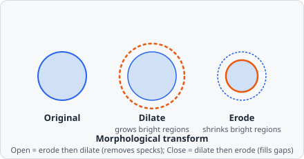

The **Morphological Transform** command applies a structuring element to reshape regions. Before a segmentation it works on the image; after one (e.g. a [Threshold](/commands/segmentation/threshold/)) it works on the segmentation mask, typically to clean it up before the objects are extracted.

All four operations boil down to sliding a small shape (the structuring element) across the image and asking either "does it fit entirely inside the bright region here?" (erosion) or "does it touch the bright region at all here?" (dilation) - opening and closing just chain the two in different orders to get asymmetric effects: shrink-then-grow erases anything too small to contain the structuring element at all, while grow-then-shrink bridges gaps that are narrower than it.

## Operations

| Operation  | Effect                                                                              |
| ---------- | ----------------------------------------------------------------------------------- |
| **Dilate** | Expands bright regions; fills small holes and gaps (default)                        |
| **Erode**  | Shrinks bright regions; removes thin protrusions and isolated noise pixels          |
| **Open**   | Erode followed by dilate - removes small bright objects while preserving large ones |
| **Close**  | Dilate followed by erode - fills small dark holes while preserving overall shape    |

## Parameters

| Parameter        | Description                                                                                                         |
| ---------------- | ------------------------------------------------------------------------------------------------------------------- |
| **Operation**    | _Dilate_ (default), _Erode_, _Open_ or _Close_                                                                      |
| **Kernel size**  | Diameter of the structuring element in pixels: an odd number from 3 to 101 (default 3). An even size stops the step with an error - the kernel would have no centre pixel and shift the objects. |
| **Kernel shape** | _(advanced)_ _Box_ (square, default), _Ellipse_ (disk) or _Cross_ (plus)                                            |
| **Works on**     | Read-only: **Image** or **Segmentation mask**, set by the step's place (see below)                                   |

### Kernel shapes

| Shape       | Description                                                                                         |
| ----------- | --------------------------------------------------------------------------------------------------- |
| **Box**     | All pixels in a square neighbourhood are included (8-connectivity)                                  |
| **Ellipse** | Pixels inside a disk centred on the pixel - keeps round objects round. Size 3 is the same as a box. |
| **Cross**   | Only horizontal and vertical neighbours (plus pattern, 4-connectivity)                              |

For a stronger effect, use a larger kernel or add the step twice.

## What it works on

Morphological Transform belongs to two [categories](/commands/overview/#command-categories): **Preprocess** (its home) and **Instance Seg.**. Its place in the pipeline decides which one it runs as:

- **Before a segmentation** (at the start, after a blur or another preprocessing step) it runs as **Preprocess** on the image - gray or each colour of an RGB image - and the steps after it see the transformed image.
- **After a segmentation** (after a [Threshold](/commands/segmentation/threshold/), [Connected Components](/commands/segmentation/connected-components/), [Fill Holes](/commands/object/fill-holes/), …) it runs as **Instance Seg.** on the segmentation mask, before [Extract Objects](/commands/object/extract-objects/).

The step's line shows the colour of the category it runs as, and its settings show a read-only **Works on** line (_Image_ or _Segmentation mask_). To change what it works on, move the step. [Utility](/commands/overview/#utility) steps (Script, Save Image, Image Cache) in between don't count: the step looks past them.

The command picker lists it once: under **Preprocess** when that chip is on (or no chip is), otherwise under **Instance Seg.** when that chip is on - e.g. after a Threshold - with the hint _also Preprocess_.

### On the segmentation mask

Every class of the mask is transformed as its own mask, whatever the class numbers:

- **Dilate** grows each class into the background only, never over another class.
- **Erode** shrinks touching classes away from each other equally.
- **Open** and **Close** run per class.

A mask with a single class (the usual case after a Threshold) is plain binary morphology.

## When to use

- **Erode** - separate objects that are barely touching; remove single-pixel noise.
- **Dilate** - connect small gaps in a detected contour.
- **Open** - remove debris / small artefacts from a mask without changing the size of larger objects significantly.
- **Close** - fill small holes inside detected objects.

## Notes

Older project files with the former **Use grayscale** switch still load: the migration to project schema version 4 drops the switch (and a module parameter bound to it), and the step's place decides what it works on.

## Background

The mathematical framework behind these operations - structuring elements, erosion, dilation, and their compositions - is mathematical morphology, developed by Georges Matheron and Jean Serra at the Centre de Morphologie Mathématique in the 1960s-70s and formalized in Jean Serra, *Image Analysis and Mathematical Morphology*, Academic Press, 1982.
