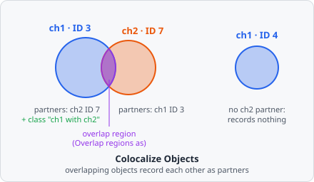

The **Colocalization** command answers "are these objects at the same place?". Every object of the classes to colocalize that overlaps an object of each other class records those objects as its **partners**. The [results](/guide/results/#colocalization-details) list the partners by ID and count them per class (see [Colocalization Partners](/fundamentals/metrics/#colocalization-partners)).

Optionally, the colocalizing objects of one class also get a class of their own (for example "ch1 with ch2"), and the overlap regions become objects of their own.

Unlike [Object Math](/commands/object/object-math/), which derives a new shape from two object sets, Colocalization links objects that already exist: each one keeps its ID, shape and measurements. Which object _belongs to_ which (spots per cell) is the job of [Relate Objects](/commands/object/relate-objects/).

## Parameters

| Parameter                                      | Description                                                                                                                                                       |
| ---------------------------------------------- | ----------------------------------------------------------------------------------------------------------------------------------------------------------------- |
| **Colocalize**                                 | The classes whose objects must overlap (e.g. the ch1 and the ch2 spots). At least two; with fewer the step does nothing.                                         |
| **All combinations**                           | Also record the partners of objects that don't overlap an object of every class - see [All combinations](#all-combinations). Off by default.                     |
| **But not**                                    | Objects that also overlap an object of one of these classes are left out entirely - see [But not](#but-not).                                                     |
| **By at least**                                | How much two objects must overlap, in **Size Unit**. `0` (default): any overlap.                                                                                  |
| **Size Unit**                                  | Unit of **By at least**: **px** (default), **nm** or **%** - see [Minimum overlap](#minimum-overlap).                                                            |
| **Partners**                                   | Which overlapping objects count as partners - see [Partners](#partners).                                                                                          |
| **Overlap regions as**                         | Optional: the overlap region of each colocalizing group becomes a new object with this class.                                                                    |
| **Mark objects of**                            | Optional: only the colocalizing objects of this class get the class set under **As**. Unset: the colocalizing objects of every class.                            |
| **As**                                         | Optional: the class the colocalizing objects get (e.g. "ch1 with ch2") - to count them per image or relate them to cells. Unset: only the partners are recorded. |

## How it works

For every object of each class in **Colocalize**:

1. The objects of every _other_ class in **Colocalize** that overlap it by at least **By at least** are its candidate partners. **Partners** may reduce them to the best-overlapping one.
2. If it has no partner of one of the other classes, it records nothing (unless **All combinations** is on).
3. If it also overlaps an object of a **But not** class by at least **By at least**, it records nothing.
4. Otherwise it records its partners, per class. With **As** set, it gets that class (only when it is of the class under **Mark objects of**, if one is set). With **Overlap regions as** set, the region where it and one partner of each other class all overlap becomes a new object.

Each object is checked on its own, so the partner links go both ways: a ch1 spot lists its ch2 spot, and the ch2 spot lists the ch1 spot. An overlap region is created once per group of objects, not once per member. It is measured on every channel like any other object, but it records no partners.

## Minimum overlap

**By at least** decides how much two objects must overlap to count as partners. Its meaning depends on **Size Unit**:

| Size Unit | Two objects are partners when …                                                   |
| --------- | --------------------------------------------------------------------------------- |
| **px**    | they share at least this many pixels                                              |
| **nm**    | their overlap area is at least this large in physical units (uses the pixel size) |
| **%**     | the overlap covers at least this percentage of the **smaller** of the two objects |

**%** makes the threshold independent of object size: a spot lying completely inside a cell overlaps it by 100 %, whatever the size of the cell. For example, with 50 %, a 100 px spot that overlaps a 400 px cell by 50 px colocalizes (50 % of the spot), even though the overlap is only 12.5 % of the cell. The same threshold applies to [But not](#but-not).

## Partners

| Option (GUI label)                              | Effect                                                                                                                                                         |
| ----------------------------------------------- | -------------------------------------------------------------------------------------------------------------------------------------------------------------- |
| **All partners** _(default)_                    | Every overlapping object that meets **By at least** is a partner - a spot touching two others has two.                                                       |
| **Only the best-overlapping partner**           | Per other class, only the object with the largest overlap. Two objects are partners only when each is the other's best.                                       |
| **Several partners only for selected classes**  | Only the objects of the selected classes may have more than one partner; every other class is capped to its best-overlapping one. Kept for older pipelines. |

With **Only the best-overlapping partner**, a small object on the border of two larger ones picks the one it overlaps more. A tie goes to the object further up in the image, then further left - the same pick in every run.

**Several partners only for selected classes** was the way to count spots per cell: with **Colocalize** set to `Cell, Spot` and `Cell` selected, a cell can have any number of spots, but each spot only one cell. For new pipelines use [Relate Objects](/commands/object/relate-objects/) for this.

## All combinations

By default an object records partners only when it overlaps an object of **every** other class. With three classes A, B and C, an A object overlapping only a B object records nothing.

With **All combinations** on, every overlapping pair is recorded, also for objects that miss one of the classes. One step with A, B and C then shows A∩B, A∩C, B∩C and A∩B∩C in the partner columns of the results. **As** and **Overlap regions as** still need every class: only the objects overlapping an object of each class get the class, and only those groups give an overlap region.

## But not

**But not** is a blocklist checked after the partners are found: an object that overlaps an object of one of these classes by at least **By at least** records no partners, gets no class and gives no overlap region - even though it passed the check for **Colocalize**. Leave it empty (the default) to turn it off.

Example: to find the cells colocalizing with a nucleus stain and a membrane stain, but not the ones that also overlap a dead-cell marker, set **Colocalize** to the nucleus and membrane classes and **But not** to the dead-cell-marker class.

## Example: two-channel spot colocalization

1. Classify the spots in the Cy5 channel → `cy5@spot`
2. Classify the spots in the Cy7 channel → `cy7@spot`
3. Add a Colocalization step:
   - **Colocalize**: `cy5@spot`, `cy7@spot`
   - **Mark objects of**: `cy5@spot`, **As**: `cy5 with cy7`
   - **Overlap regions as**: `coloc@cy5cy7` (optional)
4. Every Cy5 spot overlapping a Cy7 spot (and every Cy7 spot overlapping a Cy5 spot) lists its partner in the results. The Cy5 spots with a partner also carry `cy5 with cy7`, so the [results](/guide/results/) count them per image - or, after [Relate Objects](/commands/object/relate-objects/) with the cells as parents, per cell.

:::note
**Filter classes**, an older secondary filter, still exists in the project file for older projects, but is not shown on the step card: only objects carrying every filter class take part.
:::
