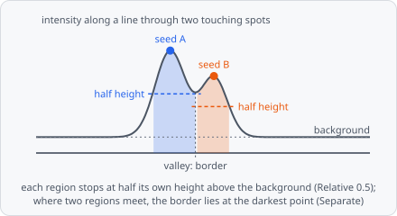

**Grow Regions** grows a region from each seed object through a channel, like a magic wand: for example a spot's outline from its maximum, or a nucleus from a point inside it. Pixels join a region from the seed outwards, and every seed has its own stop level - relative to its own peak and background, so dim and bright objects keep the same shape. Where regions of different seeds meet they are split on the darkest line between them, may overlap, or are merged.

A typical spot pipeline:

[Find Maxima](/commands/segmentation/find-maxima/) → [Extract Objects](/commands/object/extract-objects/) → **Grow Regions**

Each region is a new object of the **Output Class** and keeps its seed's pixels. The seeds stay as they are and the region is not linked to its seed: use [Relate Objects](/commands/object/relate-objects/) for that. The regions' intensities are measured on the raw channels, also with **Smoothing**. To keep the seeds (e.g. the one-pixel maxima) out of the results, give their class the class setting **Results** › **Intermediate** (see [What goes into the results](/guide/classification/#what-goes-into-the-results)).

In a project file it is `GROW_REGIONS`.

## When to use

- **Spots:** give the one-pixel maxima of Find Maxima a size and shape of their own, cut at the same relative height for dim and bright spots (**Order** Intensity, **Stop** Relative 0.5 - the full width at half maximum).
- **Evenly bright objects** (nuclei, organelles) from a seed inside them: **Order** Similarity.
- **Touching objects:** **Separate** splits them on the darkest line between them, as a watershed would, but each region still stops at its own level.

To divide the whole image (or a mask) among seeds, with no stop level - cells around nuclei - use [Propagation](/commands/object/propagation/).

## Parameters

| Parameter | Description |
| --- | --- |
| **Seeds** | Objects of this class are the seeds (e.g. the maxima of Find Maxima after Extract Objects, or nuclei). Each grows into one region. |
| **Growth Channel** | The channel the regions grow through (the raw spot or nucleus stain). |
| **Smoothing** | Smooths the growth channel before growing (noisy images): **None** (default) or **Gaussian**. The growth order, stop level, background and noise then come from the smoothed pixels. |
| **Sigma** | With **Gaussian**: the standard deviation of the Gaussian. Noise smaller than σ no longer stops or splits a region. As a guide, 1-2 px for noisy spots, at most about a quarter of the smallest object's radius (larger blurs the outlines). Default 1, range 0.1-100. |
| **Unit** | With **Gaussian**: unit of **Sigma**, **px** (default) or **nm**. |
| **Objects Are** | **Bright** (default): objects brighter than their background (fluorescence). **Dark**: objects darker than their background (brightfield, stains) - everything below then counts the other way round. |
| **Order** | Which neighbouring pixel joins a region next - see [Order](#order). **Intensity** (default) or **Similarity**. |
| **Stop** | Which pixels may join a region - see [Stop](#stop). **Relative** (default), **Tolerance**, **Threshold** or **Noise**, each with its own value below it. |
| **Max Distance** | How far a region reaches at most from its seed (from the nearest seed pixel). Also where the background is measured: a little more than the largest object's radius. Default 10, range 1-1000. |
| **Distance Unit** | Unit of **Max Distance**: **px** (default) or **nm**. |
| **When Regions Meet** | What happens where regions of different seeds meet - see [When regions meet](#when-regions-meet). **Separate** (default), **Overlap** or **Merge**. |
| **Mask** | Regions only grow into pixels of objects of this class (e.g. the thresholded cells). Unset: everywhere. |
| **Output Class** | The class the grown regions get. |
| **Exclude At Edges** | Discard regions that touch the image border. Off by default. |

**Seeds** and **Output Class** must be set, else the step fails with an error.

### Order

A region grows one pixel at a time: of all pixels next to it, the one the **Order** picks joins next, as long as the **Stop** rule lets it. It is done when no neighbour may join (or **Max Distance** is reached).

| Order | Next pixel |
| --- | --- |
| **Intensity** | The brightest: a region spreads downhill from its peak. For objects with a bright centre that fades out (spots, blobs). |
| **Similarity** | The one closest to the seed's value (the median of the seed's pixels): a region covers what looks like its seed. For evenly bright objects (nuclei, organelles); larger seeds give a steadier value than a single pixel. |

### Stop

The seed's own pixels always belong to its region. For **Relative** and **Noise**, the background is the median of the pixels in a 2 px wide ring just beyond **Max Distance** around the seed, the noise their median absolute deviation × 1.4826.

| Stop | Value | Pixels that may join |
| --- | --- | --- |
| **Relative** | **Fraction**, default 0.5, range 0-1 | A level between the background (0) and the seed (1). 0.5 cuts each region at half its height, so dim and bright objects keep the same shape. Intensity: pixels at or above the level, measured from the region's peak (the brightest pixel the seed reaches without going down). Similarity: pixels closer to the seed's value than (1 - **Fraction**) of its contrast, on either side. A seed not above its background grows nothing. |
| **Tolerance** | **Tolerance** (default 10, range 0-65535) and **Unit** (**bit** default, **%**, **rel**) | The classic magic wand. Intensity: pixels at most **Tolerance** below the region's peak. Similarity: pixels at most **Tolerance** from the seed's value, on either side. |
| **Threshold** | **Level** (default 0, range 0-65535) and **Unit** (**bit** default, **%**, **rel**) | Pixels above one fixed level, the same for every seed. |
| **Noise** | **Noise Factor**, default 3, range 0-100 | Pixels more than **Noise Factor** times the noise above the background: a region covers what stands out from the noise around it - the same factor fits every exposure. |

### When regions meet

| When Regions Meet | Result |
| --- | --- |
| **Separate** | Each pixel goes to one region: the border lies on the darkest line between them (touching spots counted apart). |
| **Overlap** | Every region grows as if it were alone: a pixel may belong to several (e.g. each spot's whole halo). A region may then take in a neighbouring spot if the valley between them stays above its stop level. |
| **Merge** | Regions that meet over a shallow valley become one object (several maxima on one object); regions with a deep valley between them stay apart. **Max Valley** (default 0.2, range 0-1): the deepest valley merged, as a part of the dimmer region's contrast (peak - background) - 0.2 merges regions whose border lies at most 20 % below the dimmer peak. Two objects only touching at their stop level never merge below 1 - the stop fraction. A merged region is given to the first of its seeds. |

## How it works

Pixels join a region in a priority order from the seed outwards (seeded region growing, Adams & Bischof 1994), through the 8 neighbours of each pixel: the brightest first with **Intensity** (a flooding from markers as in Vincent & Soille 1991), the most similar to the seed first with **Similarity**. A pixel joins only if the **Stop** rule accepts it and it lies within **Max Distance** of the seed. With **Tolerance** and **Intensity**, a region is the support of its peak's h-dome (Vincent 1993).

**How seeds compete.** Each seed is flooded on its own, inside **Max Distance** of it. A pixel's score for a seed is the best path to it: the highest of the lowest brightness along the path (Intensity), or the lowest of the largest difference to the seed's value (Similarity). With **Separate** a pixel goes to the seed scoring best on it (then the nearer one, then the first in image order), and each region keeps the pixels connected to its seed. Because the result is defined per pixel from the seeds near it, it doesn't depend on how the image is split up.

**Smoothing.** With **Gaussian**, the growth channel is smoothed with the discrete Gaussian (Lindeberg 1998) before growing, mirrored at the image's border. Every pixel gets the value it would get from smoothing the whole image.

The step runs on the whole image at once, so a region can grow across tile borders. **Exclude At Edges** checks the border of the image, not of a tile.

## Limitations

- Seeds 1024 px across or more (a tissue-sized object) don't grow: their region is the seed.
- No sub-pixel outlines: a region is a set of whole pixels.
- **Relative** and **Noise** measure the background just beyond **Max Distance**: if other objects lie there, the background comes out too high. Choose **Max Distance** a little larger than the largest object's radius.

## References

- Adams R. & Bischof L., "Seeded Region Growing," _IEEE Transactions on Pattern Analysis and Machine Intelligence_, vol. 16, pp. 641-647, 1994. [doi:10.1109/34.295913](https://doi.org/10.1109/34.295913)
- Vincent L. & Soille P., "Watersheds in Digital Spaces: An Efficient Algorithm Based on Immersion Simulations," _IEEE Transactions on Pattern Analysis and Machine Intelligence_, vol. 13, pp. 583-598, 1991. [doi:10.1109/34.87344](https://doi.org/10.1109/34.87344) - with **Order** Intensity.
- Vincent L., "Morphological Grayscale Reconstruction in Image Analysis: Applications and Efficient Algorithms," _IEEE Transactions on Image Processing_, vol. 2, pp. 176-201, 1993. [doi:10.1109/83.217222](https://doi.org/10.1109/83.217222) - with **Stop** Tolerance and **Order** Intensity.
- Hampel F. R., "The Influence Curve and Its Role in Robust Estimation," _Journal of the American Statistical Association_, vol. 69, pp. 383-393, 1974. [doi:10.1080/01621459.1974.10482962](https://doi.org/10.1080/01621459.1974.10482962) - with **Stop** Noise.
- Lindeberg T., "Feature Detection with Automatic Scale Selection," _International Journal of Computer Vision_, vol. 30, pp. 79-116, 1998. [doi:10.1023/A:1008045108935](https://doi.org/10.1023/A:1008045108935) - with **Smoothing** Gaussian.

The step always cites Adams & Bischof and the others only with the settings named; see [Citation](/citation/#citing-the-algorithms-you-used) for exporting the citations of a project.
