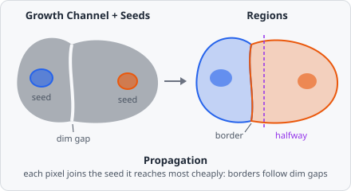

**Propagation** grows one region around each seed object (typically a nucleus) through a channel (typically a cell or membrane stain). Every pixel goes to the seed it can be reached from at the lowest cost, and a step costs more the more the stain's brightness changes along it. So the border between two touching cells falls on the dim gap between them, not halfway between their nuclei.

The method is a port of CellProfiler's Propagation (IdentifySecondaryObjects, Jones, Carpenter & Golland 2005), with the same step cost, the same 8 neighbours and the same order of equally cheap pixels, so the same image gives the same regions.

Each region is a new object of the **Output Class**. The seeds stay as they are, and the region is not linked to its seed: use [Relate Objects](/commands/object/relate-objects/) for that (for example, **Children** = the nuclei, **Parents** = the grown cells), which then gives the nucleus of each cell in the [results](/guide/results/#list-view).

## Parameters

| Parameter            | Description                                                                                                                                  |
| -------------------- | -------------------------------------------------------------------------------------------------------------------------------------------- |
| **Seeds**            | Objects of this class are the seeds (e.g. nuclei). Each grows into one region.                                                              |
| **Growth Channel**   | The channel the regions grow through (e.g. the cell or membrane stain).                                                                     |
| **Mask**             | Regions only cover pixels of objects of this class (e.g. the thresholded cell stain). Unset: the whole image.                              |
| **Regularization**   | λ, how much plain distance counts against the change in brightness. Larger values split more by distance, `0` by brightness only. Default `0.05`. |
| **Output Class**     | The class the grown regions get.                                                                                                             |
| **Exclude At Edges** | Discard regions that touch the image border.                                                                                                |

## How it works

The channel is used with its values normalised to 0 to 1. Starting from the seed pixels (cost 0), the regions grow one pixel at a time, always taking the cheapest pixel next (like Dijkstra's shortest path). A pixel that has been taken is not given to another seed.

The cost of a step from pixel _a_ to one of its 8 neighbours _b_ combines the brightness change with the distance:

$$
\text{cost}(a, b) = \sqrt{\Delta^2 + \lambda^2 \, d_{\text{M}}(a, b)}
\qquad
\Delta = \sum_{3 \times 3} \left| I_a - I_b \right|
$$

- $\Delta$ is the summed absolute difference between the 3 × 3 neighbourhoods around _a_ and _b_ (past the image border, the border pixels are repeated). It is large where the stain changes, for example across a dark gap between two cells.
- $d_{\text{M}}$ is the Manhattan distance of the step: 1 to the side, 2 diagonally.
- $\lambda$ is **Regularization**. With $\lambda = 0$, only brightness changes cost and a flat stain gives no direction. With a large $\lambda$, distance dominates and the split comes close to a split by distance from the edges of the seeds.

A pixel's cost is the sum of the step costs along the cheapest path to it, and it goes to the seed of that path.

**Stopping.** Growth stops where there is nothing left to take:

- With a **Mask**, regions only grow into pixels of the mask's objects. Background that is not in the mask is never assigned, and a part of the mask that is not connected to any seed stays empty. There is no intensity threshold in the command itself: threshold the cell stain first (e.g. with [Threshold](/commands/segmentation/threshold/)) and use that class as the **Mask**.
- Without a mask, every pixel of the image goes to some seed.
- A pixel that is not a number (NaN) in the channel is never grown into.

**Ties.** Pixels reached at exactly the same cost go to the seed created first, then the earlier pixel in reading order, as in CellProfiler. Where seeds overlap, the overlapping pixels go to the seed created first.

**Seeds.** Each region keeps all its seed's pixels, even pixels outside the mask. A seed that lies completely outside the mask does not grow: its region is just the seed itself.

The regions are measured like any other object (area, shape, and the intensity of every channel). The command runs on the whole image at once, so a region can grow across tile borders. **Exclude At Edges** checks the border of the image, not of a tile.

## Limitations

- No intensity threshold or maximum distance: limit the growth with a **Mask**.
- Only the regions are created. The cytoplasm (cell minus nucleus) is not; use [Object Math](/commands/object/object-math/) for it.
