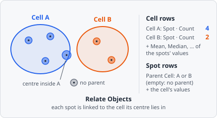

**Relate Objects** links each child object (e.g. a spot) to the parent object it belongs to (e.g. its cell). A child gets at most one parent of each parent class, so a spot can belong to a cell and to a tissue region at the same time.

It is the only step that links objects. The links are stored with each child, and the [results](/guide/results/#list-view) work out from them, per parent, how many children it has and the mean, median, ... of their measurements, and show the parent's values next to each child. It works like CellProfiler's RelateObjects.

## Parameters

| Parameter                            | Description                                                                                                       |
| ------------------------------------ | ----------------------------------------------------------------------------------------------------------------- |
| **Children**                         | The classes of the objects to link to a parent (e.g. spots). Several can be chosen.                              |
| **Parents**                          | The classes of the objects they belong to (e.g. Cell). A child gets at most one parent of each.                  |
| **A child belongs to the parent if** | How a child is matched to a parent: **Its centre is in the parent** (default) or **It overlaps the parent most**. |
| **Remove children without a parent** | Remove the children that don't get a parent of every chosen parent class (e.g. keep only the spots inside cells). |

## How it works

For every child and every parent class, the parent is chosen among the objects of that class whose bounding box overlaps the child's:

- **Its centre is in the parent**: the child's centre of mass (the mean position of its pixels, see [Centroid](/fundamentals/metrics/)) is rounded to the nearest pixel, and the child goes to the parent that has this pixel in its mask. Robust for small children such as spots in a cell.
- **It overlaps the parent most**: the child goes to the parent it shares the most pixels with. A parent it doesn't overlap at all is never chosen. For children whose centre can lie outside themselves, such as crescents or the overlap regions of [Colocalization](/commands/object/colocalization/).

If two parents qualify equally (they overlap each other, or have the same overlap), the one that comes first in reading order wins: the one whose first pixel lies higher in the image, then further left. So the link is the same in every run.

An object is never its own parent. It may be a child and a parent at the same time, for example a nucleus linked to its cell and the parent of its spots.

**Re-linking.** A child that already has a parent of one of the chosen parent classes (from an earlier Relate Objects) is linked anew. If no parent of that class matches now, the old link is removed. Links to other parent classes are kept.

With **Remove children without a parent**, a child that ends up without a parent of one or more of the chosen parent classes is deleted.

## In the results

Once objects are linked, the [List View](/guide/results/#list-view) gets two more groups in its settings:

- **Children**: one entry per linked pair, e.g. _Spot in Cell_. Ticking it adds columns to the parent's rows: the number of its children (**Spot · Count**, 0 for a cell without spots) and, for every ticked value column, an aggregate of the children's values (**Spot · Mean · Area [px]**). **Of the columns** picks the aggregates: **Average** (default), **Minimum**, **Maximum**, **Std Dev**, **Sum**, **Median** or **Skewness**. A parent without children has no aggregate.
- **Linked objects**: one entry per parent class, e.g. _Parent · Cell_. Ticking it adds columns to the child's rows: the parent's object ID (**Parent Cell**) and the parent's value of every ticked value column (**Parent Cell · Area [px]**), e.g. the cell's area next to each spot.

The object details beside the image list an object's **Parent** and **Children**.

In the exported results database, each object stores its links in `parent_ids`, a map from parent class to parent object ID. A child without a parent of a class has no entry for it.

:::note
Relate Objects replaces the earlier **Parent Object ID**, which some commands set on their own. Today only Relate Objects links objects; its link per parent class takes that place.
:::

[Measure Object Distance To Parent](/commands/measure/measure-distance-to-parent/) measures how far each child lies from its parent. [Propagation](/commands/object/propagation/) grows cells from nuclei; relate them afterwards to get each cell's nucleus.

## Limitations

- One parent per parent class: a child that overlaps two cells is counted in one of them only.
