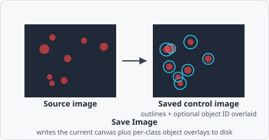

The **Save Image** command writes a **control image** to disk: the image at this point of the pipeline, optionally with the objects of selected classes drawn on top. Control images are useful for checking segmentation quality outside EVAnalyzer, or for figures.

Save Image is a transparent step: it doesn't change the image, so the steps after it work on the same data as without it.



## Parameters

| Parameter           | Description                                                                                                                                         |
| ------------------- | --------------------------------------------------------------------------------------------------------------------------------------------------- |
| **Name**            | File name of the control image (without extension).                                                                                                 |
| **Display Classes** | Object classes to draw on top of the image. Empty: the image is saved as it is.                                                                     |
| **Source**          | _(advanced)_ What to save: **Image** (the current image, default), **Instance Map** or **Segmentation Mask** - both colored, one color per label. |
| **Opacity**         | _(advanced)_ Opacity of the filled objects in percent: **0** draws only the contours, **100** solid fills. Contours are always drawn opaque.        |

## Drawing objects

Every object of a selected class is drawn in its **class color**: the area filled with the chosen opacity, the contour opaque. All fills are drawn before any contour, so a neighbour's fill never hides a contour. An object that carries several of the selected classes is drawn in the color of the first one in **Display Classes**.

Objects are drawn as they are when the step runs - add Save Image after the steps that create or classify the objects you want to see.

## Output

Control images are written as 8-bit PNG files into the analysis output folder, one folder per source image:

```
<project folder>/results/<date>__<job_name>/images/<image path without extension>/<name>_x<offset>_y<offset>.png
```

Large images are analysed in tiles, and Save Image writes one file per tile. `x` and `y` are the tile's offset in the image (zero-padded to six digits), so the files sort in tile order and the whole image can be put back together from them. Images that fit in one tile get a single file, `<name>_x000000_y000000.png`.

Gray images are saved as gray PNGs, RGB images as RGB; any drawn objects make the file RGB.
