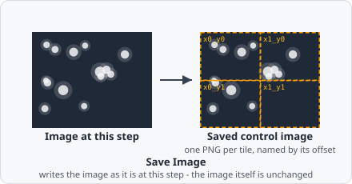

The **Save Image** command writes a **control image** to disk: the image at this point of the pipeline. Control images are useful for checking preprocessing and segmentation outside EVAnalyzer, or for figures.

Save Image is a transparent step: it doesn't change the image, so the steps after it work on the same data as without it. It belongs to the **Utility** category: it fits anywhere in a pipeline, the command picker always lists it, and the step after it looks past it (see [Command categories](/commands/overview/#command-categories)).



## Parameters

| Parameter           | Description                                                                                                                                         |
| ------------------- | --------------------------------------------------------------------------------------------------------------------------------------------------- |
| **Name**            | File name of the control image (without extension). It may not contain a folder (`/`, `\`, `..`, a drive like `C:`) - the step then stops with an error and writes nothing. |
| **Source**          | _(advanced)_ What to save: **Image** (the current image, default), **Instance Map** or **Segmentation Mask** - both colored, one color per label. |

## Objects

Save Image doesn't draw objects. It runs once per tile, before the steps that work on the whole image (Classify Objects, Propagation, the merge of objects across tiles, …), so it would miss their objects. To get images with the final objects drawn on top, export them from the results - **Images with objects drawn (PNG)** in the export dialog (see [Exporting Results](/guide/results/#exporting-results)).

## Output

Control images are written as 8-bit PNG files into the analysis output folder, one folder per source image:

```
<project folder>/results/<date>__<job_name>/images/<image path without extension>/<name>_x<offset>_y<offset>.png
```

Large images are analysed in tiles, and Save Image writes one file per tile. `x` and `y` are the tile's offset in the image (zero-padded to six digits), so the files sort in tile order and the whole image can be put back together from them. Images that fit in one tile get a single file, `<name>_x000000_y000000.png`.

Gray images are saved as gray PNGs, RGB images as RGB. **Instance Map** and **Segmentation Mask** are saved colored, one color per label.
