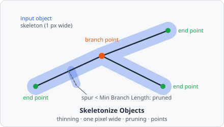

**Skeletonize Objects** reduces each object of a class to its 1-pixel-wide centre line, its **skeleton** - the first step of filament analysis (neurites, vessels, fibres). Each object gets one skeleton object; its branch points and end points can become 1-pixel objects of their own classes. Short side branches (spurs) that a ragged outline leaves are pruned.

A typical pipeline:

[Threshold](/commands/segmentation/threshold/) → [Extract Objects](/commands/object/extract-objects/) → **Skeletonize Objects** → [Relate Objects](/commands/object/relate-objects/) → [Measure Object Skeleton](/commands/measure/measure-object-skeleton/)

For thin or faint fibres, [Vesselness](/commands/edge-detection/vesselness/) before the threshold helps. In a project file it is `SKELETONIZE_OBJECTS`.

The input objects stay as they are. The skeletons and points are new objects without a parent: to link a skeleton to the object it was made of, or the points to their skeleton, use [Relate Objects](/commands/object/relate-objects/). [Measure Object Skeleton](/commands/measure/measure-object-skeleton/) needs that link for its diameter.

## Parameters

| Parameter              | Description                                                                                                                               |
| ---------------------- | ----------------------------------------------------------------------------------------------------------------------------------------- |
| **Input Class**        | The objects that are skeletonized (e.g. the thresholded neurites).                                                                        |
| **Skeleton Class**     | The class the skeletons get, one per input object.                                                                                        |
| **Branch Point Class** | The class the branch points get, one 1-pixel object each. Unset (default): none are created.                                             |
| **End Point Class**    | The class the end points get, one 1-pixel object each. Unset (default): none are created.                                                 |
| **Min Branch Length**  | Side branches shorter than this, from their end point to the branch point, are removed (0 to 100000, default 5). 0: none are removed.     |
| **Length Unit**        | Unit of **Min Branch Length**: **px** (default) or **nm**.                                                                                |

Without an **Input Class** or a **Skeleton Class** the step does nothing.

## How it works

Each object is processed on its own, in four steps.

### 1. Thinning

Border pixels are peeled off in parallel passes, two sub-iterations each, until none can be removed (Guo & Hall's algorithm A1). A pixel $P$ with the neighbours $p_2 \dots p_9$ (clockwise from north) is removed when

- removing it keeps its neighbours connected: $C(P) = 1$, the number of 8-connected groups among its neighbours;
- it is a border pixel and not an end point: $2 \le N(P) \le 3$, where $N(P)$ counts neighbour pairs;
- the sub-iteration's side condition holds: in the first, not $(p_6 \lor p_7 \lor \lnot p_9) \land p_8$; in the second, not $(p_2 \lor p_3 \lor \lnot p_5) \land p_4$.

The shape's parts and holes are kept: an object with a hole gives a skeleton with a loop.

### 2. Thin to one pixel

Thinning can leave 4-connected staircases on diagonal lines. Their corner pixels - with exactly two 4-neighbours at a right angle - are removed in row order where the neighbours stay connected. Otherwise every corner would count as a branch point. The centre of a T (three 4-neighbours) and end points stay.

### 3. Pruning

From each end point the line is followed to the first pixel with three or more neighbours. Its length counts 1 px per step to a 4-neighbour and $\sqrt{2}$ per diagonal step. A spur shorter than **Min Branch Length** is removed. If every arm of a branch point is such a short spur, the longest one stays. A line with an end point at both ends is never pruned, nor is a spur that runs into a loop. After removing spurs, steps 1 and 2 run again (so no stub stays where a spur was attached), and pruning repeats until nothing changes.

**Min Branch Length** in nm is divided by the pixel size (the mean of its x and y size); without a pixel size it is taken as pixels.

### 4. Points

- **End points** are the skeleton pixels with exactly one neighbour.
- **Branch points** are the skeleton pixels with three or more neighbours. Neighbouring ones (8-connected) form one branch point, placed at its pixel nearest the group's centre.

A skeleton that is a single pixel (e.g. of a 2 × 2 square) has neither.

The skeleton, branch point and end point objects keep the input object's plane and segmentation class. Like any object, they get their intensities measured on their own pixels and the usual [object metrics](/fundamentals/metrics/).

The thinning algorithm is from Z. Guo and R. W. Hall, "Parallel Thinning with Two-Subiteration Algorithms," _Communications of the ACM_, vol. 32, no. 3, pp. 359-373, 1989, [doi:10.1145/62065.62074](https://doi.org/10.1145/62065.62074).

## Limitations

- 2D only.
- An input object made of several pieces gives one skeleton object with several pieces.
- The step runs on the whole image at once, so objects across tile borders are skeletonized as a whole. It needs one bit per pixel of each object's bounding box, so even tissue-sized objects fit.
