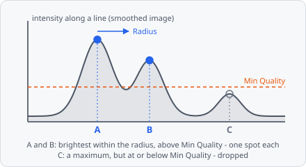

**Find Maxima** finds spots as **local maxima**: every pixel with no brighter pixel within **Radius** becomes one object of a single pixel. The image's value at the maximum is its **quality**; maxima at or below a cut-off are dropped. Use it for small, round spots (vesicles, foci, particles) that touch or lie close together, in place of [Threshold](/commands/segmentation/threshold/) + [Connected Components](/commands/segmentation/connected-components/) + [Watershed](/commands/segmentation/watershed/).

In a project file it is `FIND_MAXIMA`.

It works best on an image smoothed at the size of the spots, e.g. with [Gaussian Blur](/commands/image-processing/gaussian-blur/), or on the result of a spot filter - [Laplacian of Gaussian](/commands/edge-detection/laplacian-of-gaussian/), [Difference of Gaussians](/commands/edge-detection/difference-of-gaussians/) or [Wavelet Spots](/commands/edge-detection/wavelet-spots/), which also remove the background: each spot is then one peak. A typical spot pipeline:

**Laplacian of Gaussian** (or **Gaussian Blur**) → **Find Maxima** → [Extract Objects](/commands/object/extract-objects/) → [Transform Objects](/commands/object/transform-objects/) (**Draw circle**)

Find Maxima writes the segmentation and one instance per maximum, so [Extract Objects](/commands/object/extract-objects/) can follow directly. The image itself stays as it is. The spots are one pixel each; give them a size afterwards with **Draw circle**, or grow each one into its own outline with [Grow Regions](/commands/object/grow-regions/).

One-pixel objects are hard to see when zoomed out: wherever a one-pixel object is smaller on screen than 5 px, it is drawn as a **dot** of 5 px (fill and outline like every object), and a click on the dot selects it. This is display only; the object stays one pixel.

## Parameters

| Parameter | Description |
| --- | --- |
| **Radius** | A pixel is a maximum only if no pixel within this radius is brighter. About half the spot diameter: smaller finds several maxima per spot, larger merges neighbouring spots into one. Default 2, range 1-1000. |
| **Radius Unit** | Unit of **Radius**: **px** (default) or **nm**. |
| **Cutoff** | How the quality cut-off is chosen: **Manual** (default), **Otsu** or **Noise** - see [Cutoff](#cutoff). |
| **Noise Factor** | With **Noise**: how many times the noise a maximum must lie above the background. 3 keeps few noise peaks, 5 hardly any; lower finds fainter spots and more noise. Default 3, range 0-100. |
| **Min Quality** | Maxima with a quality at or below this value are dropped. With **Otsu** and **Noise**: the lowest cut-off. Default 0. |
| **Quality Unit** | _(advanced)_ Unit of **Min Quality**: **bit** (default, 0-255 or 0-65535), **%** (0-100) or **rel** (0-1). |
| **Inside Segmentation** | Only maxima on pixels of the current segmentation count (any class, e.g. from a [Threshold](/commands/segmentation/threshold/) before). Brighter pixels outside it still suppress maxima within the radius. Off by default. |
| **Exclude At Edges** | Drop maxima closer to the image border than the radius. Off by default. |
| **Segmentation Class** | The segmentation class the maxima get. |

## How it works

1. **Peaks:** a pixel is a peak if no pixel within **Radius** is brighter - all pixels with $dx^2 + dy^2 \le r^2$. With **nm**, $r$ is **Radius** divided by the mean pixel size of x and y; without a pixel size, nm are taken as pixels. $r$ is at least 1, so the four direct neighbours always count.
2. **Plateaus:** neighbouring pixels of equal value (8-connected) form a plateau. It is a maximum only if every pixel of it is a peak, and the pixel nearest the plateau's centre stands for it. A flat region with no darker pixel next to it - a background of 0, a flat image - is never a maximum.
3. **Equal maxima:** of two equal maxima within the radius, the one found first (row by row) is kept. With **Inside Segmentation**, a maximum on a pixel outside the segmentation is dropped here.
4. **Edges:** with **Exclude At Edges**, maxima closer than $r$ to the image border are dropped.
5. **Quality:** maxima whose value is above the cut-off are kept ($>$, like Threshold's minimum).

The segmentation and the instance map are cleared first, then each maximum is written with **Segmentation Class** and its own instance (1, 2, … row by row).

### Cutoff

| Cutoff | Cut-off |
| --- | --- |
| **Manual** | **Min Quality**. |
| **Otsu** | Otsu's method on the qualities of all maxima found - 256 bins between the lowest and the highest quality - splits spots from noise peaks. **Min Quality** stays the lowest cut-off, so an image without spots doesn't turn its noise into spots. With fewer than two different qualities there is nothing to split: **Min Quality** is used. |
| **Noise** | background + **Noise Factor** × noise, at least **Min Quality**. The background is the median of all pixels of the image this step gets, the noise their median absolute deviation × 1.4826 (the standard deviation for normally distributed noise); pixels that are not a number are skipped. Background and noise scale with the exposure, so the same factor fits every exposure. After a blur or spot filter the noise of the filtered image counts. |

**Noise** assumes the spots cover less than half the image - otherwise they raise the background.

In a project file the cut-off is a tagged value: `{"type": "MANUAL"}`, `{"type": "OTSU"}` or `{"type": "NOISE", "noiseFactor": 3}`.

The detection - local maxima within a radius, then a brightness cut-off - is the one Sbalzarini & Koumoutsakos (2005) describe for particles; the step cites it, Otsu (1979) with **Otsu**, and Hampel (1974) - the noise as scaled median absolute deviation - with **Noise**.

## References

- Sbalzarini I. F. & Koumoutsakos P., "Feature point tracking and trajectory analysis for video imaging in cell biology," _Journal of Structural Biology_, vol. 151, pp. 182-195, 2005. [doi:10.1016/j.jsb.2005.06.002](https://doi.org/10.1016/j.jsb.2005.06.002)
- Otsu N., "A Threshold Selection Method from Gray-Level Histograms," _IEEE Trans. Systems, Man, and Cybernetics_, vol. 9, no. 1, pp. 62-66, 1979. [doi:10.1109/TSMC.1979.4310076](https://doi.org/10.1109/TSMC.1979.4310076)
- Hampel F. R., "The Influence Curve and Its Role in Robust Estimation," _Journal of the American Statistical Association_, vol. 69, pp. 383-393, 1974. [doi:10.1080/01621459.1974.10482962](https://doi.org/10.1080/01621459.1974.10482962)

## Limitations

- Each spot is one pixel at its maximum: no size, no sub-pixel position.
- It replaces the segmentation of the steps before - **Inside Segmentation** only uses it to choose the maxima.
- Whole slides are searched tile by tile, and a tile doesn't see the pixels of its neighbours. A spot right on the border between two tiles can be found in both: two spots, which [cross-tile merging](/fundamentals/cross-tile-merging/) only joins if their pixels touch. Images small enough to be one tile are not affected.
- On a whole slide, **Otsu** takes the maxima of each tile and **Noise** the pixels of each tile, not of the whole image.
