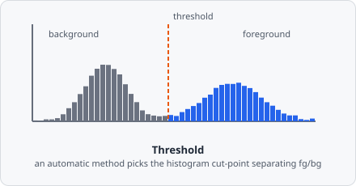
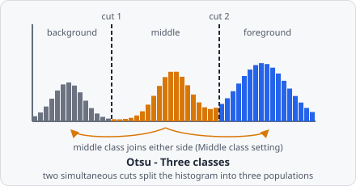

The **Threshold** command is the primary segmentation step. It converts a greyscale image to a binary mask: pixels with intensity below the minimum threshold become 0 (background); pixels above become 65535 (foreground).

The output of Threshold feeds directly into [Connected Components](/commands/segmentation/connected-components/).

## Single threshold

Define one threshold entry to produce a simple binary mask:

| Parameter         | Description                                                                 |
| ----------------- | --------------------------------------------------------------------------- |
| **Method**        | _Manual_ or one of the auto-threshold algorithms                            |
| **Min threshold** | Minimum intensity to include as foreground                                  |
| **Max threshold** | Maximum intensity to include as foreground (set to 65535 to disable)        |
| **Unit**          | Intensity unit (_Absolute_ 0–65535, _Percent_ 0–100, or _Relative_ 0–1)     |
| **Object class**  | The segmentation class assigned to objects detected by this threshold entry |
| **Value source**  | Which image the threshold *value* is calculated from - see [Value source](#value-source) below |

:::tip
Examine the image histogram to choose a starting value for the minimum threshold. Set it just above the highest background pixel intensity.
:::

:::caution
Always set a **minimum threshold greater than zero** even when using an auto-threshold method. Control images containing only background noise will otherwise produce false-positive detections.
:::

## Value source

By default, the threshold value is calculated from the same image it's applied to (**Actual image**) - the historical behaviour. Two alternatives let you calculate the cut-off from a *different* image than the one being segmented, mirroring CellProfiler's ability to compute a threshold on one image (e.g. the raw, unblurred image) and apply it to another:

| Option | Description |
|---|---|
| **Actual image** | Calculate from the pipeline's current image - the same image the threshold is applied to |
| **Raw image** | Calculate from the unedited image this channel started the pipeline with, ignoring any preprocessing (blur, illumination correction, …) applied so far |
| **Memory** | Calculate from a snapshot stored earlier in the pipeline via [Image Cache](/commands/image-processing/image-cache/), addressed by its memory slot |

Whichever image the value is calculated from, the resulting cut-off is always applied against the pipeline's actual current image - only where the *number* comes from changes.

## Multiple threshold classes

Click **+ Add** to define additional threshold entries for the same image. Each entry uses a different intensity range and assigns a different segmentation class, allowing two or more object populations to be detected from one image in a single step.

Under the hood, each threshold class maps to a distinct greyscale value in the binary output (65535 for the first class, decrementing for subsequent classes). [Connected Components](/commands/segmentation/connected-components/) and [Extract Objects](/commands/object/extract-objects/) use these values to distinguish the populations.

## Auto-threshold algorithms

When **Method** is not _Manual_, EVAnalyzer builds a 256-bin histogram of the image - stretched from the darkest to the brightest pixel actually present, so the methods get the full bin resolution whatever the bit depth - and computes the threshold from it. Every method is implemented from its original paper (the step cites it); where a paper leaves a detail open, the choice is stated below. The bin the method returns and everything below it is background; foreground starts at the lower edge of the next bin, so every pixel value counted into that next bin is foreground. Each method makes a different assumption about what separates foreground from background, so the "best" method depends on the shape of your histogram:

| Method | How the threshold is found | Reference |
| --- | --- | --- |
| **Otsu** | The cut that maximises the between-class variance (= minimises the variance within the two classes) - the most widely used general-purpose method. Supports two- or [three-class](#otsu-two-vs-three-classes) splitting. Ties go to the lowest bin, so in an empty gap between two populations the cut lands at the end of the lower one. | Otsu, "A Threshold Selection Method from Gray-Level Histograms," *IEEE Trans. SMC*, vol. 9, no. 1, pp. 62-66, 1979 |
| **Li** | Minimum cross entropy between the image and its two-level version (every pixel replaced by its class mean), found with Li & Tam's iteration $t = (\mu_b - \mu_a) / (\ln \mu_b - \ln \mu_a)$, starting at the mean, until $t$ moves by less than half a bin. Gray levels are counted 1-256, as in Li & Lee (§3) - the criterion uses $\ln$, so this shift matters. | Li & Lee, "Minimum Cross Entropy Thresholding," *Pattern Recognition*, vol. 26, no. 4, pp. 617-625, 1993; Li & Tam, "An Iterative Algorithm for Minimum Cross Entropy Thresholding," *Pattern Recognition Letters*, vol. 19, no. 8, pp. 771-776, 1998 |
| **MinError** | Models the histogram as two normal distributions and moves the cut to where the two weighted densities are equal (the minimum-error boundary), step by step from the mean, until it stops changing. | Kittler & Illingworth, "Minimum Error Thresholding," *Pattern Recognition*, vol. 19, no. 1, pp. 41-47, 1986; Glasbey 1993 |
| **Triangle** | A line from the histogram's peak to the far end of its longer tail; the threshold is the bin where the histogram lies furthest below the line. Best for one dominant peak with a long tail. | Zack, Rogers & Latt, "Automatic Measurement of Sister Chromatid Exchange Frequency," *J. Histochem. Cytochem.*, vol. 25, no. 7, pp. 741-753, 1977 |
| **Moments** | Replaces the image by a two-level image that keeps the first three moments of the histogram; the threshold is the cut whose background fraction is nearest to that image's. | Tsai, "Moment-Preserving Thresholding: A New Approach," *Computer Vision, Graphics, and Image Processing*, vol. 29, no. 3, pp. 377-393, 1985; Glasbey 1993 |
| **Huang** | The cut whose image is least "fuzzy": each gray level belongs to its class by its distance to the class mean, and the summed fuzziness (Shannon's function of the memberships) is minimised. The exact class means are used. | Huang & Wang, "Image Thresholding by Minimizing the Measures of Fuzziness," *Pattern Recognition*, vol. 28, no. 1, pp. 41-51, 1995 |
| **Intermodes** | Smooths the histogram (three-bin running mean, repeated) until it has exactly two peaks; the threshold is halfway between them. | Prewitt & Mendelsohn, "The Analysis of Cell Images," *Annals of the New York Academy of Sciences*, vol. 128, no. 3, pp. 1035-1053, 1966 |
| **IsoData** | Starting at the mean, the threshold is replaced by the average of the two class means until the split no longer changes - it ends halfway between the mean background and the mean foreground. | Ridler & Calvard, "Picture Thresholding Using an Iterative Selection Method," *IEEE Trans. SMC*, vol. 8, no. 8, pp. 630-632, 1978 |
| **MaxEntropy** | The cut whose background and foreground, each taken as its own distribution, have the largest summed Shannon entropy. | Kapur, Sahoo & Wong, "A New Method for Gray-Level Picture Thresholding Using the Entropy of the Histogram," *Computer Vision, Graphics, and Image Processing*, vol. 29, no. 3, pp. 273-285, 1985 |
| **Mean** | The mean gray level of all pixels. | Glasbey, "An Analysis of Histogram-Based Thresholding Algorithms," *CVGIP: Graphical Models and Image Processing*, vol. 55, no. 6, pp. 532-537, 1993 |
| **Minimum** | Smooths the histogram as Intermodes until it has two peaks; the threshold is the bottom of the valley between them. | Prewitt & Mendelsohn 1966; Glasbey 1993 |
| **Percentile** | The p-tile with p = 50 %: the cut whose background share is closest to half of the pixels (for a smooth histogram the median). In a saturated image, where one bin holds more than half of the pixels, it still separates that bin from the rest. | Doyle, "Operations Useful for Similarity-Invariant Pattern Recognition," *J. ACM*, vol. 9, no. 2, pp. 259-267, 1962 |
| **RenyiEntropy** | Three maximum-entropy cuts - Rényi entropy of order 0.5, 1 (= MaxEntropy) and 2 (= Yen) - combined into one weighted average. | Sahoo, Wilkins & Yeager, "Threshold Selection Using Renyi's Entropy," *Pattern Recognition*, vol. 30, no. 1, pp. 71-84, 1997 |
| **Shanbhag** | Each gray level belongs to its class more surely the further it is from the cut; the threshold is the cut where both classes carry the same information. | Shanbhag, "Utilization of Information Measure as a Means of Image Thresholding," *CVGIP: Graphical Models and Image Processing*, vol. 56, no. 5, pp. 414-419, 1994 |
| **Yen** | The cut maximising the summed "correlation" $-\ln \sum p_i^2$ of the two class distributions (their Rényi entropy of order 2). | Yen, Chang & Chang, "A New Criterion for Automatic Multilevel Thresholding," *IEEE Trans. Image Processing*, vol. 4, no. 3, pp. 370-378, 1995 |
| **RobustBackground** | Trims outliers from a clean, low background, then sets the threshold a fixed number of deviations above it - see [Robust Background parameters](#robust-background-parameters). Works on the exact pixel values, not the histogram. | A port of CellProfiler's "Robust Background" method |

An image with fewer than two occupied histogram bins has nothing to split: every method then returns its lowest bin.

:::note[Changed in this version]
The automatic methods were rewritten from their original papers. Projects analysed with an earlier version can give slightly different masks when run again:

- **Every method:** foreground now starts at the lower edge of the bin above the cut, as in the papers. Before, pixels in the lower half of that bin were background - so masks now gain those pixels.
- **Li** also counts gray levels 1-256 as in the paper; it can move by about one gray level (and now gives a sensible threshold on some images where it used to fail).
- **Triangle**, **IsoData**, **RenyiEntropy** and **Moments** usually move by one gray level; **Huang** and **Minimum** rarely differ.
- **MinError** can move by a few gray levels, as it now always settles in a minimum of its error criterion - check projects that use it.

One gray level is 1/255 of the image's intensity range; the foreground area typically changes by less than 1 %. To compare with earlier results exactly, keep the previous version for projects already analysed.
:::

Auto-thresholds can fail on empty images (no objects, only noise) because they always find a separation. Prevent this by setting a non-zero **Min threshold** as a lower bound: if the computed value falls below it, EVAnalyzer uses the minimum instead.

### Otsu: two vs. three classes

By default Otsu makes one cut, splitting the histogram into two populations (background/foreground) - the classic behaviour. Switching **Classes** to **Three** jointly searches for *two* simultaneous cuts instead, splitting the histogram into three populations (e.g. background, a dim middle population, and bright foreground), then uses **Middle class** to decide which side of the split the middle-intensity population joins:

| Middle class | Effect |
|---|---|
| **Background** (default) | The middle population is folded into the background - use this to exclude a dim "haze" population from detection |
| **Foreground** | The middle population is folded into the foreground - use this when dim objects should still count |

This mirrors CellProfiler's "Two-class or three-class thresholding?" and "Assign pixels in the middle intensity class to the foreground or the background?" options, and is useful when a simple two-class Otsu keeps picking up a dim mid-brightness population (haze, out-of-focus signal) that neither belongs cleanly to background nor foreground.

### Robust Background parameters

| Parameter | Description |
|---|---|
| **Lower outlier fraction** | Fraction of the darkest pixels trimmed from the population before computing background statistics (default 0.05) |
| **Upper outlier fraction** | Fraction of the brightest pixels trimmed before computing background statistics (default 0.05) |
| **Averaging method** | _Mean_ or _Median_ of the trimmed background population |
| **Deviations above average** | How many standard deviations (for Mean) or MADs (for Median) above the trimmed average the threshold is set (default 2.0) |

Well suited to images with a clean, low background and sparse foreground: trimming outliers from both ends keeps bright foreground pixels from dragging the background estimate upward, unlike histogram-based auto-methods that assume a specific histogram shape.

## Maximum threshold

Setting **Max threshold** to a value below 65535 restricts detection to pixels within the `[min, max]` range. This allows extraction of a specific intensity band - for example to separate bright artefacts from dim objects, or to extract the background itself by setting Min to 0 and Max to just below the signal level.
