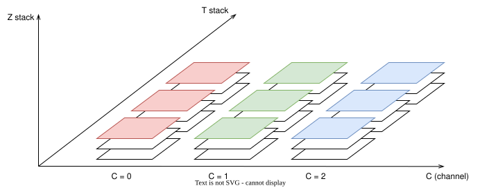
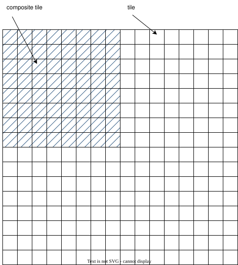

EVAnalyzer reads images through [scopeio](https://github.com/evanalyzer/scopeio), a pure-Rust reader for microscopy and whole-slide images built into the application - no Java needed.
Samples of 8, 16 and 32 bits (unsigned or signed) and 32/64-bit floating point are read, greyscale or RGB. When a file declares fewer significant bits than its sample type holds (e.g. 12-bit data stored as 16-bit), the value range follows the significant bits.

## Supported Formats

| Format | Extension(s) |
| --- | --- |
| TIFF / BigTIFF / OME-TIFF | `.tif` `.tiff` `.tf2` `.tf8` `.btf` |
| Zeiss CZI / LSM / ZVI | `.czi` `.lsm` `.zvi` |
| Nikon ND2 | `.nd2` |
| Leica LIF / LOF / XLEF / SCN | `.lif` `.lof` `.xlef` `.xlcf` `.xlif` `.scn` |
| Olympus VSI / OIB / OIF / OIR | `.vsi` `.oib` `.oif` `.oir` |
| Aperio SVS | `.svs` |
| Hamamatsu NDPI | `.ndpi` `.ndpis` |
| 3DHistech MIRAX | `.mrxs` |
| Ventana BIF, Akoya QPTIFF | `.bif` `.qptiff` |
| Imaris, DeltaVision, MetaMorph | `.ims` `.dv` `.r3d` `.stk` `.nd` |
| DICOM | `.dcm` `.dicom` |
| PNG, JPEG, JPEG 2000, BMP | `.png` `.jpg` `.jpeg` `.jp2` `.j2k` `.bmp` |

Only files with these extensions are listed in the [Images panel](/guide/images/). Companion files that belong to a main file - such as the `.ets` files next to a `.vsi` - are opened through the main file.

:::note
Formats that earlier versions could open but are not in this list (e.g. `.ics`, `.sld`, `.lei`, `.dm3`) can't be opened any more - convert them to OME-TIFF.
:::

:::tip[Best results]
Use raw, uncompressed images directly from your microscope without any pre-processing or compression applied. For multi-channel images, keep the channels in their original multi-channel format rather than merging them into an RGB image.
:::

:::caution
Certain Photoshop-encoded TIFF files are not supported. Use RAW TIFF or [OME-TIFF](https://docs.openmicroscopy.org/ome-model/latest/ome-tiff/) for multi-channel TIFF files.
:::

## Image Planes

A single microscopy file typically contains many individual images organized into three dimensions:

| Dimension  | Symbol | Description                         |
| ---------- | ------ | ----------------------------------- |
| Channel    | C      | Fluorescence or brightfield channel |
| Z-plane    | Z      | Focal plane in a z-stack            |
| Time frame | T      | Frame in a time-lapse sequence      |

Each unique combination of (C, Z, T) is one **image plane**.
EVAnalyzer can access and process any plane individually.

Pipeline input is specified by channel index (0-based).
How a z-stack is analysed - one plane, a projection, or (in preparation) as one volume - is set with the Z menu over the image, see [Z-stack](/guide/images/#z-stack). The [orthogonal views and the 3D view](/guide/images/#orthogonal-views-and-3d-view) show a z-stack from the side and from any angle.

## Metadata

EVAnalyzer takes from the file, per series:

- the number of channels, Z planes and time frames,
- each channel's name and emission wavelength (its color in the viewer) - a channel without a name is shown as _Channel 0_, _Channel 1_, …,
- the physical pixel size in X, Y and Z - a Z spacing the file doesn't give stays unknown, it is never guessed,
- the frame interval of a time-lapse - the file's time increment, or else the mean step between the time stamps of the first and the last frame,
- the objective's magnification.

A wrong value can be corrected in the [image info](/guide/images/#image-info). RGB images are split into **Red**, **Green** and **Blue** channels (alpha is dropped).

## Big Images

Large whole-slide images are handled automatically via tiling.
EVAnalyzer splits any image larger than the configured tile size into overlapping tiles, analyses them independently, and stitches the results.

The tile size used for analysis is 4096 × 4096 px.

### Cross-tile object merging

An object that straddles an internal tile boundary (for example a whole organ or tissue region on a whole-slide image) would otherwise be exported as two or more separate fragments, one per tile. EVAnalyzer reassembles these back into a single correct object once every tile of an image has finished processing, recomputing its geometry (area, perimeter, ellipse fit, …) from the true merged shape rather than from either fragment alone - regardless of how many tiles the object spans.

This is **on by default** - most users have no reason to know or care about tiles, and just expect objects to be detected correctly regardless of where a tile boundary happens to fall.

See [Cross-Tile Object Merging](/fundamentals/cross-tile-merging/) for how this works, why fixed-overlap tile stitching can't solve the same problem, and the full settings reference.

:::note
EVAnalyzer can generate a navigator minimap for big images only when the file contains a pyramid representation (reduced-resolution levels). Ensure pyramid support is enabled when saving whole-slide images.
:::

Large images that come with pyramid levels (for example SVS, NDPI, MRXS, CZI, OME-TIFF) are read at the level that fits the zoom; see [Viewing large images](/guide/images/#viewing-large-images).
