An **object** is the result of an image classification step. It represents a quantified region extracted from an image plane and stored in the results database.

Every object is assigned to one or more [object classes](/guide/classification/). For every object, a set of geometric, intensity and identity values is calculated and stored automatically - visible in the [results](/guide/results/) and exportable to CSV or XLSX. Further values come from the [Measure commands](#measurements-from-measure-commands), only when the pipeline contains them.

All metrics are calculated from the object's **mask** - the set of pixels that belong to it. Coordinates are pixel indices (x to the right, y downwards), with pixel $(x, y)$ standing for the pixel whose centre is at $(x, y)$.

Most metrics are columns in the results table (the label in brackets is the column name). A few - Aspect Ratio, Roundness, Compactness, the major axis angle, the centroid, the bounding box and Touches Edge - are stored in the results database but not offered as a results table column.

## Geometric Metrics

These describe an object's shape, size and position - useful for telling apart, for example, a round healthy nucleus from a fragmented apoptotic one, or a compact vesicle from a smeared imaging artefact.

### Area

The number of pixels in the object's mask. Unit: px² (**Area [px]**). With a known pixel size, **Area [nm²]** is the pixel count times the pixel width times the pixel height. Holes in the mask don't count. The most basic size measure - used for everything from filtering out noise-sized specks to comparing cell sizes across conditions.

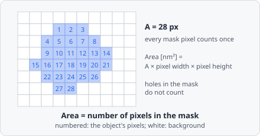

### Perimeter

The length of the object's outline (**Perimeter [px]**), as ImageJ measures it. The outline is traced along the outer edges of the mask's pixels (8-connected), which gives a staircase of horizontal and vertical pixel edges. Each corner of that staircase is then cut diagonally: for each counted corner the length is shortened by $2 - \sqrt{2} \approx 0.586$ px.

$$
P = N_{\text{edges}} - N_{\text{corners}} \left(2 - \sqrt{2}\right)
$$

A corner is counted at the end of every side longer than one pixel, and at every second corner of a run of one-pixel steps. So a smooth diagonal is measured close to its true length instead of as a staircase. Small objects come out a little short: a single pixel has a perimeter of $2\sqrt{2} \approx 2.83$, not 4. This matches ImageJ's own results.

**Perimeter [nm]** is the pixel value times $\sqrt{\text{pixel width} \cdot \text{pixel height}}$.

A jagged, spiky boundary racks up far more length than a smooth one enclosing the same area - which is exactly what [Circularity](#circularity) below exploits.

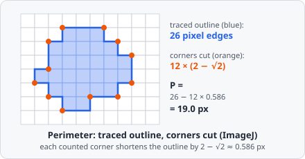

### Circularity

How closely the object resembles a circle, from its area and perimeter. Range: 0 (very irregular) to 1 (perfect circle). A circle is the shape that encloses the most area for the least perimeter, so anything jagged, elongated or branching scores lower.

$$
c = \frac{4\pi A}{P^2}
$$

An object with a perimeter of 0 gets 0. Because the [perimeter](#perimeter) of very small objects comes out a little short, their circularity can come out slightly above what their shape suggests.

Useful for spotting membrane blebbing, fragmented nuclei, or aggregated/clumped particles that should otherwise be round.

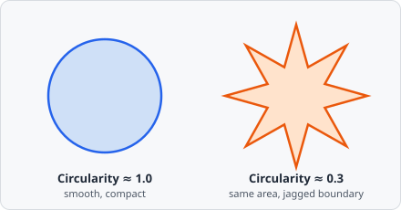

### Roundness and Compactness

**Roundness** is computed exactly like [Circularity](#circularity) - same formula, same value. **Compactness** is the reciprocal view: lower means more compact (closer to a circle), higher means more perimeter for the enclosed area (more irregular). An object with an area of 0 gets 0.

$$
r = \frac{4\pi A}{P^2}, \qquad k = \frac{P^2}{A} = \frac{4\pi}{r}
$$

If you're used to thinking "bigger number = more irregular", Compactness reads more naturally than Circularity's "bigger number = more circular". Both are stored in the results database; the results table shows Circularity.

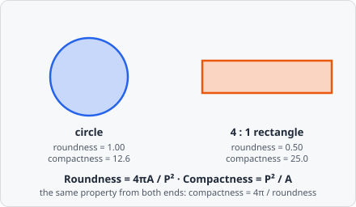

### Solidity

Area divided by the area of the mask's convex hull. The hull is taken over the corners of the pixel squares, so the mask always lies fully inside its hull and solidity never exceeds 1. Range: 0-1; 1 = perfectly convex, lower means more concave boundaries, bays or holes.

$$
s = \frac{A}{A_{\text{hull}}}
$$

Where Circularity penalises *any* deviation from round (including smooth elongation), Solidity specifically flags concave indentations - think of a crescent-shaped nucleus, a cell mid-division, or two touching objects that didn't get fully separated by segmentation.

[Measure Object Shape](/commands/measure/measure-object-shape/) gives a second solidity the way CellProfiler counts it (over the pixel centres instead of the corners), which comes out a little different for small objects.

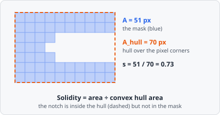

### Major and Minor Axis

The lengths of the axes of the ellipse that has the same second-order moments as the mask - the standard way of asking "if I approximated this exact pixel mask with the closest-fitting ellipse, how big would its axes be?" (**Major Axis [px]**, **Minor Axis [px]**). The ellipse is centred on the [centroid](#centroid) $(\bar{x}, \bar{y})$, and the sums run over the $A$ pixels of the mask:

$$
\mu_{20} = \frac{\sum x^2}{A} - \bar{x}^2, \quad
\mu_{02} = \frac{\sum y^2}{A} - \bar{y}^2, \quad
\mu_{11} = \frac{\sum xy}{A} - \bar{x}\,\bar{y}
$$

$$
\text{major} = \sqrt{8\left(\mu_{20}+\mu_{02}+\Delta\right)}, \quad
\text{minor} = \sqrt{8\left(\mu_{20}+\mu_{02}-\Delta\right)}, \quad
\Delta = \sqrt{(\mu_{20}-\mu_{02})^2 + 4\mu_{11}^2}
$$

The angle of the major axis to the x-axis, in radians, is stored in the results database as well:

$$
\theta = \tfrac{1}{2}\,\operatorname{atan2}\left(2\mu_{11},\ \mu_{20}-\mu_{02}\right)
$$

Because y points downwards in images, a negative angle means the major axis rises to the right on screen.

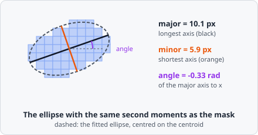

### Aspect Ratio

The ratio of the fitted ellipse's [major to minor axis](#major-and-minor-axis) - **not** the bounding box's width/height ratio. 1.0 means the object is as wide as it is long; larger values mean it's elongated along one axis. An object whose minor axis is 0 gets 1.0.

$$
\text{AR} = \frac{\text{major axis}}{\text{minor axis}}
$$

Handy for telling round objects (nuclei, vesicles) apart from rod- or fibre-like ones (some bacteria, cytoskeletal fragments) regardless of which way they happen to be rotated in the image.

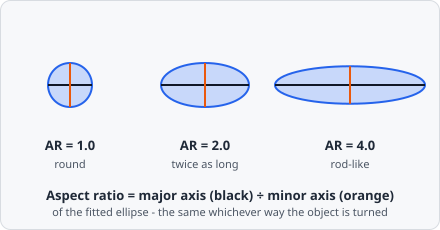

### Eccentricity

Elongation of the object's [fitted ellipse](#major-and-minor-axis) (0 = circle, approaching 1 = increasingly elongated - a flattened sliver). It answers the same "how stretched is this object?" question as [Aspect Ratio](#aspect-ratio), just on a bounded 0-1 scale instead of an open-ended ratio, which can make it easier to set a filter threshold.

$$
e = \sqrt{1 - \left(\frac{\text{minor}}{\text{major}}\right)^{2}}
$$

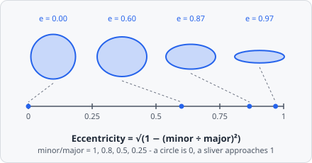

### Max Feret Diameter

The longest distance between any two pixel centres of the object (**Max Feret [px]**) - the longest caliper length at any angle. It is measured on the convex hull of the pixel centres, as in CellProfiler. A single pixel has 0. The nm value is the pixel value times $\sqrt{\text{pixel width} \cdot \text{pixel height}}$.

$$
F_{\max} = \max_{i,j} \sqrt{(x_i-x_j)^2 + (y_i-y_j)^2}
$$

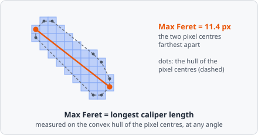

### Min Feret Diameter

The narrowest width of the object (**Min Feret [px]**): the smallest distance between two parallel lines that hold all pixel centres between them, at any angle. It is found with rotating calipers over the convex hull of the pixel centres, as in CellProfiler. A single pixel has 0.

Because both Feret diameters are measured over pixel centres, they are about one pixel shorter than the object's outer extent - a 10 × 3 pixel rectangle has a Max Feret of about 9.2 and a Min Feret of 2.

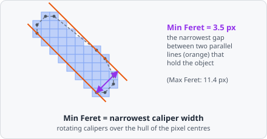

### Equivalent Diameter

The diameter of a disk with the same area as the object (**Equivalent Diameter [px]**). A size measure in a length unit that doesn't depend on the object's shape. Calculated in the results from the area:

$$
d = \sqrt{\frac{4A}{\pi}}
$$

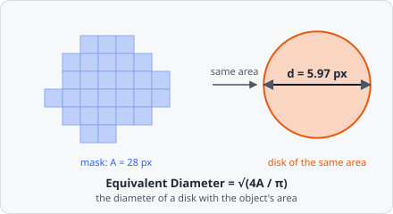

### Extent

The area divided by the area of the [bounding box](#bounding-box) (**Extent**), with the box's width and height counted in whole pixels including both edges. 1 for a filled axis-aligned rectangle, lower for anything else. Calculated in the results:

$$
\text{Extent} = \frac{A}{(x_{\max}-x_{\min}+1)\,(y_{\max}-y_{\min}+1)}
$$

Unlike Solidity, Extent depends on how the object is turned: a rectangle rotated by 45° has a much lower extent than the same rectangle lying straight.

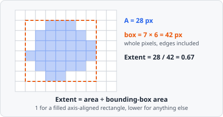

### Centroid

The mean position of the object's pixels - its centre of mass, not weighted by intensity (as in CellProfiler and Fiji). It always lies where most of the object is; for a crescent or ring it can lie outside the mask itself.

$$
\left(c_x, c_y\right) = \left(\frac{1}{A}\sum_i x_i,\ \frac{1}{A}\sum_i y_i\right)
$$

The centroid is stored in pixels and nm. The centre of the [bounding box](#bounding-box), $\left(\frac{x_{\min}+x_{\max}}{2}, \frac{y_{\min}+y_{\max}}{2}\right)$, is stored next to it - for round or symmetric objects the two coincide, for an L-shaped or crescent mask they can differ a lot. The centroid places objects in the image heatmap and the track views, and it is the "centre" the [Measure commands](#measurements-from-measure-commands) and [Relate Objects](/commands/object/relate-objects/) use.

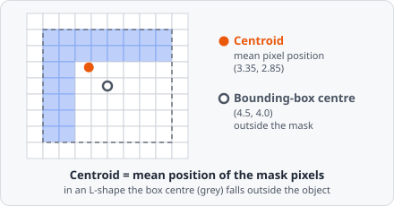

### Bounding Box

The smallest axis-aligned rectangle that contains all pixels of the object, given as the first and last pixel column ($x_{\min}$, $x_{\max}$) and row ($y_{\min}$, $y_{\max}$) - both included. Stored in pixels and nm.

The object's mask is kept relative to its bounding box. With **Keep object outlines in the results** switched on in the project settings, the mask is also stored in the results database, so the results' split view can draw the real outline. Switched off, the results file is smaller and objects are drawn as ellipses there.

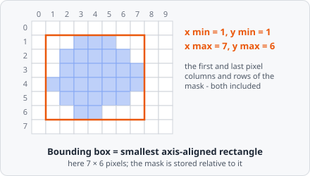

### Touches Edge

Whether any pixel of the object lies in the outermost row or column of the image. Such objects are cut off by the image border, so their size and shape are only partly measured. The [Tracks](/guide/results/#tracks) view uses it to leave out tracks that touch the image's edge.

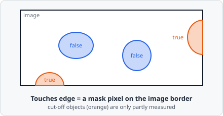

## Intensity Metrics

Calculated for each image channel separately, over the $n$ pixels of the object's mask - the actual signal being measured, as opposed to the shape metrics above. Pixels outside the mask are ignored. For an RGB image the pixel's luminance is used. The values are in the image's gray values (0-255 for an 8-bit image, 0-65535 for a 16-bit image).

$$
\text{Sum} = \sum_{i=1}^{n} v_i, \qquad
\text{Min} = \min_i v_i, \qquad
\text{Max} = \max_i v_i, \qquad
\text{Avg} = \frac{\text{Sum}}{n}
$$

**Sum** and **Avg** are the two most commonly used: Sum scales with both signal strength and object size (useful for "total protein content"-style questions), while Avg is size-independent (useful for comparing concentration regardless of how big the object is). **Min**/**Max** are useful for spotting saturation (Max pinned at the sensor's ceiling) or partially-masked/background-contaminated objects (unexpectedly low Min).

How the values spread is calculated as in CellProfiler's MeasureObjectIntensity:

| Column | Meaning |
| --- | --- |
| **Std Dev Intensity** | Population standard deviation: $\sqrt{\frac{1}{n}\sum_i (v_i - \text{Avg})^2}$ |
| **Lower Quartile Intensity** | The value a quarter of the way through the sorted values |
| **Median Intensity** | The value halfway through the sorted values |
| **Upper Quartile Intensity** | The value three quarters of the way through the sorted values |
| **MAD Intensity** | Median absolute deviation: the median of the distances $\lvert v_i - \text{Median} \rvert$ |

The quartiles and the median take the sorted values $v_{(0)} \le \dots \le v_{(n-1)}$ at position $q = n \cdot f$ (with $f$ = 0.25, 0.5 or 0.75), interpolated between the two values around it:

$$
Q_f = v_{(\lfloor q \rfloor)} \cdot \left(1 - (q - \lfloor q \rfloor)\right) + v_{(\lfloor q \rfloor + 1)} \cdot \left(q - \lfloor q \rfloor\right)
$$

At the top end, where no value follows, $v_{(\lfloor q \rfloor)}$ alone is taken. This is CellProfiler's rule ($n \cdot f$, not $(n-1) \cdot f$ as in many spreadsheet programs), so the median of 4 values is the third one, not the mean of the middle two.

The median and the MAD are robust against a few very bright or dark pixels (a hot pixel, a small speck of debris), where Avg and Std Dev are pulled along.

In the results the columns are named per channel, e.g. **Avg Intensity (Ch 0)**. Manually annotated objects that were loaded without their pixels have Sum, Min, Max and Avg but no spread values. [Classify Objects](/commands/object/classify-objects/) can filter by Avg, Sum, Min and Max.

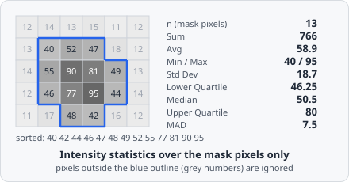

## Object Identifiers

### Object ID

A unique ID assigned to each object when it is created (**Object ID**): a UUID (version 7). IDs are unique across the whole results file, but they are not numbered 1, 2, 3 and can differ between runs.

Use the **With object ID** option in [Save Image](/commands/object/save-image/) to annotate the ID alongside the object in control images.

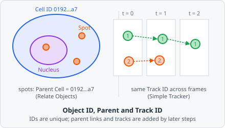

### Parent

An object can be linked to the objects it belongs to - its **parents**. Links are made only by [Relate Objects](/commands/object/relate-objects/), for example each spot to the cell its centroid lies in. An object has at most one parent per parent class, but it can have parents of several classes (a spot can belong to a nucleus and to a cell).

Example:

- [Relate Objects](/commands/object/relate-objects/) links each **spot** to its **cell** and to its **nucleus**.
- Each spot's **Parent Cell** column shows the ID of its cell, and **Parent Cell · Area [px]** shows that cell's area next to the spot.
- Each cell's **Spot · Count** column shows how many spots it has, and e.g. **Spot · Mean · Avg Intensity (Ch 1)** their mean intensity.

The children columns can aggregate with Mean, Min, Max, Std dev, Sum, Median and Skewness. A cell without spots has a count of 0.

### Track ID

Links the objects that are the same physical object in consecutive time frames (**Track ID**). Every object of a tracked class gets a track ID; all objects of one track share it. Track IDs are numbered 1, 2, 3, ...; objects that were not tracked have none.

Track IDs are assigned by the [Simple Tracker](/commands/dataset/simple-tracker/), which runs after all images have been analysed. See [Tracks](/guide/results/#tracks) for viewing them.

## Intersection

Whether an object overlaps an object of another class - the number of pixels both masks share. [Classify Objects](/commands/object/classify-objects/) uses it as a filter: with **Intersecting With** set, an object only matches when it shares at least one pixel, and at least **Min Intersection Size**, with an object of that class. Objects that only touch, without sharing a pixel, don't intersect. The overlap is not stored as a column of its own.

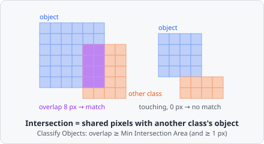

## Colocalization Partners

Per partner class, how many objects of that class an object colocalises with (**Coloc with *class***), and their object IDs. Both are set by [Colocalize Objects](/commands/object/colocalization/); the partners and their values can be shown next to each object with [Coloc details](/guide/results/#colocalization-details). The link goes both ways: each partner records the object as its partner too.

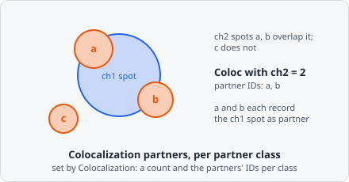

## Measurements from Measure commands

The commands of the **Measure** category add further values - only when they are in the pipeline. Their values appear in the results' **Measurements** group, named `<step ID> · <measurement>`; per-object values sit next to the object's other metrics, per-image values next to each image. Values that name another object (a parent, a nearest neighbour) also get a column with that object's ID.

| Command | Values |
| --- | --- |
| [Measure Object Shape](/commands/measure/measure-object-shape/) | Per object: convex area, solidity (CellProfiler's), Euler number, max / mean / median radius |
| [Measure Object Neighbors](/commands/measure/measure-object-neighbors/) | Per object: number of neighbours, percent touching, first and second closest distance, angle between neighbours |
| [Measure Object Distance To Parent](/commands/measure/measure-distance-to-parent/) | Per child: distance from its centroid to its parent's centroid and to its parent's edge |
| [Measure Image Texture, Measure Object Texture](/commands/measure/measure-texture/) | Per image or per object: Haralick texture features (contrast, correlation, entropy, ...) |
| [Measure Image Colocalization, Measure Object Colocalization](/commands/measure/measure-colocalization/) | Per image or per object: Pearson, Manders M1/M2 (also with Costes' threshold), overlap, K1/K2, RWC; slope per image only |
| [Measure Image Intensity](/commands/measure/image-intensity/) | Per image: total, mean, std dev, min, max, median, quartiles and MAD of a channel |
| [Measure Image Quality](/commands/measure/image-quality/) | Per image: focus score, power log-log slope, percent maximal / minimal, noise |
| [Measure Image Area Occupied](/commands/measure/area-occupied/) | Per image: the area the objects of a class cover, and its part of the image |

Use [Exclude Image](/commands/measure/exclude-image/) to leave images out of the results based on these values.

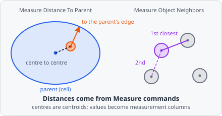
