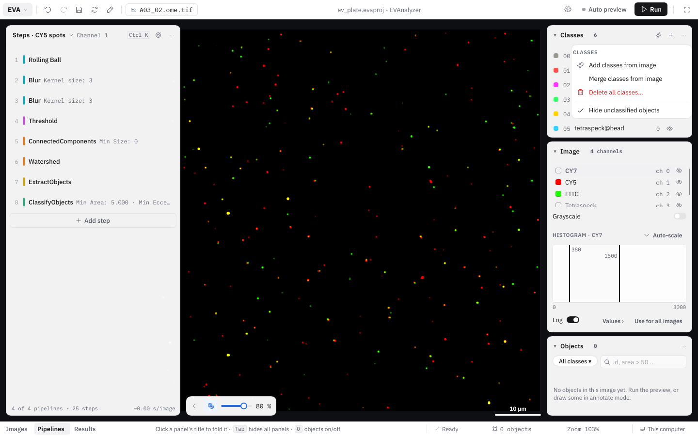
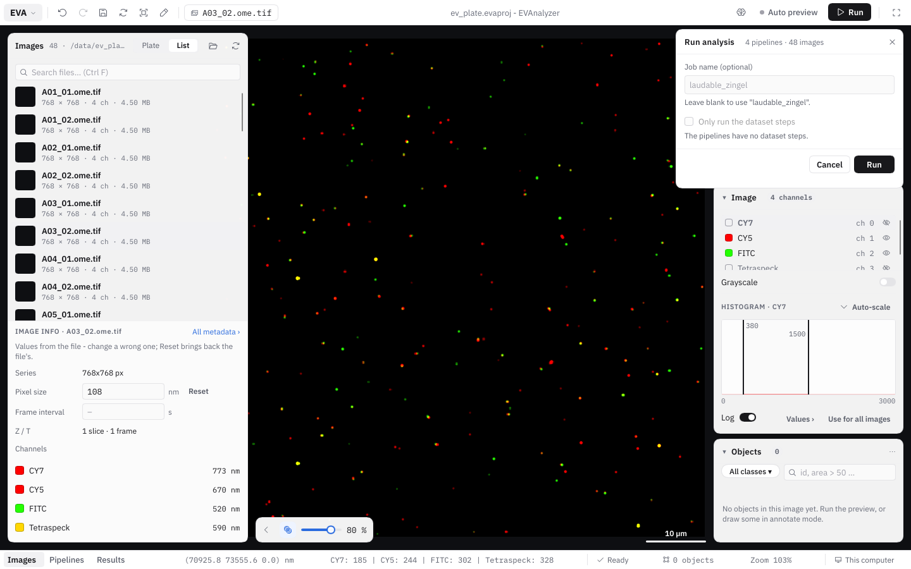
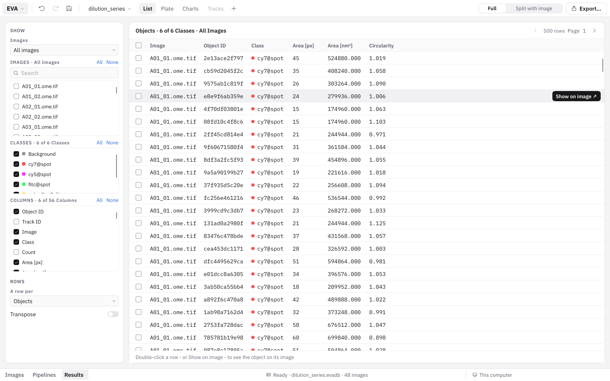

This guide walks you through the essential workflow: open a folder of images, define object classes, build a pipeline, run the analysis, and inspect the results.
For a tour of the window itself, see [The Workspace](/guide/workspace/).

## 1. Open your images

Start EVAnalyzer as described in [Installation](/getting-started/installation/).
It opens on the **Start** page.


Click **Open image folder…** (`Ctrl+Shift+O`) and choose the folder with your images.
EVAnalyzer creates a new project for them and switches to **Images**: the images are listed on the left - or laid out on a plate, if their names carry well positions.
Click an image to show it; its channels, size and pixel size appear in the image info.

The three modes of the window are in the bottom bar: **Images → Pipelines → Results** (`Ctrl+1`, `Ctrl+2`, `Ctrl+3`).

## 2. Define the classes

Before building pipelines, define the **object classes** you want to detect - for example `CY7`, `CY5`, `DAPI`.
The classes are in the **Classes** panel on the right.

- Click **+** to add a class, then give it a name and a color.
- Or use **⋯ › Add classes from image** to create one class per image channel as a starting point.



See [Classes & Objects](/guide/classification/) for details.

## 3. Build a pipeline

Pipelines extract objects from image channels.
Switch to **Pipelines** (`Ctrl+2`) and click **New pipeline** in the steps panel on the left.
Enter a **Pipeline name** and pick the **Image source** the pipeline starts with:

- **Channel** - an image channel; the usual choice.
- **Scratchpad** - an empty image, for a pipeline that only works on objects other pipelines found.
- **Shared memory slot** - an image an earlier pipeline stored with [Image Cache](/commands/image-processing/image-cache/).


Now click **Add step** to open the command picker. It stays open, so you can add one step after another; each goes in after the one you added before. A minimal spot-detection pipeline looks like:

1. **Rolling Ball** - remove uneven background
2. **Gaussian Blur** - reduce noise
3. **Threshold** - convert greyscale to binary
4. **Connected Components** - label each foreground region
5. **Watershed** - split touching objects
6. **Extract Objects** - create objects to work on from the segmented regions
7. **Classify Objects** - filter by size/circularity and assign an object class

See [Pipelines](/guide/pipelines/) for how steps work and what the colored stripe on each step means.

### Preview

The image shows the result of the pipeline on the current image.
Switch on **Auto preview** in the top bar to refresh it whenever a setting changes, or click **Refresh preview** (`F5`) to refresh it once.
Save the project with **Save** (`Ctrl+S`) in the top bar.

## 4. Run the analysis

Click **Run** at the top right.
The **Run analysis** dialog opens below it and shows what will run - the number of pipelines and images.
Enter a **Job name** under which the result is stored, or leave it blank to get a generated one.



While the analysis runs, **Run** shows its progress and a **Stop** button; you can keep looking at images in the meantime. When it is done, **Analysis finished** offers **Open results**.

Results are saved to:

```
<project folder>/results/<date>__<job_name>/<job_name>.evadb
```

## 5. View the results

Switch to **Results** (`Ctrl+3`). The analysis you just ran opens; the analysis menu in the top bar lists every analysis of the project's images.



See the [Results](/guide/results/) guide for full details.

## Next Steps

- Read [The Workspace](/guide/workspace/) for the EVA menu, the panels and the command palette.
- Read [Pipelines](/guide/pipelines/) for a detailed explanation of every pipeline option.
- Browse the [Commands](/commands/overview/) reference to learn what each pipeline step does.
- Follow a [Tutorial](/tutorials/spot-count/) for a complete worked example.
