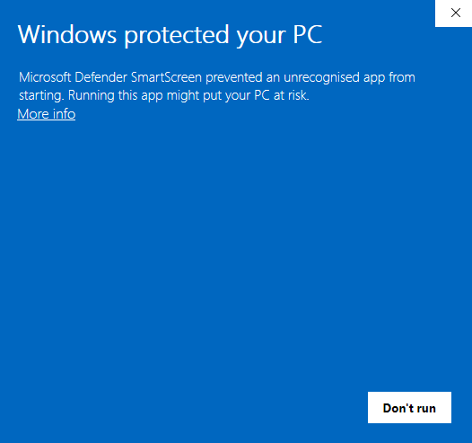
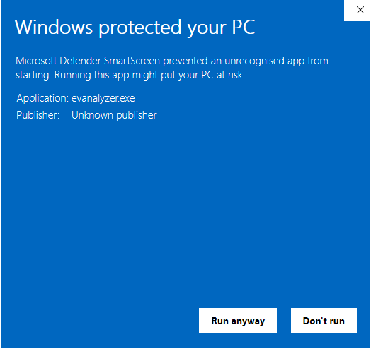

import DownloadPicker from "../../../components/DownloadPicker.astro";

EVAnalyzer is distributed as a pre-built binary for Linux and Windows (x86-64 and ARM64) and macOS (Apple Silicon).
No package manager or build toolchain is required to run the application.

Before downloading, check the [System Requirements](/getting-started/system-requirements/) page - in particular if you plan to use a CUDA build for GPU-accelerated AI segmentation.

## Downloading

Pick your operating system and processor, and whether you want a CUDA-accelerated build. The link below always points at the latest published release on [GitHub](https://github.com/evanalyzer/evanalyzer/releases).

<DownloadPicker />

:::tip[Not sure which to pick?]
If you don't have a dedicated NVIDIA GPU, choose **No CUDA** - the CPU build runs everywhere and AI segmentation still works, just slower. See [System Requirements](/getting-started/system-requirements/) for GPU/driver details.

Most PCs have an x86-64 (Intel or AMD) processor. Choose **ARM64** for ARM machines such as Windows on Snapdragon laptops or a Raspberry Pi / ARM server running 64-bit Linux. ARM64 builds are CPU-only. The Linux ARM64 build has no AI model steps (Cellpose, StarDist, U-Net, YOLOv5) - there is no libtorch for Linux ARM64; everything else works.
:::

:::note[Looking for project templates or AI models?]
Those live on the separate [Downloads](/downloads/) page, linked at the top of every page.
:::

Packages follow this naming scheme on the [GitHub Releases page](https://github.com/evanalyzer/evanalyzer/releases/latest):

| Platform              | CPU-only                         | CUDA-accelerated                                  |
| --------------------- | -------------------------------- | ------------------------------------------------- |
| Windows x86-64        | `evanalyzer-windows-x86_64.zip`  | `evanalyzer-windows-x86_64-cuda.7z`               |
| Windows ARM64         | `evanalyzer-windows-arm64.zip`   | - (CUDA builds are x86-64 only)                   |
| Linux x86-64          | `evanalyzer-linux-x86_64.tar.gz` | `evanalyzer-linux-x86_64-cuda.7z`                 |
| Linux ARM64           | `evanalyzer-linux-arm64.tar.gz`  | - (CUDA builds are x86-64 only)                   |
| macOS (Apple Silicon) | `evanalyzer-macos-arm64.tar.gz`  | - (CUDA is not available on macOS)                |

:::note[CUDA packages are 7-Zip archives]
The CUDA builds bundle the CUDA runtime libraries and are packed as one `.7z` file each. Extract it with [7-Zip](https://www.7-zip.org/) on Windows, or on Linux with:

```sh
7z x evanalyzer-linux-x86_64-cuda.7z
```
:::

Extract the downloaded archive to a directory of your choice. Besides the app, every package holds `LICENSE` and `THIRD-PARTY-NOTICES.txt` - the licences of the third-party components shipped with it.

## VS Code Extension

The [EVAnalyzer File Support](/vscode/extension/) extension adds validation, autocomplete, and creation wizards for `.evapipe`, `.evaproj`, and `.evapt` files to VS Code.

**[Download the latest release →](https://github.com/evanalyzer/evanalyzer-vscode/releases/latest)**

Grab the `evanalyzer-file-support-*.vsix` file from the release's assets, then install it:

```sh
code --install-extension evanalyzer-file-support-*.vsix
```

:::note[Not yet on the Marketplace]
This extension isn't published to the VS Code Marketplace or Open VSX yet, so it's installed from the downloaded `.vsix` file rather than through the Extensions view's search. You can also install it via **Extensions → ... → Install from VSIX...** in VS Code - see [VS Code Extension](/vscode/extension/#installation) for details.
:::

## Starting EVAnalyzer

### Linux

```sh
./evanalyzer
```

:::note[Linux libraries]

Sometimes the GUI requires a few system libraries on Linux.
If not still installed, install them once with:

```sh
apt-get install libinput10 libxkbcommon0 libxkbcommon-x11-0 libfontconfig1 libgbm1
```

:::

### Windows

Double-click `evanalyzer.exe`, or from PowerShell:

```powershell
.\evanalyzer.exe
```

:::note[Windows SmartScreen warning]
The release builds of `evanalyzer.exe` and its AI plugin are code-signed. Windows SmartScreen judges a download also by how often it has been seen, so for a new release it may still block the application on first launch. Check that the publisher shown under **More info** is EVAnalyzer's; then it is safe to dismiss.

**Step 1** — When the blue "Windows protected your PC" dialog appears, click **More info**.



**Step 2** — A **Run anyway** button becomes visible at the bottom of the dialog. Click it to start EVAnalyzer.



You will only need to do this once. Windows remembers your choice for this executable.
:::

### macOS

Open `EVAnalyzer.app` from the extracted folder.

:::note[macOS Gatekeeper quarantine]
Because EVAnalyzer is not notarized through Apple's developer program, macOS places a quarantine flag on the downloaded archive. Attempting to open the app with a double-click will show a dialog saying the app cannot be opened. Follow one of the two methods below to start it for the first time — you will not be asked again afterward.

**Method 1 — Right-click (quickest)**

Right-click (or Control-click) `EVAnalyzer.app` in Finder and choose **Open** from the context menu. A dialog will appear that — unlike the double-click dialog — includes an **Open** button. Click it to confirm and launch the application.

**Method 2 — System Settings**

If the right-click method does not work, macOS may have blocked the app silently. To unblock it:

1. Open **System Settings** -> **Privacy & Security**.
2. Scroll down to the **Security** section. You will see a message such as _"EVAnalyzer was blocked from use because it is not from an identified developer."_
3. Click **Open Anyway**, then confirm with **Open** in the dialog that follows.

**Method 3 — Terminal (remove quarantine attribute)**

For users comfortable with the command line, you can remove the quarantine flag directly:

```sh
xattr -cr EVAnalyzer.app
```

After running this command, the app opens normally with a double-click, with no further prompts.
:::

The application opens to the start screen showing the project configuration panel.

## Building from Source

See the [Building](/development/building/) guide if you want to compile EVAnalyzer yourself.
