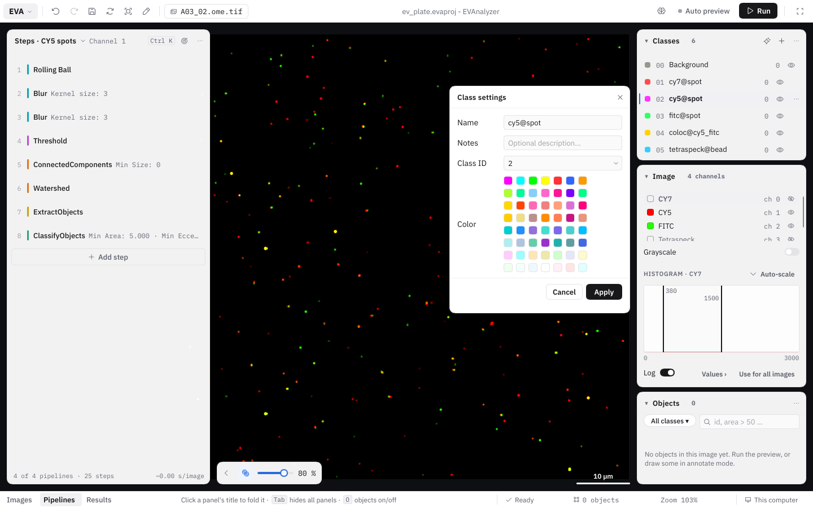
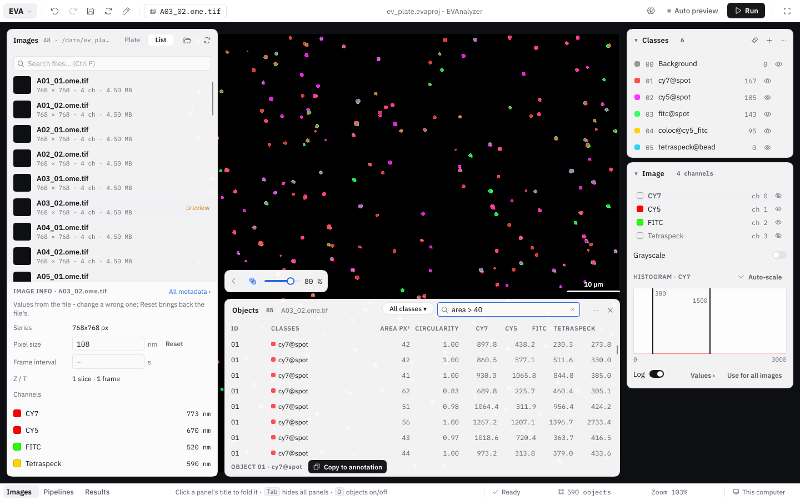
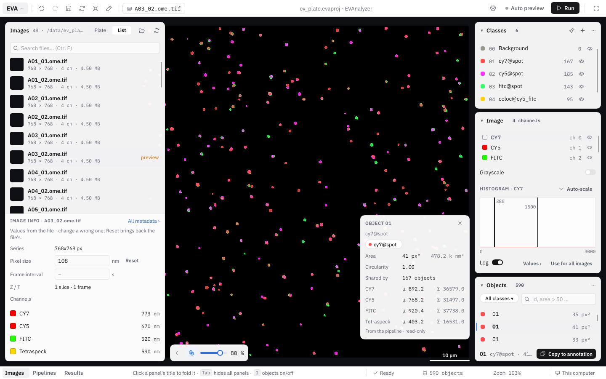
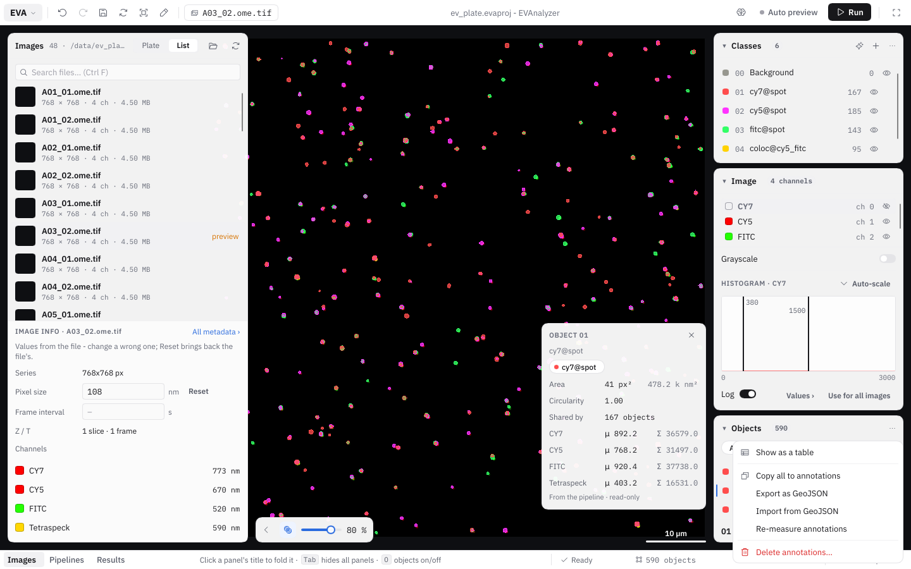

The **Classes** panel on the right is where you define the object populations that your pipelines detect and measure.
Every detected object is assigned to one or more classes. The **Objects** panel below it lists the objects of the current image.

## What is a Class?

A class represents a distinct object population in your experiment. Examples:

- `dapi@nucleus` - nuclei stained with DAPI
- `cy5@spot` - extracellular vesicles in the Cy5 channel
- `cy7@spot` - vesicles in the Cy7 channel
- `coloc@cy5cy7` - vesicles colocalising across both channels

:::tip[Naming convention]
Use `<prefix>@<type>` where the prefix (typically the fluorophore) is used for sorting in selection drop-downs.
:::

## Classes panel

Each class is a row with its color, its name, its number of objects on the current image and an eye that shows or hides its objects. Click a class to select it.

- **+** (**New class**) adds a class and opens its settings.
- **⋯ › Edit name, color, id…** of a class opens its settings.
- The same menu has **Copy**, **Move up** / **Move down** and **Delete class…**.

**Class settings**:

| Field        | Description                                            |
| ------------ | ------------------------------------------------------ |
| **Name**     | Class label, e.g. `cy5@spot`                           |
| **Notes**    | Optional free-text description                         |
| **Class ID** | The class's number - see below                         |
| **Color**    | Display color used for the class's objects in the viewer |

Every class has a number, its **Class ID** - the number a [Threshold](/commands/segmentation/threshold/) entry's segmentation class must match (see [Object Classes](/fundamentals/classes/)). **Auto** gives a new class the number above the highest one, so the number of a deleted class isn't reused by accident (old pipelines and results may still refer to it). Pick a number from the list to choose a free one yourself.

Changing the ID of an existing class moves every reference with it: pipelines, [modules](/guide/modules/) and annotated objects that use the class switch to the new ID. Results of earlier runs keep the old one. The background keeps its ID 0.

You can also create a class where you need it: the class pickers of the steps and the annotate bar's **Paint as** have **+ New class…** - the new class is picked at once.

### Add classes from the image

The Classes panel's own **⋯** menu:

- **Add classes from image** creates one class per channel of the current image, as a starting point, in the channels' colors. Each class is named after its channel; a channel without a name gives _Class 0_, _Class 1_, … (counted from 0, like the channels).
- **Merge classes from image** adds only the classes the list doesn't have yet.
- **Delete all classes…** empties the list, after a confirmation.
- **Hide unclassified objects** - see below.

### Hiding unclassified objects

**⋯ › Hide unclassified objects** (in the Classes panel) hides objects that have no class yet - on by default, so a large unfiltered detection doesn't drown out the objects you've actually classified.

## Objects panel

The **Objects** panel lists every object on the current image: the live-preview objects of the pipelines and the objects you [drew by hand](/guide/images/#annotating-the-image).

Click a row to select it - the object is highlighted on the image, and selecting an object on the image selects its row. Click it again to unselect it.

### Filtering

Above the list are a **class filter** and a **search**. The class filter's menu picks what to **SHOW** - **All**, **Annotations** (drawn by hand) or **Detections** (found by the pipeline) - and the **CLASS** (**All classes** or one class); the chip then reads e.g. _All classes · manual_, and its **✕** resets both. The search takes an object id, a class name, or a condition on a measurement - `area > 50`, `circ < 0.6` - and several terms separated by commas.

### Objects as a table

**⋯ › Show as a table** moves the objects to a table at the bottom of the window, between the left and right panels: one line per object with its **ID**, **classes**, **area**, **circularity** and the **mean** of each channel. **⋯ › Columns** picks the columns. The class filter and the search sit in the table's head. **Show as a list** brings back the list.

Whether an image opens with the list or the table is set in **EVA › Project settings… › Viewport › Objects as a table**.

### The selected object

The selected object's details are shown in a card beside the panel:

- its classes,
- **Area** in pixels² and in the physical unit (nm²) from the image's pixel size,
- **Circularity**,
- **Shared by** - how many objects have the same segmentation class (_"120 objects"_),
- per channel, the mean (**μ**) and the sum (**Σ**) of its intensity,
- **Parent** - for an object linked by [Relate Objects](/commands/object/relate-objects/), the classes of the objects it belongs to (_"Cell"_),
- **Children** - how many linked objects belong to it, per class (_"Spot · 7"_),
- **Touches** - each class it colocalizes with, and how many of that class's objects.

An object found by a pipeline is read-only (**From the pipeline · read-only**). An object drawn by hand can be changed.

### Managing objects

For the selected object:

- **Set class** - pick a class, then **Add class** adds it to the object's classes, keeping the ones it has, or **Set class** replaces them.
- **Copy to annotation** - copies a pipeline object into the hand-drawn annotations, where it can be edited (for example to train a classifier on it). The **Copy object as annotation** dialog asks for **THE COPY'S CLASS**: **Its own classes** or **Another class**; **Copy** makes the copy and selects it.
- **Delete object** (or `Delete`) - removes a hand-drawn object, after a confirmation.

The panel's **⋯** menu, for all objects of the image:

| Item | What it does |
| --- | --- |
| **Show as a table** / **Show as a list** | See [Objects as a table](#objects-as-a-table). |
| **Copy all to annotations** | Opens **Copy pipeline objects as annotations**: tick the **OBJECTS OF THESE CLASSES** to copy, and give the copies **Their own classes** or **One class for all**. The same shape is not copied twice. |
| **Export as GeoJSON** NEW | Writes the hand-drawn annotations of the open image to a `.geojson` file. Tick the classes to export and choose the file name. |
| **Import from GeoJSON** NEW | Reads a `.geojson` file - from EVAnalyzer, QuPath or other tools - into the open image. Each class name in the file is mapped to a project class (by default the one with the same name, ignoring case), a new class, no class, or _don't import_, so QuPath's class names don't need to match. Shapes without a series go to the series shown. **Add to the annotations** keeps the annotations already there (the same pixels are not added again); **Replace them** deletes this image's hand-drawn annotations first - Undo brings them back. |
| **Re-measure annotations** | Measures the hand-drawn objects again on the image file - every channel, full resolution. |
| **Delete annotations…** | Removes objects drawn by hand - on this image or all images, of the chosen classes - after a confirmation. Objects found by pipelines are not affected. |

Drawn and imported annotations are measured on the image file itself (every channel, full resolution), in the background - so their intensities are right at any zoom, also for whole slide images and through a [server](/remote/remote-control/).

## How Classes Relate to Pipelines

Classes aren't just labels - they're what every object-processing pipeline step selects, filters, and reassigns by. See [Object Classes](/fundamentals/classes/) for the full lifecycle, from a `Threshold` entry's raw segmentation class through to a named class assigned by [Classify Objects](/commands/object/classify-objects/).
