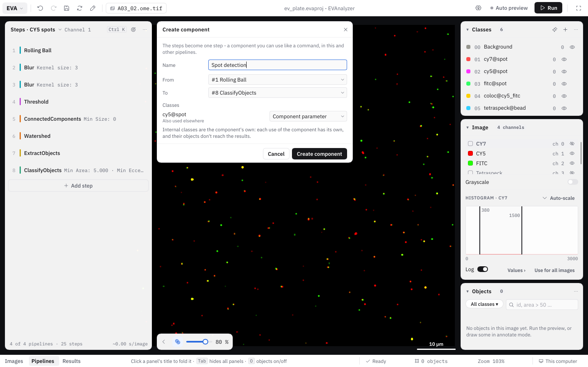
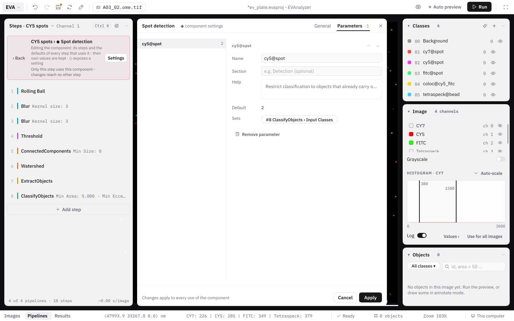

A **component** is a step made of other steps. A component such as _"Cell reconstruction"_ (blur, threshold, connected components, watershed, Voronoi, …) sits in a pipeline like any other command, can be inserted, moved and duplicated, and shows only the few settings that matter - typically an image channel and the classes it writes. Everything else stays as the component's author set it, but can still be looked at and changed.

Components are useful to

- **reuse** a proven sequence of steps in several pipelines or projects, with one place to change it;
- **hand over** an analysis to colleagues who don't want to build pipelines: they set two or three parameters and run;
- **keep intermediate results internal**: classes the component only needs on the way (seeds, candidates, rejected objects) don't clutter the class list or the results.

Components and their steps carry the component color - pink - and are marked with **◆**, both in the pipeline and in the command picker.

## Creating a component

1. Choose **Create component** in the **⋯** menu of the first step you want to bundle.
2. In the **Create component** dialog, enter a **Component name** and choose the range of steps (**From** / **To**).
3. EVAnalyzer lists the project classes the steps use under **Classes** and suggests a role for each:

   | Role                      | Meaning                                                                                                                                       | Suggested when                                                                                    |
   | ------------------------- | --------------------------------------------------------------------------------------------------------------------------------------------- | ------------------------------------------------------------------------------------------------- |
   | **Component parameter**   | The class becomes a setting on the component step - every use of the component picks its own class.                                                   | The class is also used outside the selected steps (other steps or pipelines, hand annotations, tile merging). |
   | **Internal (component only)** | The class becomes the component's own. Each use of the component has its own copy, and its objects **don't reach the results**.                       | The class is only used by the selected steps.                                                      |
   | **Fixed**                 | The class stays as it is.                                                                                                                     | Only a segmentation class without an Extract Objects among the steps.                              |

   Change a role with its dropdown. Image channels of [Load Image Channel](/commands/image-processing/load-image-channel/) steps become component parameters too, and memory slots only the selected steps use become [component memory](#memory-slots-in-components).
4. Click **Create component**. The steps are replaced by one component step - what runs doesn't change.

## The component step

A component step shows the component's **parameters** - each with the same control (dropdown, number field, class picker, …) as the setting it controls, and a **?** with its help text. Every use of a component has its own parameter values.

Its **⋯** menu has the usual step actions (**Settings**, **Disable**, **Breakpoint**, **Duplicate**, **Move up / down**, **Remove step**) and:

| Action               | What it does                                                                                                                   |
| -------------------- | ------------------------------------------------------------------------------------------------------------------------------ |
| **View**             | Opens the component read-only, to see what it does.                                                                            |
| **Edit component**   | Opens the component's steps for editing - changes apply to every use. See [Editing a component](#editing-a-component).        |
| **Edit in place**    | Gives this step a copy of its own (it asks for the copy's name if other steps use the component) and opens it - changes stay with this step. |
| **Expand**           | Puts the steps back into the pipeline, with this step's parameter values. The component's own classes become new project classes, its memory slots pipeline slots. |
| **Save as**          | Saves the component as a library file (`.evacomp`).                                                                            |
| **Create component** | Bundles this and more steps into a new component.                                                                              |

**Update to v_N_** stays on the step itself: it shows when the [library](#component-library) has a newer version of the component. **Duplicate** adds a second use of the same component; **Remove step** removes the step, the component itself stays in the project.

The **?** on any step - component or command - shows what the step does: a command's summary and description, a component's short and long description.

## Editing a component

**Edit component** opens the component's steps in the steps panel, with a bar on top: **‹ Back · Pipeline › ◆ Component · Settings**. The bar also says who else is affected - _Only this step uses this component - changes reach no other step._ Inside, you work as in a normal pipeline - add, remove, move steps and change settings.

Changes to a component **apply to every use of it**. If the component is used by more than one step, EVAnalyzer asks first:

- **Edit for all** - change the component; every step using it follows.
- **Only this step** - make a copy (_"Name (2)"_) just for this step, and edit the copy.

### Exposing settings as parameters

Next to every setting of an opened component is a **◇**. Click it to **expose** the setting as a component parameter - it then shows on the component step, with its current value as default. An exposed setting is marked **◆**; clicking it again hides it.

One parameter can set several settings at once - for example the same class in a Threshold, a Classify Objects and a Voronoi step. When you expose a setting that an existing parameter of the same kind could set, EVAnalyzer asks whether to create a **new parameter** or **add it to** the existing one.

A setting controlled by a parameter always runs with the parameter's value. Editing it inside the opened component changes the parameter's default, and every setting the parameter controls follows.

### Component settings

**Settings** in the bar of an opened component (or **✎** next to a **◆**) opens the **component settings** next to the steps panel, with two tabs:

- **General** - the component's **Name**, **Short description** (one line, shown in the command picker), **Author**, **Organization** and **Description** (shown behind the component's **?**).
- **Parameters** - the parameters as a list by section; the chosen one's form beside it: its **name** on the component step, its **section**, its **help** text (shown as **?** next to the parameter; empty shows the controlled setting's own help), its **default**, the settings it **Sets** (as chips; **Also set…** adds one), **↑ / ↓** for the order, and **Remove parameter**.

Changes apply to every use of the component. **Apply** keeps them; **Cancel** (or **✕**, `Esc`) undoes everything changed while the dialog was open.

### Checks

EVAnalyzer checks components when a project is loaded and while editing - for example a parameter that controls settings of different kinds, a setting that no longer exists, or a [mixing of internal and project classes](#internal-classes). Problems are shown as **⚠** on the component step, in the [Problems](/guide/pipelines/#problems) panel and in the bar of the opened component, so they are found before an analysis starts.

## Internal classes

An internal class belongs to the component: every use of the component has its own copy, so two uses of _"Cell reconstruction"_ never see each other's seeds. When a use of the component has run its last step, its internal objects are deleted - they **never reach the results database**, and the memory they took is freed right away.

The rules that follow from this:

- **Moving objects into a project class.** An object never carries an internal and a project class at the same time. [Classify Objects](/commands/object/classify-objects/) (and the AI Object Classifier) may _reclassify_ internal objects into a project class - a typical "filter" component: internal candidates in, project-class hits out. _Adding_ a project class to an internal object (or the other way round) is an error.
- **Commands that create new objects** are always fine: the new objects belong to the class they are written to. A Voronoi of internal seeds can write project-class cells.
- **Colocalization links to internal objects** are removed when the component ends. If you want the numbers that come from them (e.g. a spot count per cell), the spot class must be a project class - a component parameter.
- **Extract Objects** inside a component can map a segmentation class to one of the component's classes with its [class mapping](/commands/object/extract-objects/#class-mapping).
- **Dataset steps** such as the [Simple Tracker](/commands/dataset/simple-tracker/) only work on project classes.
- [Cross-tile merging](/fundamentals/cross-tile-merging/) merges internal objects of each use of a component separately.

## Memory slots in components

The slot picker of [Image Cache](/commands/image-processing/image-cache/) (and other steps that read a stored image) offers inside a component an additional kind, **Component memory**: slots that belong to one use of the component, so a component's intermediate image never overwrites a slot of the surrounding pipeline - or of a second use of the same component. They are freed when the component ends.

## Components in the command picker

The **Component** chip of the command picker lists the components **IN THIS PROJECT** (with **used N×**) and, under **LIBRARY**, the components from library files that aren't in the project yet. A search also finds components. The description pane shows the component's parameters with their defaults and where it comes from (e.g. _"this project · Segment → Object"_ - the category of its first and last step).

Components no pipeline uses any more can be removed with **Remove from project** in their description pane, or all at once with **Remove N unused**.

## Component library

**Save as** in a component step's ⋯ saves the component as a library file (`.evacomp`) through the template dialog. **Save as component…** in a pipeline's ⋯ does the same for a whole pipeline. Component files in the templates folder (`~/evanalyzer/templates/`) appear in the picker's **LIBRARY** section in every project.

- **Inserting** a library component copies it into the project, together with the components it uses. From then on the project has its own copy: changes affect only the project, never the file, and the project stays complete without it.
- **Updates:** the project remembers which file and version a component came from. When the library has a newer version, the component step shows **Update to v_N_**. Updating keeps every step's parameter values; if the project changed the component since inserting it, EVAnalyzer warns that updating replaces those changes.
- **Pipeline templates** carry the components their steps use, so a saved pipeline with component steps works in other projects too.

## Limitations

- Components inside components can only be created by inserting a component into an opened component, not with **Create component** inside an opened component.
- Breakpoints can't be set on steps inside a component.
- Steps are selected for bundling as a range (**From** / **To**), not by Shift-click.
