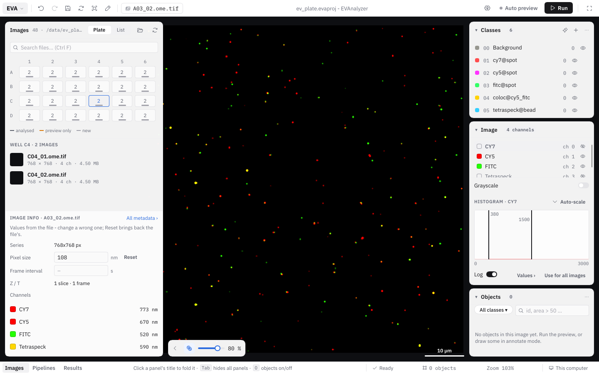
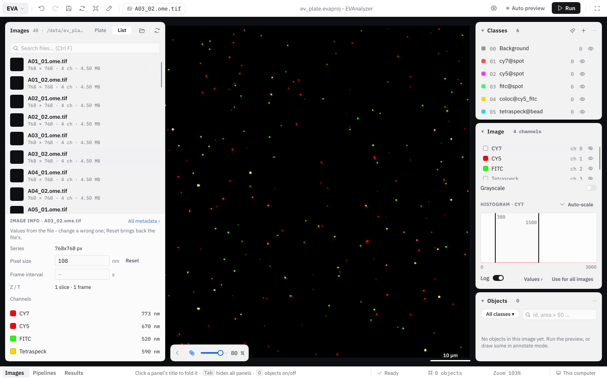
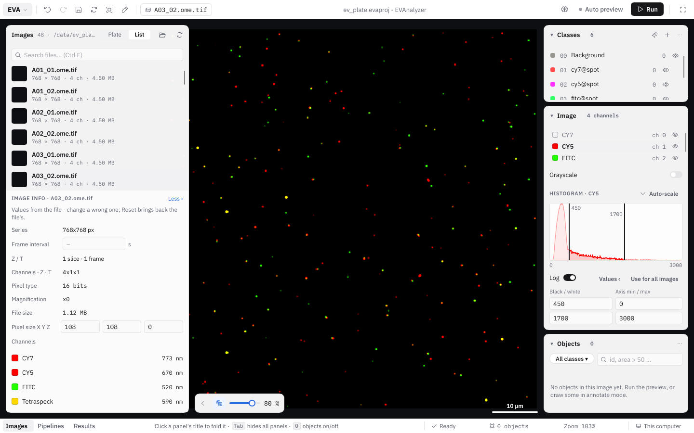
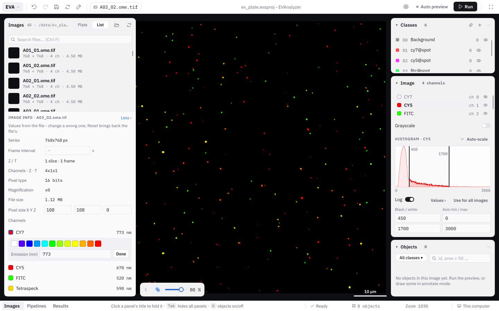
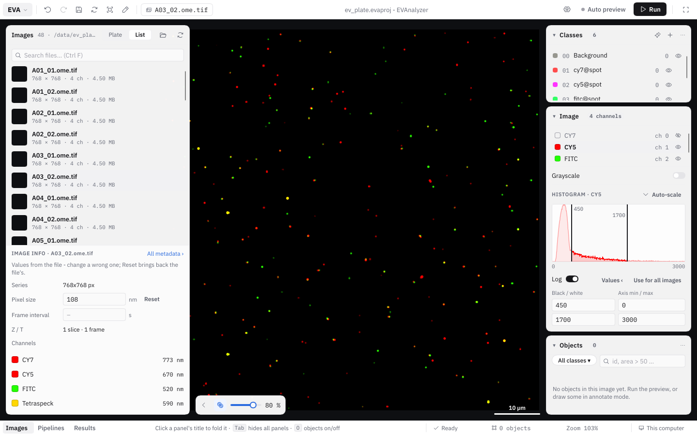
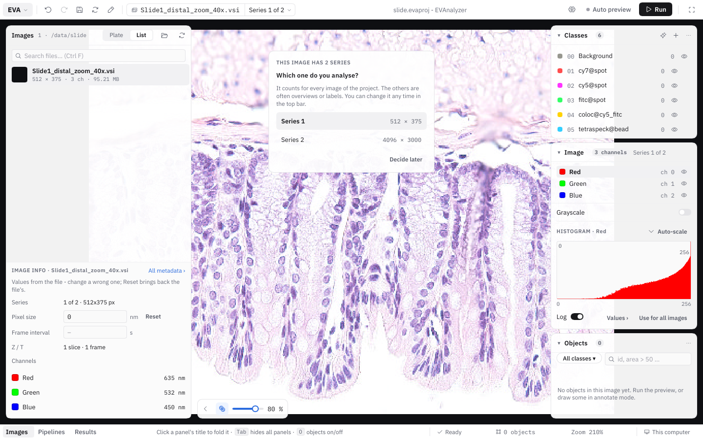
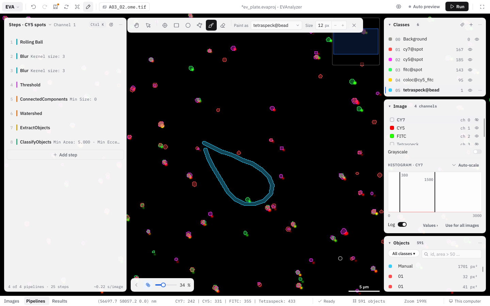

In **Images** mode (`Ctrl+1`) the **Images** panel on the left lists every image file found in the project's image folder.
Open a folder with **EVA › Open images folder…** (`Ctrl+Shift+O`) or the folder button in the panel's head; the refresh button reads the folder again.

## Images panel

The panel's head shows the number of images and the folder. **List | Plate** switches between two ways of showing them.

### List

One row per image, with its size, its channels and its state:

- **new** - not looked at yet,
- **preview** - previewed in this session,
- **analysed** - part of the analysis open in [Results](/guide/results/).

Type into **Search files…** (`Ctrl+F`) to filter by file name. Click a row to show the image - it is also the image the [live preview](/guide/pipelines/#live-preview) runs on.

### Plate

The images grouped into wells, by the project's plate settings (**EVA › Project settings… › Plate & grouping**, the same as in [Results › Plate](/guide/results/#grouping-images-into-wells)). Each well shows a bar with the state of its images; click a well to list its images below the plate. A plate bigger than 8 × 12 is shown in sections of 8 × 12 - pick one above the plate (_A1–H12 · A13–H24 …_).

## Image info

Below the list, **Image info** shows the selected image in short: **Channels · Z · T**, size, **Pixel size**, **Magnification**. **All metadata ›** shows everything the file holds (**Less ‹** folds it again).

| Field | Description |
| --- | --- |
| **Magnification** | From the file. |
| **Channels · Z · T** | Number of channels, Z planes and time frames. |
| **Channels** | Each channel's name, color and emission wavelength (nm) - color editable, see below. |
| **Pixel size X Y Z** | In nm - editable, see below. |
| **Frame interval** | Seconds between two frames of a time-lapse - editable. |
| **File size**, **Pixel type** | From the file. |

The values come from the file. Change a wrong one; **Reset** brings back the file's value. Changed values apply to the whole project and are marked **edited**.

### Pixel size

Correct the pixel size if it was not stored correctly in the file - it sets the scale bar and every physical-unit measurement (area, distance) of an analysis.

### Frame interval

The time between two frames of a time-lapse, in seconds, as read from the file (**-** if the file has none). Only a positive number is accepted.

### Channel color

EVAnalyzer colors every channel by its emission wavelength, read from the file. If the file has none or you prefer another color, click the channel's color swatch to open the color chooser:

- Pick one of the color tiles - each tile is an emission wavelength between 420 nm and 635 nm (pure blue, green and red are at 450, 532 and 635 nm), shown in exactly the color the viewer will use. Or type any wavelength into **Emission (nm)** and press Enter.
- Click **Done** to close the chooser, or **Reset** to go back to the wavelength stored in the file.

The chosen wavelength is saved in the project and applies to that channel in every image of the project. Classes created with **Add classes from image** in the [Classes](/guide/classification/#add-classes-from-the-image) panel take over the channel colors shown in the viewer.

Channels the file gives no wavelength are shown white. To give them distinct colors instead, switch on **Color channels without a wavelength** in **EVA › Project settings… › Viewport** - the colors are then kept in the project as their wavelength.

RGB images keep their fixed red, green and blue channel colors.

## Image panel

The **Image** panel on the right (its button above the right-hand panels shows and hides it) holds the controls of the viewer.

### Channels

Each channel of the image with its color, its number (**ch 0**, **ch 1**, …) and an eye that shows or hides it. Click a channel to select it - the histogram shows the selected channel.

- **Grayscale** shows the channels in white instead of their colors. Because overlaid gray channels can't be told apart, only one channel is visible at a time: switching grayscale on keeps the selected channel (or the first visible one), and showing another channel hides the previous one. The setting is saved in the project.
The small bar at the bottom left of the image holds the objects: its button shows or hides them (`O`), the slider sets their opacity in percent.

### Histogram

The histogram of the selected channel, with its black and white points as two lines you can drag. The values are in the image's own units (0 to 2bits), the counts on a log scale (**Log** switches to linear).

- **Auto-scale** sets black and white from the histogram; double-click the histogram does the same. Its menu (**▾**) does it for every channel of the image.
- **Values ›** shows the numbers: **Black / white** and **Axis min / max**.
- **Use for all images** applies these settings to every image of the project.

An image opened for the first time is auto-scaled, every channel. To start with the full value range instead, switch off **Auto-scale new images** in **EVA › Project settings… › Viewport**. The scaling of each image is kept in the project either way.

### Z-stack

For images with several Z planes, **Z** picks **Single** (one plane) or a projection: **Max**, **Min**, **Avg**, **Sum** or **Mid** (middle plane). `Page Up` / `Page Down` step through the planes.

### Time-lapse

For images with several frames, **T** steps through the frames (`,` and `.`). **▶** plays the sequence, at the speed set next to it in frames per second.

### Navigator

A mini-map in the corner shows the whole image with the visible part marked. Click or drag in it to move there. **EVA › View › Navigator** shows it **Auto** (only when zoomed in), **Always** or **Never**.

## Series selection

Some formats (e.g. LIF, CZI, VSI) store several image series in one file - often a full-resolution image and downscaled overviews or labels. The image chip in the top bar shows **Series N of M ▾**; its menu lists every series with its size.

The series is a **project-wide setting**: it applies to every image of the project - viewer, live preview, AI training and analysis all use the same series. When you open an image with several series and none is chosen for the project yet, EVAnalyzer asks once which one to use - **Decide later** keeps asking in this session.

An image that lacks the project's series shows its first series, but an analysis refuses to start rather than measuring it on a different series.

## Viewing large images

Panning and zooming move the image that is already on screen right away; the sharp version is rendered once the movement stops. For whole slide images, EVAnalyzer can keep earlier high-resolution renders, so panning back or zooming out shows them instead of a blurry overview. How much memory the viewer uses for this - and for its tile and overview caches - is set in [Settings](/guide/settings/#viewport).

Large images that come with pyramid levels (SVS, NDPI, MRXS, CZI, OME-TIFF) are read at the level that fits the zoom. Large images without pyramid levels are read in blocks and subsampled, so they don't need more memory than the screen shows - but every zoom step reads the image again, which can take a few seconds.

### Scale bar

A physical scale bar is drawn at the bottom right of the image, in nm, µm or mm depending on the zoom. If the file has no pixel size, set it in the [image info](#pixel-size).

### Position and pixel value

As you move the mouse over the image, the bottom bar shows the cursor's **position** and the **pixel value** of every visible channel.

To keep a measurement, use the **Marker** tool (`K`) in [annotate mode](#annotating-the-image) and click the position: a marker with the values of all channels stays on the image. Right-click it to remove it.

<strong>Marker and pixel values</strong>
A marker on the image with the values of all channels, the bottom bar showing position and pixel value.
<code>src/assets/screenshots/screenshot-image-measure-points.png</code>

## Annotating the image

Click **Annotate** in the top bar (or press `A`) to draw on the image. The annotate bar appears over the image:

| Tool | Key | What it does |
| --- | --- | --- |
| **Move** | `M` / `Esc` | Pan the image. |
| **Select** | `S` | Select an object. |
| **Marker** | `K` | A [measurement marker](#position-and-pixel-value). |
| **Rectangle** | `R` | Drag a rectangular region. |
| **Ellipse** | `E` | Drag an elliptical region. |
| **Polygon** | `P` | Click the corners, double-click to close. |
| **Brush** NEW | | Paint a region - a stroke as wide as the brush. |
| **Eraser** NEW | | Cut away from hand-drawn objects. |

**Paint as** picks the class of what you draw - **+ New class…** creates one and picks it at once. The paint tools stay off until a class is picked. **Size** sets the brush's width in pixels.

The brush paints into the selected hand-drawn object, or makes a new one of the chosen class. The eraser cuts hand-drawn objects: an object it empties is deleted, the others are measured again. Every stroke and every drawn shape is a step of its own for **Undo**.

Annotations are saved per image in the project. To measure them and use them in an analysis - for example to count spots inside a hand-drawn region - add [Load Annotated Objects](/commands/object/load-annotated-objects/) to a pipeline. Annotations can also be exported and imported as GeoJSON - for example to and from QuPath - from the Objects panel's ⋯ menu, see [Classes & Objects](/guide/classification/#managing-objects).

## Supported formats

See [Image Formats](/fundamentals/image-formats/) for the full list of supported file types.
