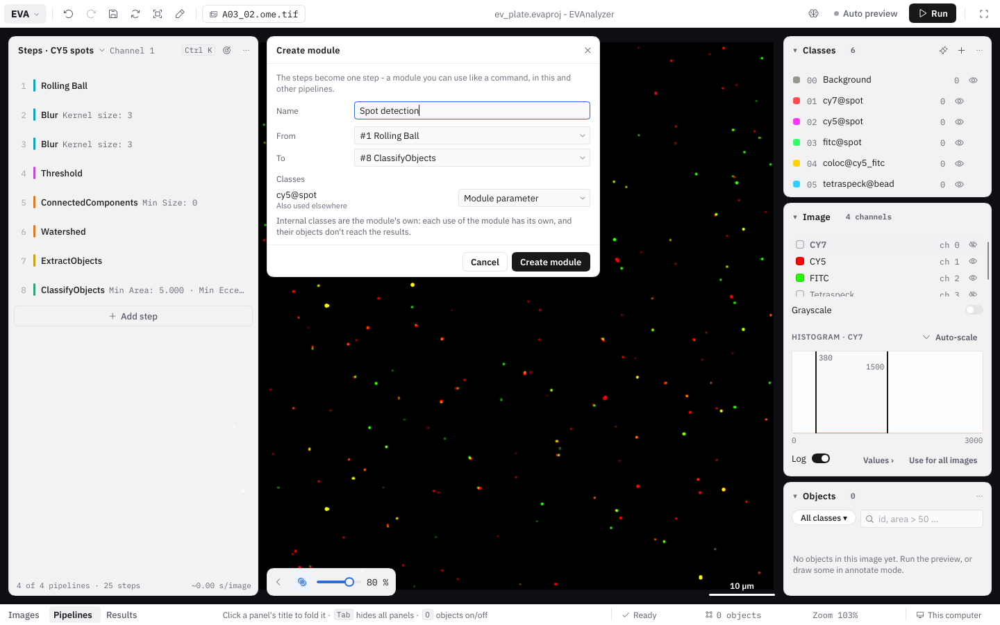
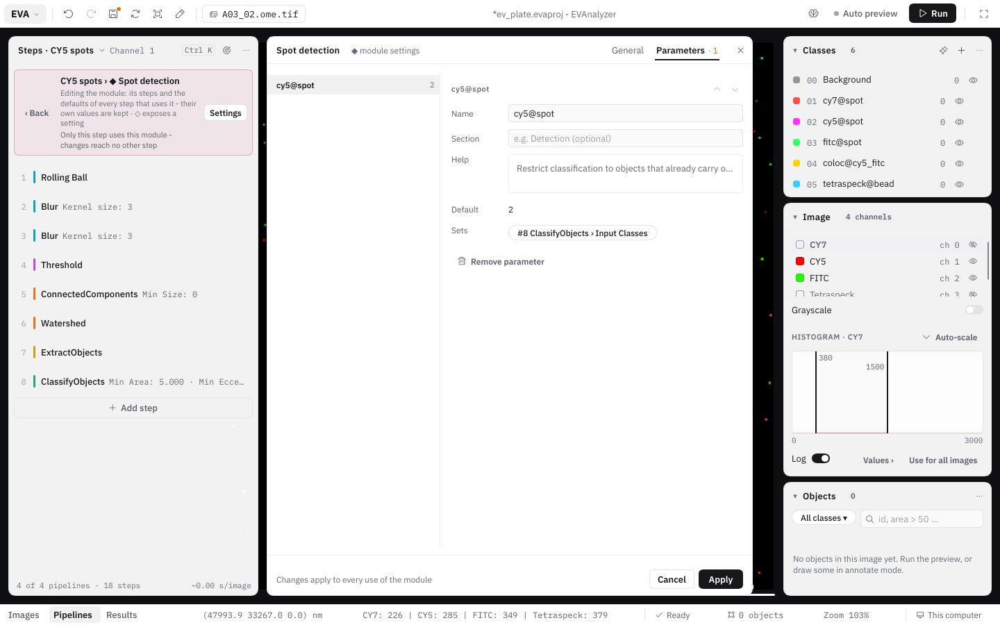

A **module** is a step made of other steps. A module such as _"Cell reconstruction"_ (blur, threshold, connected components, watershed, Voronoi, …) sits in a pipeline like any other command, can be inserted, moved and duplicated, and shows only the few settings that matter - typically an image channel and the classes it writes. Everything else stays as the module's author set it, but can still be looked at and changed.

Modules are useful to

- **reuse** a proven sequence of steps in several pipelines or projects, with one place to change it;
- **hand over** an analysis to colleagues who don't want to build pipelines: they set two or three parameters and run;
- **keep intermediate results internal**: classes the module only needs on the way (seeds, candidates, rejected objects) don't clutter the class list or the results.

Modules and their steps carry the module color - pink - and are marked with **◆**, both in the pipeline and in the command picker.

## Creating a module

1. Choose **Create module** in the **⋯** menu of the first step you want to bundle.
2. In the **Create module** dialog, enter a **Module name** and choose the range of steps (**From** / **To**).
3. EVAnalyzer lists the project classes the steps use under **Classes** and suggests a role for each:

   | Role                      | Meaning                                                                                                                                       | Suggested when                                                                                    |
   | ------------------------- | --------------------------------------------------------------------------------------------------------------------------------------------- | ------------------------------------------------------------------------------------------------- |
   | **Module parameter**   | The class becomes a setting on the module step - every use of the module picks its own class.                                                   | The class is also used outside the selected steps (other steps or pipelines, hand annotations, tile merging). |
   | **Internal (module only)** | The class becomes the module's own. Each use of the module has its own copy, and its objects **don't reach the results**.                       | The class is only used by the selected steps.                                                      |
   | **Fixed**                 | The class stays as it is.                                                                                                                     | Only a segmentation class without an Extract Objects among the steps.                              |

   Change a role with its dropdown. Image channels of [Load Image Channel](/commands/image-processing/load-image-channel/) steps become module parameters too, and memory slots only the selected steps use become [module memory](#memory-slots-in-modules).
4. Click **Create module**. The steps are replaced by one module step - what runs doesn't change.

## The module step

A module step shows the module's **parameters** - each with the same control (dropdown, number field, class picker, …) as the setting it controls, and a **?** with its help text. Every use of a module has its own parameter values.

Its **⋯** menu has the usual step actions (**Settings**, **Disable**, **Breakpoint**, **Duplicate**, **Move up / down**, **Remove step**) and:

| Action               | What it does                                                                                                                   |
| -------------------- | ------------------------------------------------------------------------------------------------------------------------------ |
| **View**             | Opens the module read-only, to see what it does.                                                                            |
| **Edit module**   | Opens the module's steps for editing - changes apply to every use. See [Editing a module](#editing-a-module).        |
| **Edit in place**    | Gives this step a copy of its own (it asks for the copy's name if other steps use the module) and opens it - changes stay with this step. |
| **Expand**           | Puts the steps back into the pipeline, with this step's parameter values. The module's own classes become new project classes, its memory slots pipeline slots. |
| **Save as**          | Saves the module as a library file (`.evamodule`).                                                                            |
| **Create module** | Bundles this and more steps into a new module.                                                                              |

**Update to v_N_** stays on the step itself: it shows when the [library](#module-library) has a newer version of the module. **Duplicate** adds a second use of the same module; **Remove step** removes the step, the module itself stays in the project.

The **?** on any step - module or command - shows what the step does: a command's summary and description, a module's short and long description.

## Editing a module

**Edit module** opens the module's steps in the steps panel, with a bar on top: **‹ Back · Pipeline › ◆ Module · Settings**. The bar also says who else is affected - _Only this step uses this module - changes reach no other step._ Inside, you work as in a normal pipeline - add, remove, move steps and change settings.

Changes to a module **apply to every use of it**. If the module is used by more than one step, EVAnalyzer asks first:

- **Edit for all** - change the module; every step using it follows.
- **Only this step** - make a copy (_"Name (2)"_) just for this step, and edit the copy.

### Exposing settings as parameters

Next to every setting of an opened module is a **◇**. Click it to **expose** the setting as a module parameter - it then shows on the module step, with its current value as default. An exposed setting is marked **◆**; clicking it again hides it.

One parameter can set several settings at once - for example the same class in a Threshold, a Classify Objects and a Voronoi step. When you expose a setting that an existing parameter of the same kind could set, EVAnalyzer asks whether to create a **new parameter** or **add it to** the existing one.

A setting controlled by a parameter always runs with the parameter's value. Editing it inside the opened module changes the parameter's default, and every setting the parameter controls follows.

### Module settings

**Settings** in the bar of an opened module (or **✎** next to a **◆**) opens the **module settings** next to the steps panel, with two tabs:

- **General** - the module's **Name**, **Short description** (one line, shown in the command picker), **Author**, **Organization** and **Description** (shown behind the module's **?**).
- **Parameters** - the parameters as a list by section; the chosen one's form beside it: its **name** on the module step, its **section**, its **help** text (shown as **?** next to the parameter; empty shows the controlled setting's own help), its **default**, the settings it **Sets** (as chips; **Also set…** adds one), **↑ / ↓** for the order, and **Remove parameter**.

Changes apply to every use of the module. **Apply** keeps them; **Cancel** (or **✕**, `Esc`) undoes everything changed while the dialog was open.

### Checks

EVAnalyzer checks modules when a project is loaded and while editing - for example a parameter that controls settings of different kinds, a setting that no longer exists, a [mixing of internal and project classes](#internal-classes), or a module with a [measurement step](/guide/pipelines/#measurement-steps) that is used more than once and so measures under the same **ID** each time (_"… make the name a module parameter, so each use gets its own"_). Problems are shown as **⚠** on the module step, in the [Problems](/guide/pipelines/#problems) panel and in the bar of the opened module, so they are found before an analysis starts.

## Internal classes

An internal class belongs to the module: every use of the module has its own copy, so two uses of _"Cell reconstruction"_ never see each other's seeds. When a use of the module has run its last step, its internal objects are deleted - they **never reach the results database**, and the memory they took is freed right away.

The rules that follow from this:

- **Moving objects into a project class.** An object never carries an internal and a project class at the same time. [Classify Objects](/commands/object/classify-objects/) (and the AI Object Classifier) may _reclassify_ internal objects into a project class - a typical "filter" module: internal candidates in, project-class hits out. _Adding_ a project class to an internal object (or the other way round) is an error.
- **Commands that create new objects** are always fine: the new objects belong to the class they are written to. A Voronoi of internal seeds can write project-class cells.
- **Colocalization links to internal objects** are removed when the module ends. If you want the numbers that come from them (e.g. a spot count per cell), the spot class must be a project class - a module parameter.
- **[Relate Objects](/commands/object/relate-objects/) links to internal parents** are removed the same way: the results then have no children per parent for them. EVAnalyzer warns about both.
- **Extract Objects** inside a module can map a segmentation class to one of the module's classes with its [class mapping](/commands/object/extract-objects/#class-mapping).
- **Dataset steps** such as the [Simple Tracker](/commands/dataset/simple-tracker/) only work on project classes.
- [Cross-tile merging](/fundamentals/cross-tile-merging/) merges internal objects of each use of a module separately.

## Memory slots in modules

The slot picker of [Image Cache](/commands/image-processing/image-cache/) (and other steps that read a stored image) offers inside a module an additional kind, **Module memory**: slots that belong to one use of the module, so a module's intermediate image never overwrites a slot of the surrounding pipeline - or of a second use of the same module. They are freed when the module ends.

## Modules in the command picker

The **Module** chip of the command picker lists the modules **IN THIS PROJECT** (with **used N×**) and, under **LIBRARY**, the modules from library files that aren't in the project yet. A search also finds modules. The description pane shows the module's parameters with their defaults and where it comes from (e.g. _"this project · Segment → Object"_ - the category of its first and last step).

Modules no pipeline uses any more can be removed with **Remove from project** in their description pane, or all at once with **Remove N unused**.

## Module library

**Save as** in a module step's ⋯ saves the module as a library file (`.evamodule`) through the template dialog. **Save as module…** in a pipeline's ⋯ does the same for a whole pipeline. Module files in the `templates` folder in EVAnalyzer's user folder (`~/.local/share/evanalyzer/templates` on Linux, `~/Library/Application Support/evanalyzer/templates` on macOS, `%APPDATA%\evanalyzer\templates` on Windows) appear in the picker's **LIBRARY** section in every project.

- **Inserting** a library module copies it into the project, together with the modules it uses. From then on the project has its own copy: changes affect only the project, never the file, and the project stays complete without it.
- **Updates:** the project remembers which file and version a module came from. When the library has a newer version, the module step shows **Update to v_N_**. Updating keeps every step's parameter values; if the project changed the module since inserting it, EVAnalyzer warns that updating replaces those changes.
- **Project templates** carry the modules their pipelines use, so a template with module steps works in other projects too.

## Modules inside modules

A module can contain other modules. Open an inner one from an opened module - the bar then shows **Pipeline › ◆ Outer › ◆ Inner**, and **‹ Back** goes up one level. **Create module** and **Expand** work inside an opened module too: classes and memory slots the outer module hands in become parameters of the new inner one, and expanding an inner module makes its classes and slots the outer one's. A module can't contain itself, also not through another module - the command picker leaves such modules out.

## Limitations

- Breakpoints can't be set on steps inside a module; a breakpoint on the module's own line stops after the whole module.
- Steps are selected for bundling as a range (**From** / **To**), not by Shift-click.
