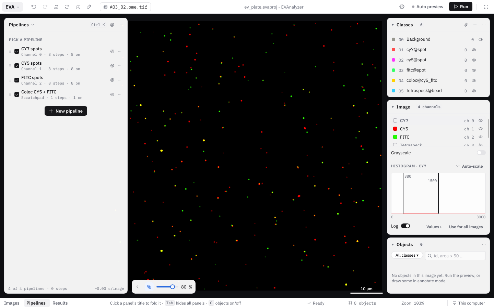
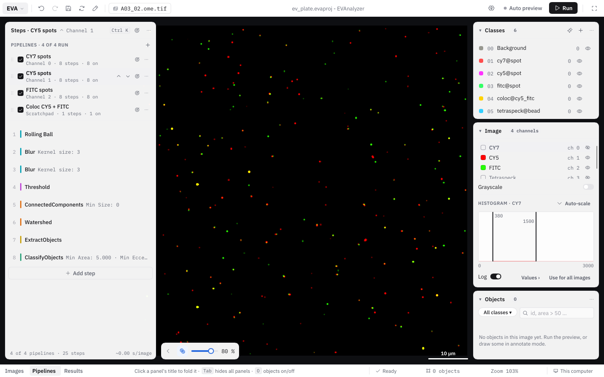
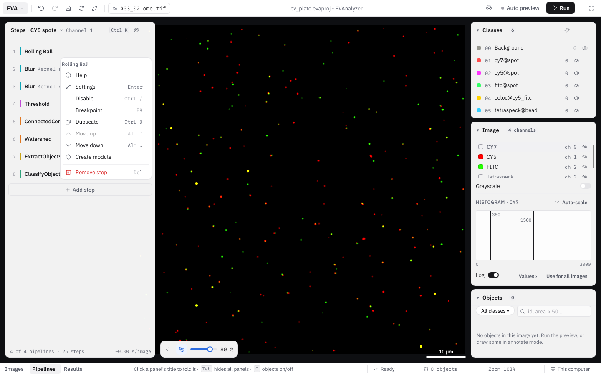
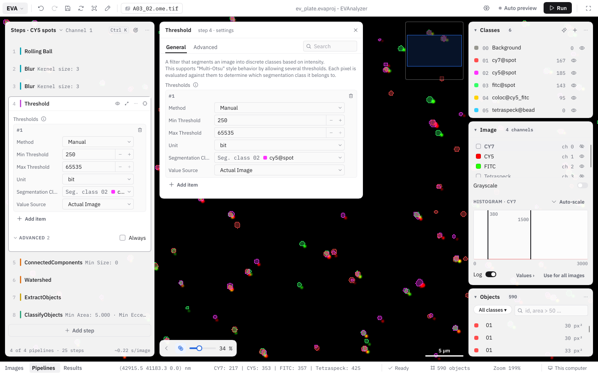
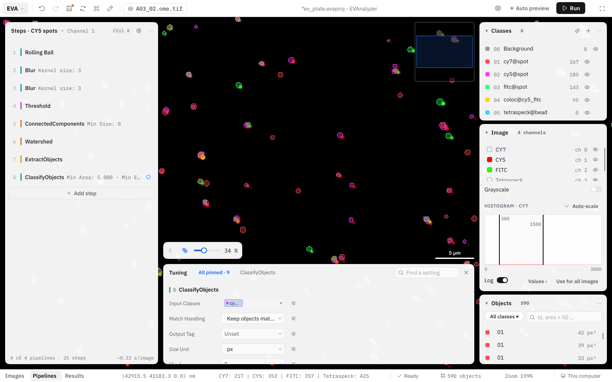
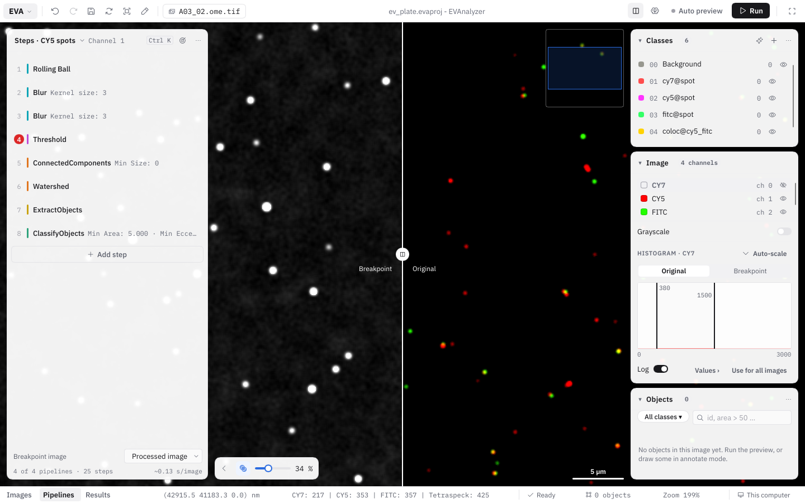
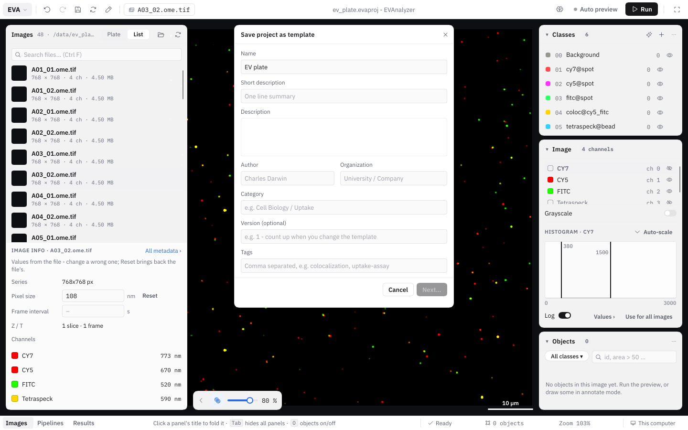

Pipelines define the sequence of image processing commands applied to raw inputs to extract specific objects.
EVAnalyzer supports multiple, independent pipelines within a single project.
Each pipeline can isolate and process a distinct image channel, or target pre-existing parent objects.
Because a pipeline can ingest and refine objects generated by a previous workflow step, users can easily construct complex, multi-channel processing architectures to resolve sophisticated biological queries.

## The steps panel

In **Pipelines** mode (`Ctrl+2`) the **steps panel** on the left shows the steps of one pipeline. Its head names the pipeline; click it to open the **pipeline switcher**.


### Pipeline switcher

The switcher lists the project's pipelines with how many are enabled and how many steps they have.

- The checkbox decides whether the pipeline runs (**4 of 4 run**).
- Click a pipeline to show its steps; click the shown one again to show none.
- Drag a pipeline by its **⋮⋮** to change the order.
- **New pipeline** adds one.
- **⌖** on a pipeline focuses on it - see [Focus mode](#focus-mode).

With no pipeline shown, the steps panel lists the pipelines to pick one.



The **⋯** of a pipeline has **Edit pipeline…** (or double-click the pipeline), **New pipeline**, **Duplicate**, **Save as module…** and **Delete pipeline…**.



### Image source

**Edit pipeline…** opens the **Edit pipeline** dialog next to the steps panel. The image source is the image the pipeline's first step works on:

| Source                 | The pipeline starts with                                                                                                                                  |
| ---------------------- | --------------------------------------------------------------------------------------------------------------------------------------------------------- |
| **Channel**            | An image channel - the usual choice. The picker shows each channel's name and color.                                                                      |
| **None**               | No image. The first step loads one with [Load Image Channel](/commands/image-processing/load-image-channel/) - useful when a pipeline reads several channels. |
| **Scratchpad**         | An empty image - for pipelines that only work on objects.                                                                                                 |
| **Shared memory slot** | The image an earlier pipeline stored with [Image Cache](/commands/image-processing/image-cache/) in a **Shared** slot.                                       |


## Steps

Steps run top to bottom. Each step is one line, like a line of code:

- at the far left its **number** - also its [breakpoint](#breakpoints),
- a colored **stripe** for its category (see below),
- its name and a short summary of its settings (**EVA › View › Step values on a second line** puts them below the name).

Click a line to open its settings right there in the panel. Hovering a line shows its buttons at the end: the **eye** (disable / enable), **⤢** ([step settings](#step-settings)), **⋯** and **⌖** ([pin to Tuning](#tuning-panel)). A selected line takes the keys:

| Key | Action |
| --- | --- |
| `Enter` | The step's settings |
| `Ctrl+/` | Disable / enable the step |
| `F9` | Breakpoint |
| `Ctrl+D` | Duplicate |
| `Alt+↑` / `Alt+↓` | Move up / down |
| `Delete` | Remove the step |

The same actions are in the step's **⋯** menu - **Help** (what the step does), **Settings**, **Disable**, **Breakpoint**, **Duplicate**, **Move up** / **Move down**, **Create module** ([modules](/guide/modules/)) and **Remove step**.



### Step categories

The stripe on a step and in the command picker tells what kind of data goes in and comes out:

| | Category | In → out | Examples |
| --- | --- | --- | --- |
| <span class="evx-cat evx-cat-preprocess"></span> | **Preprocess** | image → image | Rolling Ball, Gaussian Blur, edge detection |
| <span class="evx-cat evx-cat-segment"></span> | **Segment** | image → segmentation mask | Threshold, UNet |
| <span class="evx-cat evx-cat-object"></span> | **Instance Seg.** | mask → labelled mask | Connected Components, Watershed |
| <span class="evx-cat evx-cat-extract"></span> | **Extract** | labelled mask → objects | Extract Objects, Fill Object Holes |
| <span class="evx-cat evx-cat-classify"></span> | **Object** | objects → objects | Classify Objects, Object Math, Voronoi, [Colocalize Objects](/commands/object/colocalization/), [Relate Objects](/commands/object/relate-objects/), [Propagation](/commands/object/propagation/) |
| <span class="evx-cat evx-cat-measure"></span> | **Measure** <span class="evx-new">NEW</span> | objects / image → values | [Measure Image Intensity](/commands/measure/image-intensity/), [Measure Image / Object Texture](/commands/measure/measure-texture/), [Exclude Image](/commands/measure/exclude-image/) - see [Measurement steps](#measurement-steps) |
| <span class="evx-cat evx-cat-dataset"></span> | **Dataset** | all images' objects | [Simple Tracker](/commands/dataset/simple-tracker/) - see [Dataset steps](#dataset-steps) |
| <span class="evx-cat evx-cat-component"></span> | **Module ◆** | | A [module](/guide/modules/): several steps bundled into one, with its own parameters |

A typical pipeline flow:

1. **Preprocess** commands reduce noise and enhance the signal (Rolling Ball, Gaussian Blur, …).
2. **Segment** commands separate foreground from background (Threshold), **Instance Seg.** commands split it into single objects (Connected Components → Watershed).
3. **Extract Objects** converts the labelled mask into objects of a class.
4. **Classify Objects** applies size/circularity filters and assigns an object class.
5. **Object** commands perform further analysis (Colocalize Objects, Relate Objects, …).
6. **Measure** commands measure the final objects or the image (texture, colocalization coefficients, image quality, …).

A step can only follow the categories that fit before it: Extract after Instance Seg. (or another Extract), Object after Extract or Object, Measure after Extract, Object or Measure, Dataset after any of those or another Dataset step.

When a fixed sequence of steps isn't enough - for example to retry a step with other settings depending on the image - use a [Script](/commands/image-processing/script/) step: a small program that runs the same commands with loops and conditions.

### Adding steps

Click **Add step** below the steps, or **+** between two lines (**Insert a step here**), to open the command picker. Its head says where the step goes (_After step 8 of "CY5 spots"_); two tabs list **Commands** and **Modules**. It shows the commands by category - **All**, **Preprocess**, **Segment**, **Instance Seg.**, **Extract**, **Object**, **Measure**, **Dataset**, **Module** - with your **Recents** first and a search (**Search commands…**). It starts on the categories that fit after the step before - after a Classify Objects, **Object**, **Measure** and **Dataset**. The pane on the right describes the chosen command, with its settings, authors and what to cite. **Import bioimage.io model…** sets up an [AI model](/ai/bioimageio-import/).

The picker stays open: each step you add goes in after the one you added before, and the footer confirms it (_"✓ Added Threshold as step 3"_). **Done** closes it. You can also add a command from the [command palette](/guide/workspace/#command-palette) (`Ctrl+K`).


### Step settings

A step's settings open right in the panel (click its line), or in the **step settings** dialog next to the panel (**⤢**, `Enter`, or **Settings** in its ⋯). The dialog - _"Threshold · step 4 · settings"_ - has **General** and **Advanced** as tabs, the step's description, and a search over all its settings.

**Number fields** can be typed into, or changed without typing: drag sideways over the number (one step per 4 pixels), `Ctrl` + mouse wheel, `↑` / `↓`, or the **−** / **+** buttons beside it (not on the small fields).



### Advanced settings

To keep the steps short, each command shows only its essential settings. Settings that rarely need changing - fine-tuning options of the AI models, filters and object commands - are under **Advanced** (with the number of them). If you changed an advanced setting from its default, it says so (**· 2 changed**), so modified settings are never hidden unnoticed. Tick **Always** to show the advanced settings of every step; EVAnalyzer remembers this. Some dropdowns offer extra choices only in the advanced section - it says where (_"More choices in: Partners"_).

### Problems

Settings that can't work - a class that doesn't exist, a module parameter that no longer matches - are marked **⚠** on the step, with the number of problems. The **Problems** panel lists all of them; click one to go to its step. Some problems come with a fix one click away - **Add class _N_** for a missing class, **Stop setting _<setting>_** for a module parameter that no longer matches.

## Tuning panel

When a pipeline is nearly right, the last few settings that matter are often spread over several steps. **Pin** them to keep them together: the pin next to a setting (shown, like its **?**, while you point at the row) adds it to the **Tuning** panel, docked below the image; **⌖** on a step's line pins all its settings (again: unpins them).

The Tuning panel has a tab **All pinned · N**, one tab per step and **Find a setting**. Change a value there and the preview follows - without opening the steps. The pins are saved with the project; **✕** closes the panel, a new pin opens it again.



## Live preview

The image shows the result of all steps on the current image. With **Auto preview** on (top bar), any change refreshes it; **Refresh preview** (`F5`) refreshes it once - after switching images, for example. The bottom bar shows how many objects it found.

The preview only works on the part of the image in view. **Preview the whole image** <span class="evx-new">NEW</span> (top bar, `Shift+F5`) runs it on the whole image - the visible part first - and its note says how many objects the whole image has (_"Whole image: 1 204 objects"_). The note stays until another image is shown; a change of the settings cancels a running whole-image preview, or marks a finished one _"Whole image: outdated - settings changed"_.

While the preview runs, a small pill at the top of the image shows its progress; its **✕** cancels it. An image that takes a moment to open shows _"Opening <name>…"_ in the same pill first (no ✕), and the bottom bar says **Opening** instead of **Ready**. If the preview fails, the pill says why and in which step - _"Preview failed in cellpose › #3 Blur: …"_. A message too long for the pill opens as a card with the whole text, **Show step** (selects the step in the steps panel) and **Copy message** (for a bug report). Neither blocks the image.

### Measurements panel

When a pipeline or module has [measurement steps](#measurement-steps), the **Measurements** panel on the right (`Alt+5`, **EVA › View › Measurements**) lists what the preview measured, by step: each measurement's name, its step and value - an image's own value (_image_), or the median over the objects (_median of 23 objects_). Its head says **visible part**: like the preview, it measures only what is in view. Click a row to show its step. When an [Exclude Image](/commands/measure/exclude-image/) step would leave the image out, a banner says so and why (_"Excluded from the results: …"_).

<div class="evx-shot-todo">
<strong>Measurements panel</strong>
<span>The Measurements panel on the right ("visible part" in its head): rows of measurement name, step · median of N objects, value; an Exclude Image banner on top.</span>
<code>src/assets/screenshots/screenshot-measurements-panel.png</code>
</div>

### Breakpoints

To see the image as it is after a step - not just the final objects - set a **breakpoint**: click the step's number at the far left of its line (or `F9`). Each click goes one further:

- **Stop** (red) - the preview stops at this step and shows its image.
- **Snapshot** (orange) - the preview keeps the image of this step and runs on to the end.
- **Off**.

The steps panel's footer then offers **Breakpoint image**: which image of the step to show (e.g. **Processed image**). Breakpoints can't be set on the steps inside a module; on a module's own line, it stops after the whole module.

### Compare with the original

With a breakpoint image, **Compare** in the top bar shows the breakpoint image and the original side by side, with a divider between them:

- drag the divider to move the cut; near an edge it snaps there and shows only one side,
- click the divider's handle to swap the sides,
- hold `Space` to see the whole original.

While comparing, the [histogram](/guide/images/#histogram) offers **Original | Breakpoint** - the breakpoint image has its own black and white points.



### Measurement steps

**Measure** steps - category **Measure** in the command picker - add values to the results without changing any object. They come after the objects are final (after the Extract and Object steps), so they measure what ends up in the results. Some measure the **image** - one value per image plane, of the whole image or of the area a class covers (the **Measure Image …** commands, e.g. [Measure Image Quality](/commands/measure/image-quality/), [Measure Image Area Occupied](/commands/measure/area-occupied/)) -, others measure **each object** of a class (the **Measure Object …** commands, e.g. [Measure Object Shape](/commands/measure/measure-object-shape/), [Measure Object Distance To Parent](/commands/measure/measure-distance-to-parent/)). Colocalization and texture come as a pair: [Measure Image / Object Colocalization](/commands/measure/measure-colocalization/) and [Measure Image / Object Texture](/commands/measure/measure-texture/). A value that points to another object - the nearest neighbour, the parent - stores that object too.

Every measurement step has an **ID**, unique in the project, which names its values: a value's key is _ID/measurement_, and the results show it as **ID · measurement** (e.g. **coloc_01 · Pearson**). A new step gets the next free ID of its kind (`coloc_01`, `coloc_02`, …); a duplicated step gets a new one. An ID may only have letters, digits and `_`, and IDs that differ only in case count as the same - both are reported as [problems](#problems) on the step. A module with a measurement step that is used twice measures under the same ID twice: make the ID a [module parameter](/guide/modules/#exposing-settings-as-parameters), so each use gets its own.

Later steps choose measurements by these names - [Exclude Image](/commands/measure/exclude-image/) for example leaves an image out of the results by **Rules** that compare a **Measurement** with a **Value**. The values show in the [Measurements panel](#measurements-panel) while you tune, as columns in [Results](/guide/results/#list-view) and in the [measurements export](/guide/results/#exporting-results).

### Dataset steps

Most steps work on one image (or one tile of it) at a time. **Dataset steps** - category **Dataset** in the command picker - run **once after every image has been analysed**, on the stored objects of all images, frames and wells, without pixels. Tracking objects through a time-lapse is the first example: [Simple Tracker](/commands/dataset/simple-tracker/).

Add dataset steps at the end of a pipeline, after the objects they use are classified. They only work on project classes, and they don't run in the live preview - only in an analysis.

## Focus Mode

A project with several pipelines quickly fills the viewer with channels and object classes that have nothing to do with the pipeline you are working on. **Focus mode** shows only what belongs to the shown pipeline:

- only the pipeline's **image channel** (all channels if the pipeline reads from a scratchpad or memory source), and
- only the **object classes** the pipeline creates, reads or filters on.

While a pipeline is focused, a banner **Focused on "…"** appears above the channel and class lists, so hidden channels and classes never look like a bug. Click **Show all** in the banner to leave the focus.

| Action | Effect |
| --- | --- |
| **⌖** in the steps panel's head | Switches focus mode on or off. While on, showing another pipeline moves the focus to it. EVAnalyzer remembers this setting. |
| **⌖** on a pipeline in the switcher, `Alt`+click on a pipeline, or `F` | Focuses this pipeline right away (`F` uses the shown one). Doing it again on the focused pipeline shows everything again. |

Focus mode only changes what is displayed. Your own visibility settings for channels and classes are not touched - leaving the focus restores them exactly.


## Reusing a pipeline

**Save as module…** in a pipeline's ⋯ turns the whole pipeline into a [module](/guide/modules/) and saves it to the library: it then appears in the command picker under **Module** in every project, as one step with the parameters you choose.

## Saving a Project as a Template

You can save an entire project - its class definitions, plate configuration, and all pipelines - as a **project template**.

Click **EVA › Save as template…** to open the template dialog.
Fill in **Name**, **Short description**, **Description**, **Author**, **Organization** and optionally **Category**, **Version** (count it up when you change the template) and **Tags**, then click **Next…** to choose a save location.
Project templates use the `.evatemplate` extension.

To create a new project from a template, use **EVA › New from template…** or **New project from a template…** on the Start page.
This pre-populates the classes, plate settings, and all pipelines, so you can start a new experiment with a known-good configuration without rebuilding from scratch.

You can also open an `.evatemplate` file directly with **EVA › Open…** - EVAnalyzer detects the project-template extension and applies it the same way **New from template…** does, so a template downloaded or shared with you doesn't need a separate import step.



:::tip
Use project templates to standardize analysis configurations across your lab - share a single `.evatemplate` file to ensure every team member starts from the same pipeline and class setup.
:::

## Running the Analysis

Once all pipelines are configured, click **Run** at the top right. The **Run analysis** dialog opens below it, shows how many pipelines and images will run, and asks for an optional **Job name** - left blank, the generated name shown in the field is used (_Leave blank to use "brave_otter"._).

If the pipelines have dataset steps, the dialog offers **Only run the dataset steps**: no image is analysed again - the dataset steps run on a copy of an earlier analysis (chosen from the list), saved under the new job name. Use it to try other tracking settings without re-analysing every image.

While the analysis runs, **Run** in the top bar turns into its progress (**Analyzing ▬ 12 / 48 · ~2 s**) and **Stop**; the window stays usable (see [Working while an analysis runs](/guide/workspace/#working-while-an-analysis-runs)). When it is done, **Analysis finished · N images** offers **Open results**.


Results are written to a folder of their own in the project's folder, named by the start time and the job name:

```
<project folder>/results/<date>__<job_name>/<job_name>.evadb
```

Next to the database, `<job_name>.evaproj` keeps a copy of the exact settings the run used - open it to see, or restore, what produced these results.

## Best Practices

- Add **one pipeline per image channel** you want to analyze.
- Add **separate pipelines** for object-processing steps (colocalization, in-cell counting) that operate on already-extracted objects.
- Pin the settings you keep adjusting to the **Tuning** panel instead of opening step after step.
