EVAnalyzer stores the results of each analysis in a DuckDB database file, in a folder of its own named by the start time and the job name:

```
<project folder>/results/<date>__<job_name>/<job_name>.evadb
```

The folder also holds `<job_name>.evaproj`, a copy of the exact settings that analysis used.

Results are a mode of the main window: switch to **Results** in the bottom bar (`Ctrl+3`).

## The results bar

In Results, the top bar holds the results' controls:

- **Analysis ▾** - the analysis shown, picked from every analysis of the project's images (**ANALYSES · N**). With none open the chip says _Pick an analysis_; with none at all the menu says _"None yet - Run writes one"_. The same menu has **Refresh** and **Show the output folder**.
- The project's [views](#views) as tabs - each a **List**, **Plate**, **Charts** or **Tracks** - and **+** (**New view**) to add one.
- On the right a **Z/T** stepper when the data has Z-stacks or time-lapse frames - it applies to whichever view is open -, **Full | Split with image** - the results alone, or [beside the image](#split-with-the-image) (not for Charts: _"Split view works with List, Plate and Tracks"_) - and **Export…**.

Each view has its settings in a panel on the left and its content beside it. The bottom bar shows the number of images (_"81 images · 1 disabled"_).


## Views

A **view** is one way of looking at the results, with all of its settings: a List with its classes, columns and aggregations, a Plate with its value and colors, a chart with its axes, and whether the image is shown beside it. The views belong to the **project**, not to one analysis: every analysis of the project opens with the same views, so a view set up once - say _"Spots per cell"_ or _"QC"_ - shows the next analysis the same way.

A new project has four views: **List**, **Plate**, **Charts** and **Tracks**. The tab of a view says its kind (**LIST**, **PLATE**, **CHART**, **TRACKS**) unless its name starts with it already. A Tracks view is dimmed while the analysis has no [tracks](#tracks).

- Click a tab to show the view. The view shown saves itself: every change of its settings is written into the project (and the project has unsaved changes).
- **+** opens **NEW VIEW**: a **List**, **Plate**, **Charts** or **Tracks** view with the default settings, or **A copy of the view shown**. A new view is named after its kind (_"List 2"_), a copy _"… copy"_.
- Double-click a tab to rename it in place - `Enter` takes the name, `Esc` keeps the old one.
- Right-click a tab for its menu: **SHOW AS** **List**, **Plate**, **Charts** or **Tracks** (the view keeps the settings of each kind, for switching back), **Rename…**, **Move left**, **Move right**, **Duplicate**, **Back to how it was saved** and **Delete** (not the last view).
- With more views than fit, the tabs scroll and **All views** lists them all (**VIEWS · N**).

Creating, renaming, moving and deleting views can be undone with **Undo** (`Ctrl+Z`).

Views name classes by their id and columns by their key, so they fit every analysis of the project. When a view names a column the analysis shown doesn't have - for example a measurement of a step it didn't run - a banner says so: _"Not in these results, left out of the view: … - the view keeps them for other results."_ The view keeps the column for the next analysis that has it.

The CLI can export a results database the way a List view shows it - see [`export --view`](/cli/cli/#exporting-as-a-view).

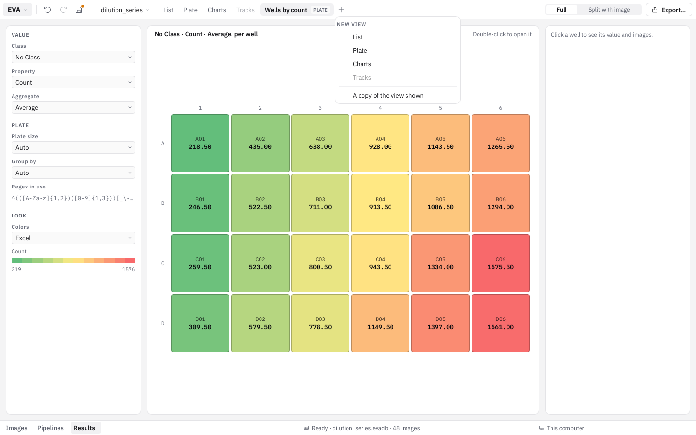

## List View

The **List** view shows one row per detected object. The default columns are **Image**, **Object ID**, **Class** (with the class's color), **Area [px]**, **Area [nm²]** and **Circularity**; more are under **Columns**:

- **General** - **Object ID**, **Track ID** (the track an object belongs to, see [Simple Tracker](/commands/dataset/simple-tracker/)), **Image**, **Class**, **Count**.
- **Geometry** and **Shape** - area, perimeter, circularity, solidity, eccentricity, **Max Feret [px]**, **Min Feret [px]**, **Major Axis [px]**, **Minor Axis [px]**, **Equivalent Diameter [px]** and **Extent**.
- **Coloc** - per partner class **Coloc with …**, the number of partners from [Colocalization](/commands/object/colocalization/).
- **Intensity** - per channel **Avg**, **Sum**, **Min**, **Max**, **Std Dev**, **Median**, **Lower Quartile**, **Upper Quartile** and **MAD Intensity (Ch n)**.
- **Measurements** <span class="evx-new">NEW</span> - the values of the pipeline's [measurement steps](/guide/pipelines/#measurement-steps), named _step ID · measurement_ (e.g. **coloc_01 · Pearson**). A measurement of the whole image shows the image's value in every row of that image. A measurement that points to another object - the nearest neighbour, the parent - has a second column **… · object**; click its cell to see that object.

The settings panel has, under **SHOW**:

- **Images** - **All images**, **Only enabled** or **Only disabled** (the images [left out](#leaving-images-out)).
- three check lists - **Images**, **Classes** and **Columns** - each with **All** / **None** and a search. **Columns** groups per-channel intensity metrics so you can toggle a whole channel at once.

Above the table, **N rows** and the page; use the arrows to page through the results rather than scrolling through everything at once.

Click a row to select it; it stays highlighted. **Show on image ↗** - or a double-click - opens the object on its image: the image opens in the editor with the object marked, and a bar over it, **RESULTS · Row 12 of 200 ‹ › Back to results**, steps to the previous or next row's object or takes you back.

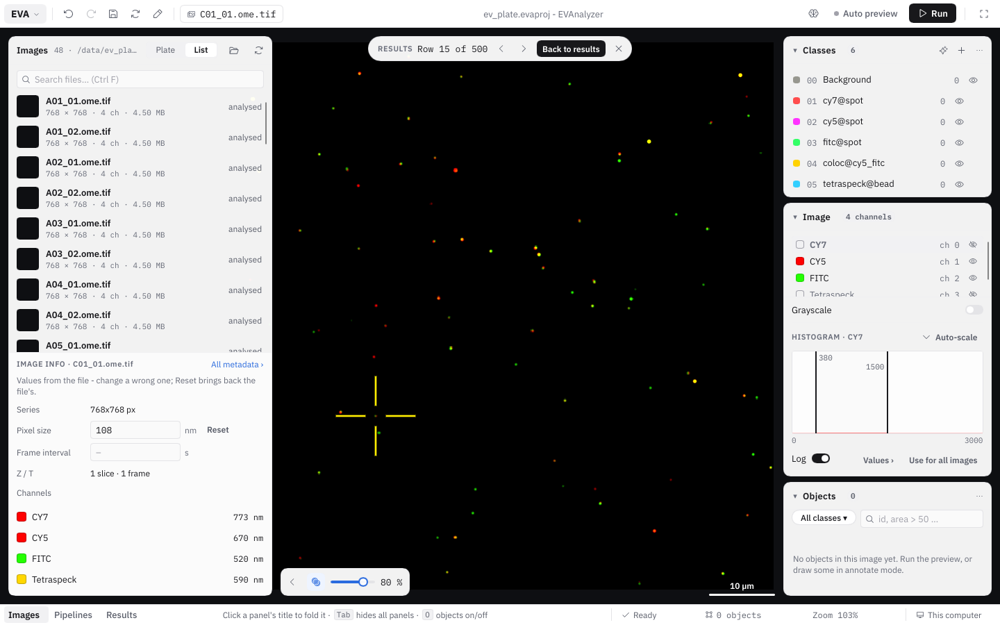

### Grouping and Aggregating Rows

**A row per** (under **ROWS**) switches the table between **Objects** (flat, one row per object), **Images** (one row per image/class combination) and - when the analysis has colocalization partners - [**Coloc pairs**](#coloc-pairs). With **Images**, **Aggregate** picks one or more of **Average**, **Minimum**, **Maximum**, **Std Dev**, **Sum**, **Median** and **Skewness**. Every numeric column is duplicated per selected aggregation (for example **Area (px²) \[avg\]** and **Area (px²) \[sum\]**), so you can compare, say, average object size against total covered area per image.

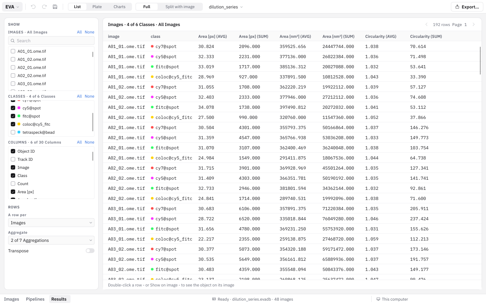

### Transpose

**Transpose** places the classes next to each other instead of below each other - handy when you want to compare classes per image, or paste the table into a spreadsheet that expects one column block per class.

- With **A row per: Images**, the table has **one row per image**, and for every class one block of columns (one column per measurement and aggregation).
- With **A row per: Objects**, the n-th object of each class in an image shares row n, with one block of columns per class. A class with fewer objects in that image leaves its block empty in the extra rows. The image name is the first column, the class is given by the block.

The **Classes** list decides which classes become column blocks.

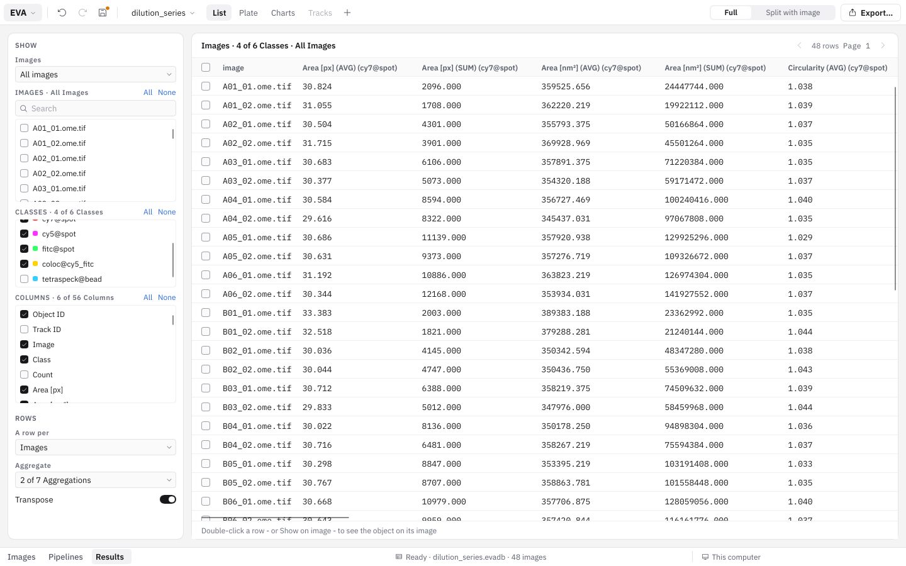

<a id="colocalization-details"></a>

### Coloc pairs

**A row per: Coloc pairs** gives every object one row per partner it colocalizes with: the object's own columns, then one set of measurement columns per partner class. A row built from a partner of one class shows a dash in the columns of every other partner class - those partners get rows of their own. Rows of the same object share a shading.

<div class="evx-shot-todo">
<strong>Coloc pairs</strong>
<span>A row per: Coloc pairs - each object once per partner, partner columns per class, dashes in the other classes' columns.</span>
<code>src/assets/screenshots/screenshot-results-coloc-details-view.png</code>
</div>

### Parents and children

When a pipeline links objects with [Relate Objects](/commands/object/relate-objects/) - spots to the cell they lie in, say - each child stores one parent per parent class. The **ROWS** group then offers two more lists:

- **CHILDREN** - one entry per link, _"Spot in Cell"_. Ticked, every parent row gets the children's **Count** (**Spot · Count**) and, per aggregation picked under **Of the columns** (the same choice as **Aggregate**: **Average**, **Minimum**, **Maximum**, **Std Dev**, **Sum**, **Median**, **Skewness**), that aggregate of every ticked numeric column over its children (**Spot · Mean · Area [px]**). The default aggregation is the average.
- **LINKED OBJECTS** - one entry per parent class, _"Parent · Cell"_. Ticked, every child row gets its parent's ID (**Parent Cell**) and its parent's value of every ticked numeric column (**Parent Cell · Area [px]**).

The counts and IDs are links: click a children's count to list just those children, a **Coloc with …** count to list the partners, a parent's ID to show the parent. A bar above the table names what is shown (_"Spot of Cell 3f9a0c21d4e7"_); **← Back** goes back to the full list.

<div class="evx-shot-todo">
<strong>Parents and children</strong>
<span>List view with CHILDREN "Spot in Cell" ticked and Of the columns: Average - the cell rows with Spot · Count and Spot · Mean columns, one count cell hovered as a link.</span>
<code>src/assets/screenshots/screenshot-results-children.png</code>
</div>

### Leaving images out from the list

Hover a row to see its eye: **Leave this image out of the results** (or **Take this image back into the results**). It applies to the row's whole image, see [Leaving images out](#leaving-images-out). The row of an image left out carries a badge - **Left out** when you left it out, **Excluded** when an [Exclude Image](/commands/measure/exclude-image/) step of the pipeline did; hovering **Excluded** shows the step's reason.

To leave several images out at once, tick their rows (the box at the start of each row, `Shift`-click for a range, the box in the head for the whole page). The bar above the table counts them (_"3 images ticked · 12 rows"_) and offers **Take back in**, **Leave out** and **Clear**.

## Charts

The **Charts** view plots the results instead of listing them. Pick the chart as a tile: **Histogram**, **Scatter**, **Boxplot** or **Over time**.

- **Histogram** bins a chosen numeric property, optionally restricted to one class, and shows the object count and the distribution across bins. Under **Display**: the number of **Bins** and **Counts on a log scale**.
- **Scatter** plots two numeric columns (**X** and **Y**), optionally restricted to one class. Large datasets are downsampled for drawing - **Points drawn** sets how many (**500**, **2 000**, **10 000** or **All**; _"2000 of 41227 objects plotted"_). Click a point to see its object on its image.
- **Boxplot** draws one box (quartile box, median line, whiskers, and outlier dots) for a chosen property. **A box per** groups them by **class**, **image**, **well**, **plate row** or **plate column**. Click a box to see its objects in the List.
- **Over time** <span class="evx-new">NEW</span> follows a property through the frames of a time-lapse. **A line per** **Class**, **Image**, **Well** or **Track** ([tracked objects](/commands/dataset/simple-tracker/)); each line's spread is drawn as a band - **Summary** **Mean ± SD** or **Median + IQR**. **Relative to the first time point** shows the change instead of the value, **Individual tracks, faint** draws every track behind the lines. **Export data…** above the chart writes the lines' values per time point as a table.

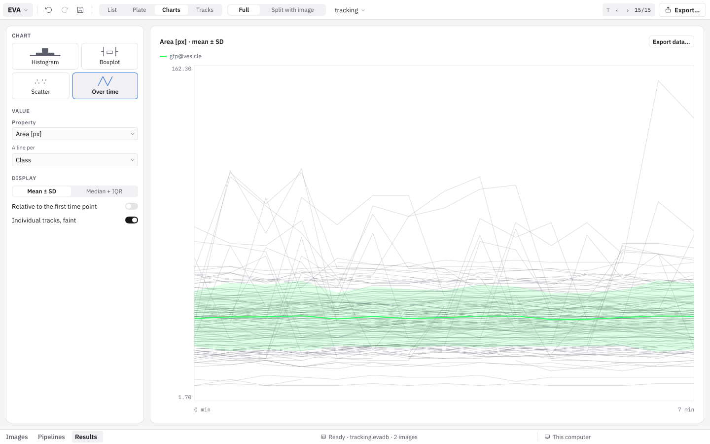

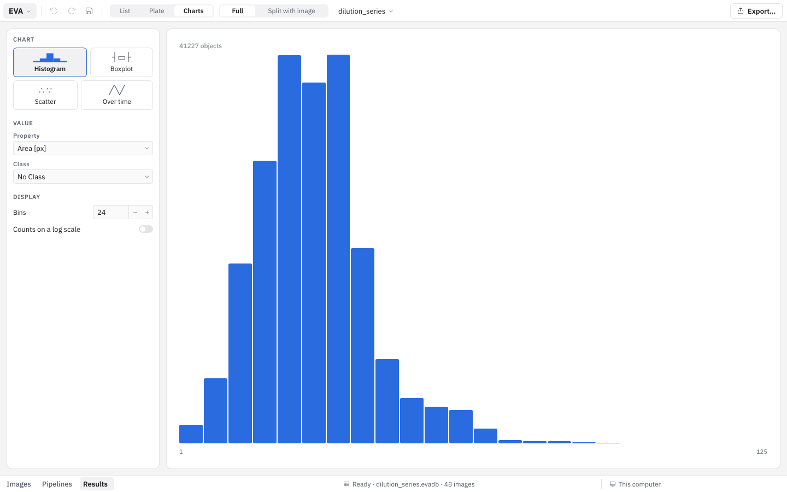

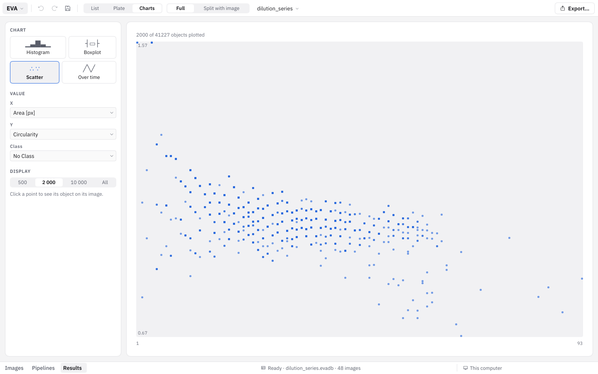

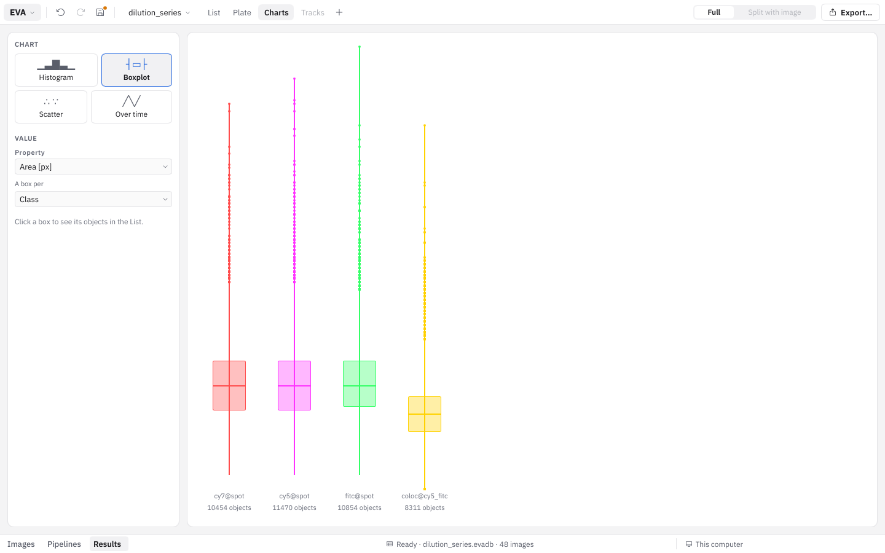

## Plate View

**Plate** lays results out as a physical plate/well grid instead of a table or chart - useful for spotting spatial patterns across a multi-well high-content screening plate. It drills down through three levels: **Plate → Well → Image**.

The settings panel holds the same settings on all three levels: **Class**, **Property** (the metric to color by), **Aggregate**, **Colors** (Excel, Viridis, Plasma, Inferno, Cividis, Coolwarm, Red-Blue, YlGnBu, Haline, Algae, or Thermal) and **Group by**. The legend shows the active color range - click it to switch between **Auto** and a **Manual** min/max.

Click a tile to select it: the card on the right shows its value - and for a well, its images with their own values. **Open well ›** / **Open image ›** drill in, or simply double-click the tile. Inside a well or an image, the plate's head shows where you are - **‹ Plate › Well C3 › image** - click a part to go back there, or **‹** to go one level up.

### Grouping images into wells

**Group by** decides how images are assigned to wells:

| Mode             | How the well is found                                                                                                                                  |
| ---------------- | ------------------------------------------------------------------------------------------------------------------------------------------------------ |
| **Auto**         | The well is detected from the image name, e.g. `A01_01.tif` or `Exp_B3_s2.tif`.                                                                        |
| **Custom regex** | Your own regular expression on the image name. Group 1 is the well (`B03`), group 2 the plate row (`B`), group 3 the plate column (`03`), group 4 the image number inside the well (`01`) - e.g. `^(([A-H])([0-9]+))_([0-9]+)`. |
| **Folder**       | One well per image folder, placed on the plate when the folder is named like a well (`B03/image_01.tif`).                                               |

**Regex in use** shows the regex - for **Auto** and **Folder** read-only, so you can see what was detected.

Grouping, plate size and well layout are **project settings**: they are stored in the project file, are the same values as in **EVA › [Project settings…](/guide/settings/) › Plate & grouping** and the [Images panel's Plate](/guide/images/#plate), and are used by the [plate and well export](#exporting-results). Changing them in one place changes them everywhere.

### Plate

Each tile is one well, colored by the aggregated metric across everything grouped into it. Wells are placed by decoding their group label into a row/column coordinate (e.g. `A14`). Pick a **Plate size** - **Auto** (the smallest standard layout that fits your data) or a fixed layout from 1 to 3456 wells (e.g. **96 Well (8 x 12)**, **384 Well (16 x 24)**).

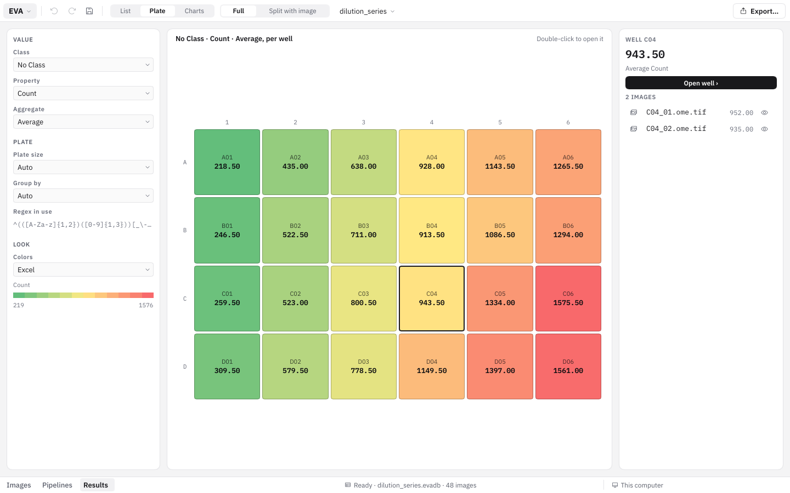

### Well

Drill into a well to see its individual images (fields) laid out as their own grid. **Well layout** sets that grid:

- **Auto** - the smallest square-ish grid that holds the highest image number in the well, images placed in number order.
- **Rows** × **Columns** - a fixed grid, with a free choice of which image goes where.

**Rearranging images by drag and drop.** If the images were not acquired in the order the grid shows them (e.g. a meander scan), drag an image tile onto another position - the two images swap places. The new order is stored in the project's plate settings and applies to every well of the plate. If the layout was **Auto**, the grid shown becomes a fixed grid of the same size first. The same order can also be edited number by number under **Images in well** in [Settings](/guide/settings/).

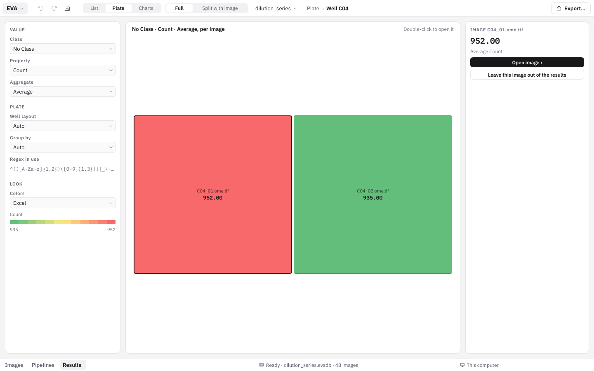

### Leaving images out

An image can be excluded from the statistics, for example because it is out of focus or contains an artifact. Click its eye in the well's card, select its tile inside the well and click **Leave this image out of the results**, or use the eye of its row in the [List](#leaving-images-out-from-the-list); **Use this image in the results** brings it back.

An [Exclude Image](/commands/measure/exclude-image/) step in the pipeline does the same during the analysis: the images it rejects are stored as left out, with its reason, and can be taken back in by hand like any other.

An image left out:

- is left out of every aggregated value - the well's value in the plate view, and the plate/well exports;
- is shown crossed out in the well view, and the well containing it gets a small corner badge in the plate view;
- is shown struck through and dimmed in the [List view](#list-view), with a **Left out** or **Excluded** badge - and listed alone with **Images: Only disabled**;
- is skipped by exports that cover all images. If you select it explicitly in the export's images, it is exported anyway.

The setting is stored in the results database, so it is kept when the results are opened again.

### Failed images and incomplete runs

An image whose analysis stopped with an error only holds the objects found before the error. Such an image is marked with a warning badge in the plate and well views (and in its well), drawn in the warning color in the List view, and - like an image left out - left out of aggregated well values.

If the whole analysis did not finish (cancelled, failed or interrupted, e.g. by a crash), Results shows a warning banner at the top: the results are incomplete.

### Image Heatmap

The innermost level bins a single image's objects into square tiles - the **Square size** (36, 48, 64, 128, 256, or 1024 px) - colored by the same metric and aggregate as the levels above. Click a tile to select it; **Show on image ↗** shows that region of the image in the editor, marked with a rectangle.

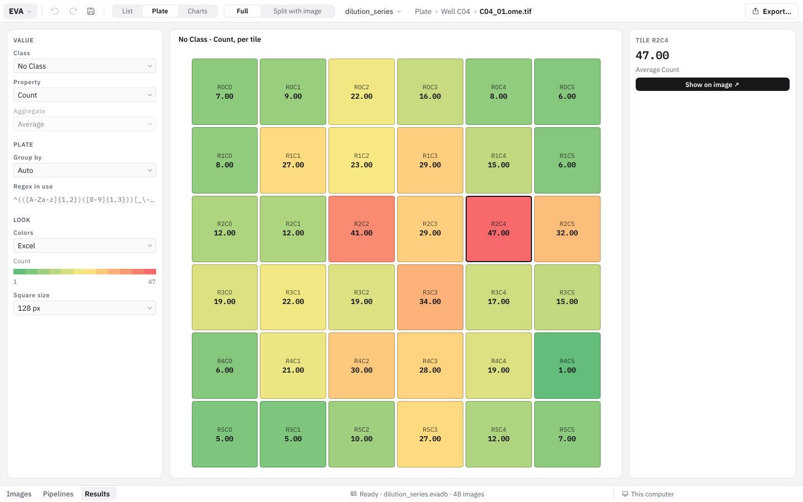

## Tracks

When an analysis has tracked objects - from a [Simple Tracker](/commands/dataset/simple-tracker/) step - the results bar offers a fourth view, **Tracks**: one row per track instead of one per object.

Each track shows its **Image**, **Class**, how many **Time points** it spans, how far it **Moved** (the path from point to point), its **Speed** and its **Straightness** - the distance from its first to its last point divided by the path, so 1 is a straight line and a value near 0 an object that wandered around. **Speed unit** picks **px/frame**, **µm/min** or **µm/s** (the µm units need the pixel size, µm/min and µm/s the [frame interval](/guide/images/#frame-interval)). Click a column's head to sort by it.

The filters above the table:

- **Class** and **Image** - which tracks to list.
- **At least** _N_ **time points** - leave out short tracks.
- **From the first time point** - only tracks that are there from the start.
- **Not touching the edge** - leave out tracks that touch the image's edge, which may have left or entered the field of view.

Click a track to see it on the right: its numbers, its **Area over time**, and **The track's time points** with the position (**X px**, **Y px**) and area at each. **Show in image** opens the split layout at that track.

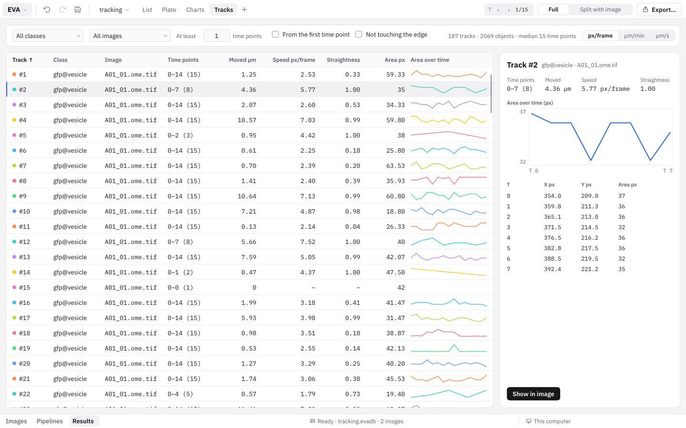

### Tracks beside the image

With **Split with image**, the tracks of one image are listed beside it, and the image draws each track as a trail through its time points. Click a row to select its track on the image - or an object to select its track (_Click an object to select its track_). **‹ ›** step to the previous or next image with tracks; **T** under the image steps through the time points or plays them.

The panel at the top right of the image sets the trails: **Trail** **Off**, the last **10 time points** or the **Whole track**; **All tracks** or **Selected only**; **Color** by **Track** or **Class**.

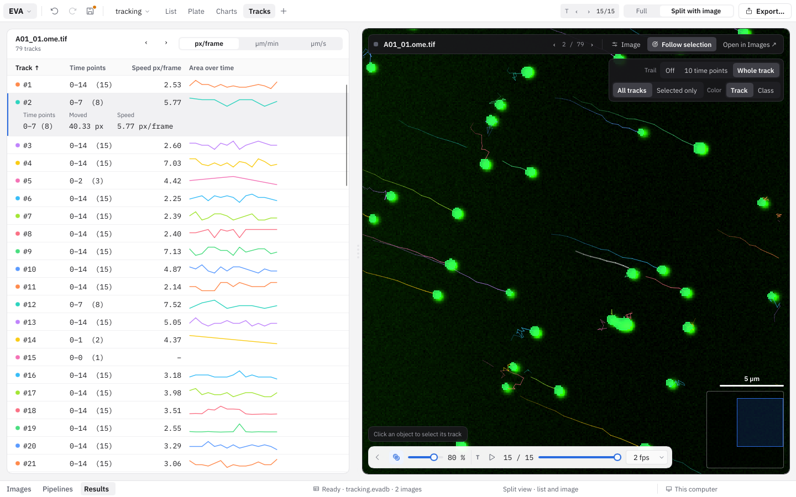

To follow a property of the tracks over time, use the [Over time](#charts) chart with **A line per: Track**.

## Split with the image

**Split with image** in the results bar puts the results on the left and the image on the right, with a divider between them that you can drag. It works with **List**, **Plate** and [**Tracks**](#tracks-beside-the-image).

The analysis' objects are drawn on the image, in their class colors, with their real outlines - the results keep each object's mask. (With **Keep object outlines in the results** switched off in [Project settings › Objects](/guide/settings/#objects), the results file is smaller and the objects are drawn as ellipses.) Select a row in the List and the image **flies to its object** - a yellow crosshair and a card (class, ID, area, the mean of a channel, position, and for [related objects](#parents-and-children) its **Parent** and **Children**) mark it. Click an object on the image to select its row.

- `↑` / `↓` (or **‹ ›**) step to the previous or next object; `Esc` lets go of it.
- **Follow selection** switches the flying off - the image then stays where it is.
- **Color by** **Class** or **Value** - with Value, the objects take the heatmap's colors for the plate's **Property**. **Value** needs a property each object has a value of - not **Count**.
- In **Plate**, a well shows its images in a filmstrip under the image.
- **Image** opens a drawer over the image with the **Classes** of the analysis and the [image panel](/guide/images/#image-panel). In the Classes list, the eye shows or hides a class's objects on the image, and a click on a class draws its objects on top of the others; the classes can't be edited here.
- **Open in Images ↗** opens the image in the editor.

The width of the results, whether the split is on, and **Follow selection** are remembered. With **Reduce motion** on (**EVA › Project settings… › Viewport**), the image jumps to the object instead of flying there.

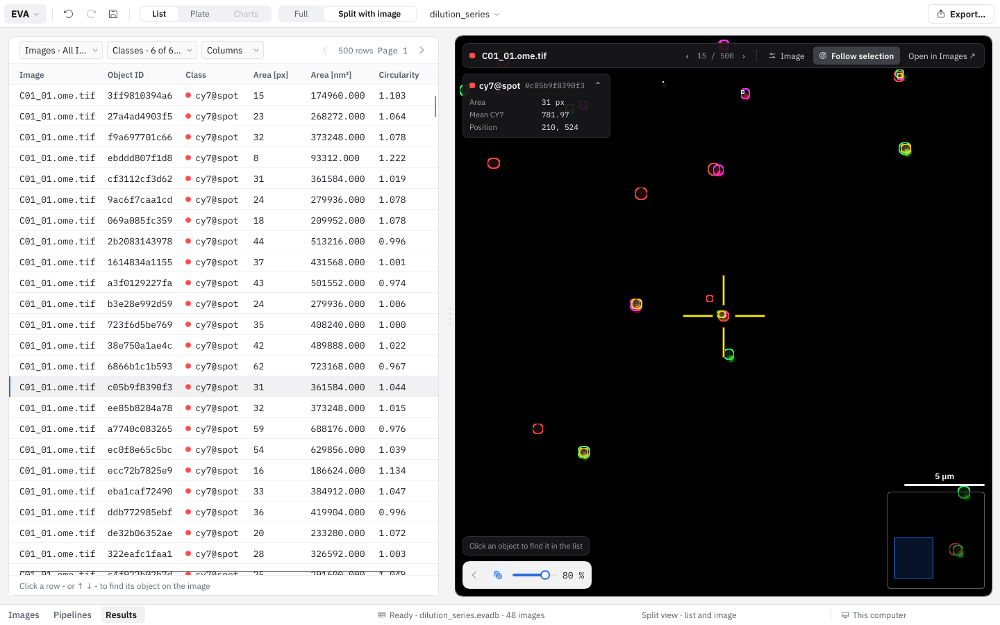

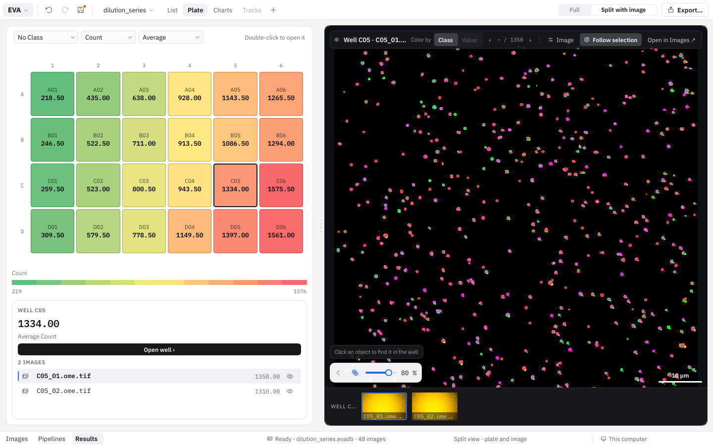

## Exporting Results

**Export…** in the results bar opens the export card below it: what to export, the **Format**, the **Classes** and the folder (**To**). **More options ›** shows the rest. Every checked option is written out together in one run. The card starts from the [view](#views) shown - its columns, classes and aggregations.

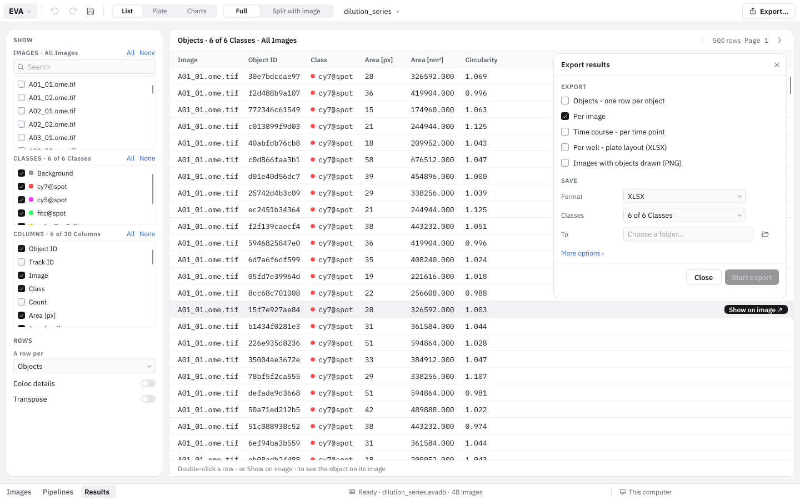

**What:**

- **Objects - one row per object** - with **Images** to pick (all by default; [images left out](#leaving-images-out) are skipped unless you select them explicitly), and optionally **A row per coloc pair** (as [Coloc pairs](#coloc-pairs) in the List) and **Each image in its own file**.
- **Per image** - the same aggregated-by-image data as [a row per image in the List](#grouping-and-aggregating-rows); optionally the **Image heatmap** (the per-image spatial heatmap grid, with its own square size).
- **Time course - per time point** <span class="evx-new">NEW</span> - for time-lapse data: the values per frame, as the [Over time](#charts) chart shows them.
- **Measurements - one row per value** <span class="evx-new">NEW</span> - when the analysis has [measurement steps](/guide/pipelines/#measurement-steps): every value on a row of its own, with what it is about - `image_name`, `image_rel_path`, `z_stack`, `t_stack`, `region`, `object_id`, `related_object_id`, `object_class_name`, `step`, `measurement`, `unit`, `key`, `value`. This long layout reads straight into R or Python, and a new measurement needs no new column. The measurements picked under **More options › Measurements** are written (none picked: all), of the chosen images, Z planes and time points. Written as `measurements.xlsx` / `.csv`.
- **Tracks - one row per track** <span class="evx-new">NEW</span> - the [tracks table](#tracks): who (image, well, class, track), when (time points, duration), how it moved (path, distance, speed, straightness), whether it touches the edge or is there from the start, then its measurements. Lengths in µm when the pixel size is known, durations in minutes when the frame interval is.
- **Per well - plate layout (XLSX)** - the plate as a heatmap; optionally **Plate as list**, **Wells as heatmap** and **Wells as list**, with **Colors** for the heatmaps. Grouping, plate size and well layout are taken from the project's plate settings - the same ones the [Plate view](#grouping-images-into-wells) uses.
- **Images with objects drawn (PNG)** <span class="evx-new">NEW</span> - each image as a PNG, with its channels in their colors (auto-scaled) and every object's box in its class color. Large images are written at the pyramid level up to 4096 px.

**Format** - **XLSX** (default), **CSV**, or **Parquet**.

**More options ›:**

- **Name prefix** - put in front of every output file name as `{prefix}_{name}` (e.g. `exp1_list.xlsx`), so exports of several experiments can share one folder. Characters that aren't allowed in file names are replaced by `_`.
- **Transpose the tables** - writes the object and image tables [transposed](#transpose), with the classes next to each other.
- **Measurements** and **Aggregations** - which columns and aggregations to write.
- **Z planes** and **Time points** - restrict the export to a range.

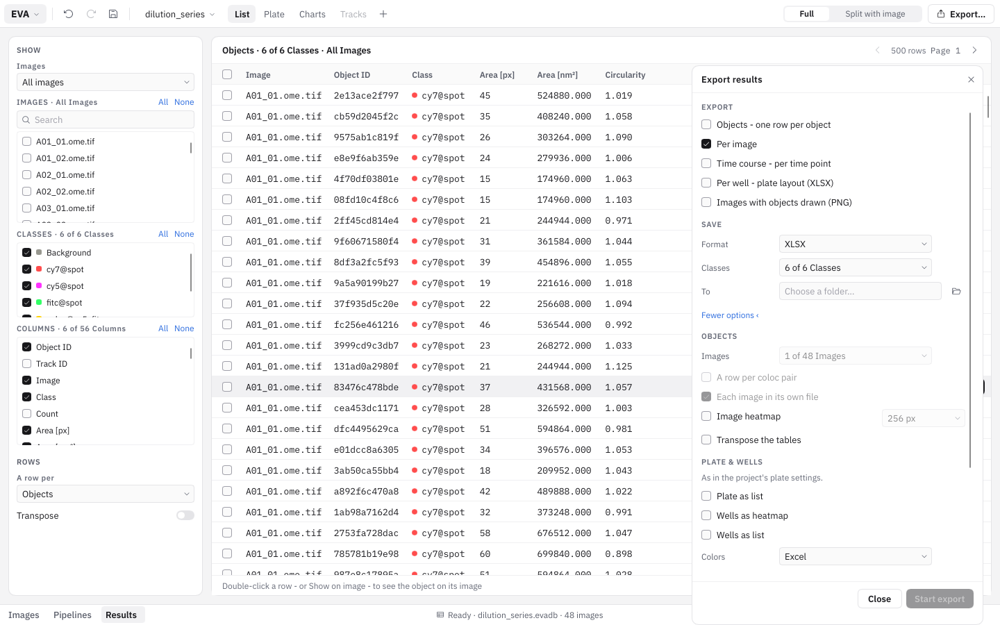

The image heatmap and the plate and well exports are XLSX-only. **Parquet** goes further: picking it ignores every other setting (filters, columns, grouping, checkboxes) and writes a single `objects.parquet` file - a raw, unfiltered dump of every column in the results database (and, when the analysis has measurements, `measurements.parquet` beside it), meant for downstream tools that read Parquet natively rather than for a human to open.

In XLSX exports, values that come from (or, for a well/plate, are affected by) an image left out are grayed out and struck through.

Click **Start export**; a progress bar tracks the run and a message confirms completion or reports an error. For XLSX/CSV, results are named for what they contain (`list.xlsx`/`.csv`, `grouped_by_image.xlsx`/`.csv`, `measurements.xlsx`/`.csv`, `plate.xlsx`, `well.xlsx`, `plate_list.xlsx`, `well_list.xlsx`, `heatmap_{image}.xlsx`), each preceded by the name prefix if one is set.

:::tip
For colocalization exports, partner lookups are resolved in batches of 5,000 source objects at a time - large colocalization datasets export reliably without needing to load everything at once.
:::
