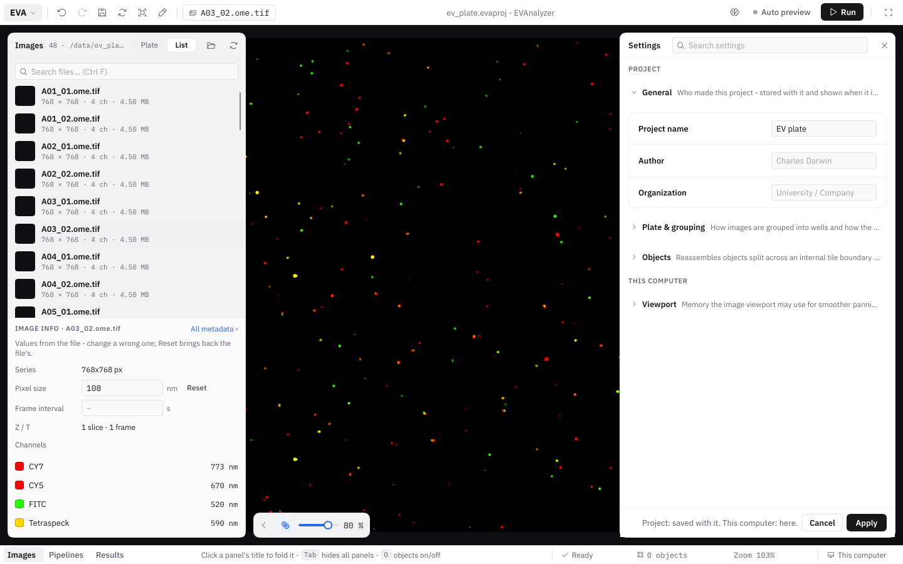

Open **EVA › Project settings…** to change the settings of the open project and of EVAnalyzer on this computer. They open as a sheet on the right; the image and the panels stay usable beside it. Each section opens and closes by its head. Use **Search settings** at the top to find a setting by name, e.g. _"plate"_, _"merge"_ or _"memory"_.

**Project settings are saved with the project; the settings under This computer here.** **Apply** saves the changes, **Cancel** discards them, and **Reset to defaults** sets the shown section back to its defaults.

## Project

### General

| Setting          | Description                     |
| ---------------- | ------------------------------- |
| **Project name** | Name of the project.            |
| **Author**       | Who created the project.        |
| **Organization** | University, institute, company. |

### Plate & grouping

How images are grouped into wells and how the plate and the wells are laid out - **Grouping**, **Regex**, **Plate size**, **Well size** (**Rows** / **Columns**) and **Images in well**. These are the same settings as in the [Results' Plate view](/guide/results/#grouping-images-into-wells) and the [Images panel's Plate](/guide/images/#plate); see there for what they mean.

### Objects

The settings of [cross-tile object merging](/fundamentals/cross-tile-merging/#settings) - **Merge objects across tiles**, **Exclude classes**, **Connectivity** and **Max fragments per group** - and what the results keep of the objects:

| Setting | Description |
| --- | --- |
| **Keep object outlines in the results** NEW | On (the default): the results store each object's mask, so the [split view](/guide/results/#split-with-the-image) draws its real outline. Off: a smaller results file; the split view draws the objects as ellipses. |

## This computer

### Viewport

How the image viewer works on this computer: its memory - which matters most for large and whole slide images; the defaults suit most computers - and how images and objects open.

| Setting                                  | Description                                                                                                                                                                                               |
| ---------------------------------------- | --------------------------------------------------------------------------------------------------------------------------------------------------------------------------------------------------------- |
| **Keep earlier high-resolution renders** | Panning back or zooming shows the sharp earlier renders instead of the blurry overview - most useful for whole slide images. Off: only the current render and one overview are kept (least RAM).          |
| **Memory for earlier renders**           | In MB. The graphics card holds about as much again.                                                                                                                                                       |
| **Object overlay margin**                | In pixels: how far objects are drawn past the visible area, so panning doesn't uncover an empty border. 0 uses the least RAM; objects at a newly uncovered edge then appear once you stop moving.         |
| **Size caches automatically**            | Sizes the tile and overview caches from this computer's RAM. Off: use the sizes below.                                                                                                                    |
| **Tile cache**                           | In MB: image tiles kept after reading, so panning back or returning to an image doesn't read them from disk again.                                                                                        |
| **Overview cache**                       | In MB: whole-image overviews kept, so switching between images shows them at once.                                                                                                                        |
| **Free caches when an analysis starts**  | Gives a local analysis the RAM of both caches; they fill up again as you use the viewport.                                                                                                                |
| **Preview tiles**                        | At most this many tiles in a preview - zoomed out further, zoom in first. **Auto**: one per 4 GB of RAM of the computer running it.                                                                         |
| **Breakpoint tiles**                     | The visible tiles nearest the middle show their [breakpoint image](/guide/pipelines/#breakpoints) - each up to ~190 MB RAM while a breakpoint is set (freed when it is cleared or an analysis starts). **Auto**: as this computer's RAM allows. |
| **Draw in software**                     | Without the graphics card: about 135 MB less RAM, and smoother on computers without a working graphics driver (virtual machines, remote desktop, older computers). Slower on very large screens. Takes effect after a restart. |
| **Objects as a table**                   | The objects open as a [table](/guide/classification/#objects-as-a-table) below the image. Off: as a list in the right panel. Its ⋯ switches either way.                                                    |
| **Auto-scale new images**                | An image opened the first time is auto-scaled, every channel. Off: the full value range. The scaling is kept in the project either way.                                                                     |
| **Color channels without a wavelength**  | When an image opens, channels the file gives no emission wavelength get distinct colors (kept in the project as their wavelength). Off: white.                                                             |
| **Reduce motion**                        | No animated moves: the results' [split view](/guide/results/#split-with-the-image) jumps to an object instead of flying there.                                                                              |

## Colors

The color scheme - **Light**, **Dark** or **Dim** - is picked under **EVA › View › Colors**, not here. See [Colors](/guide/workspace/#colors).
