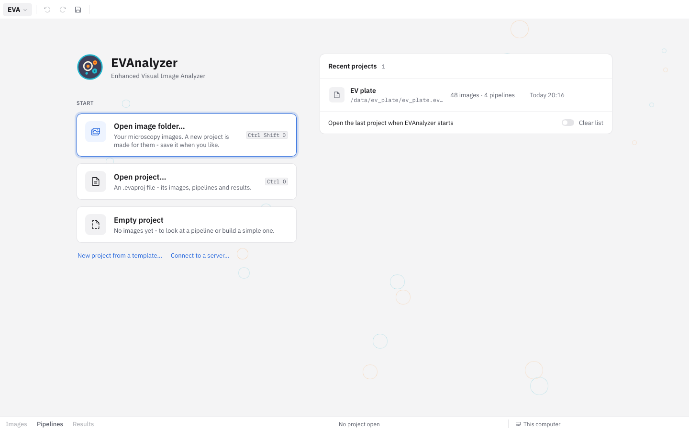
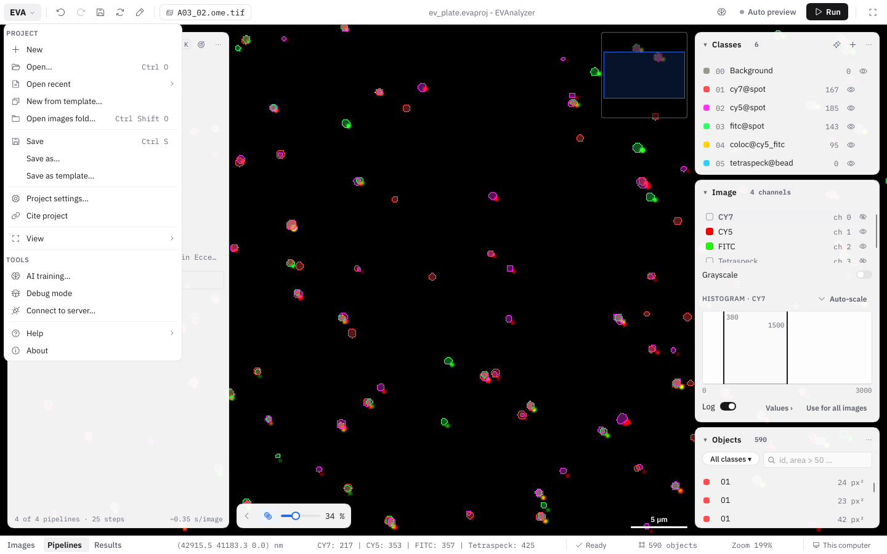
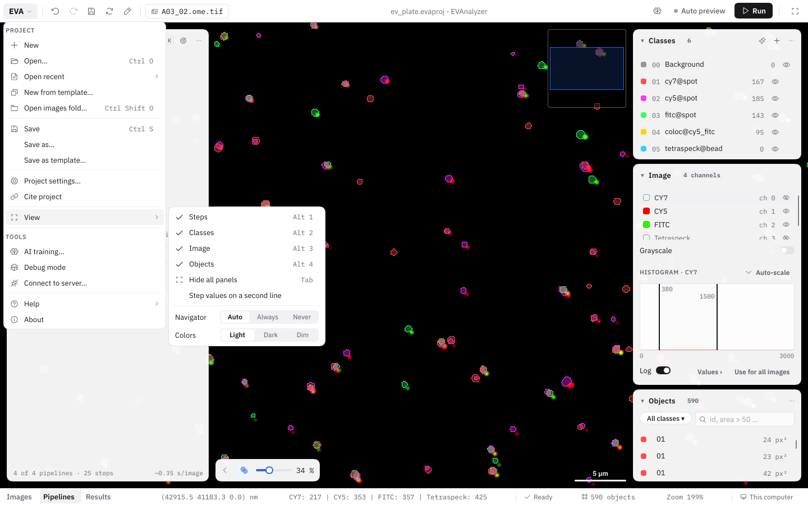
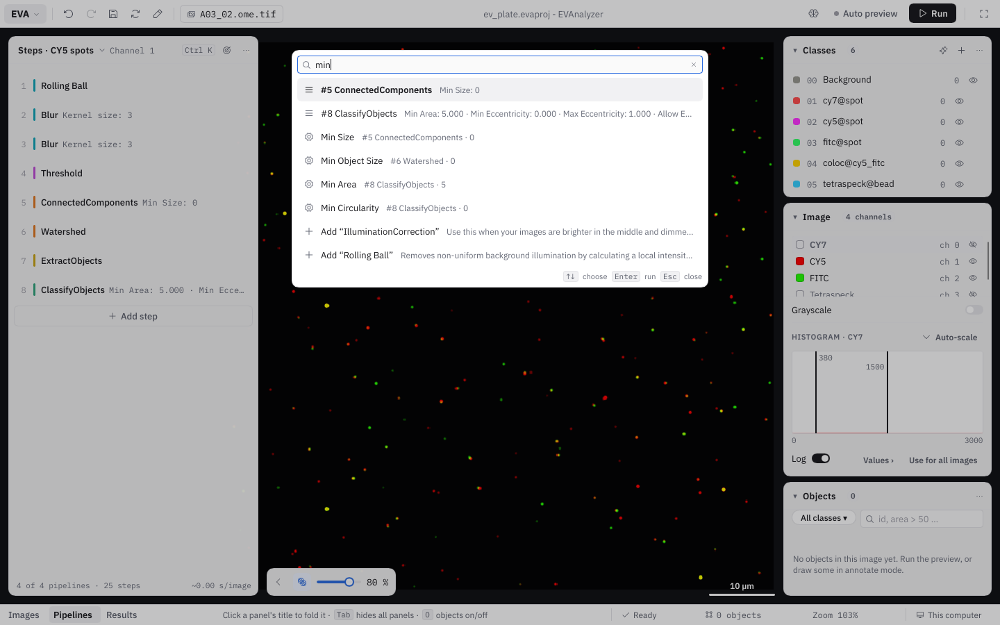
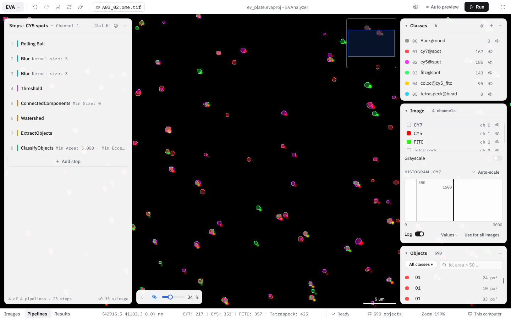
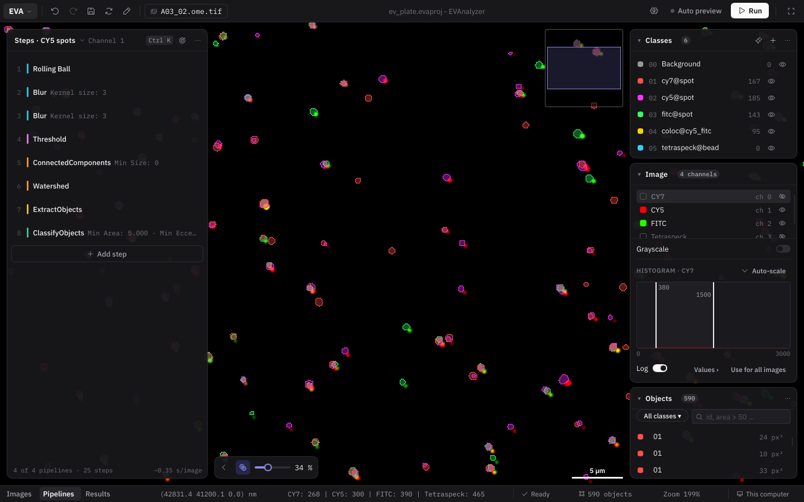
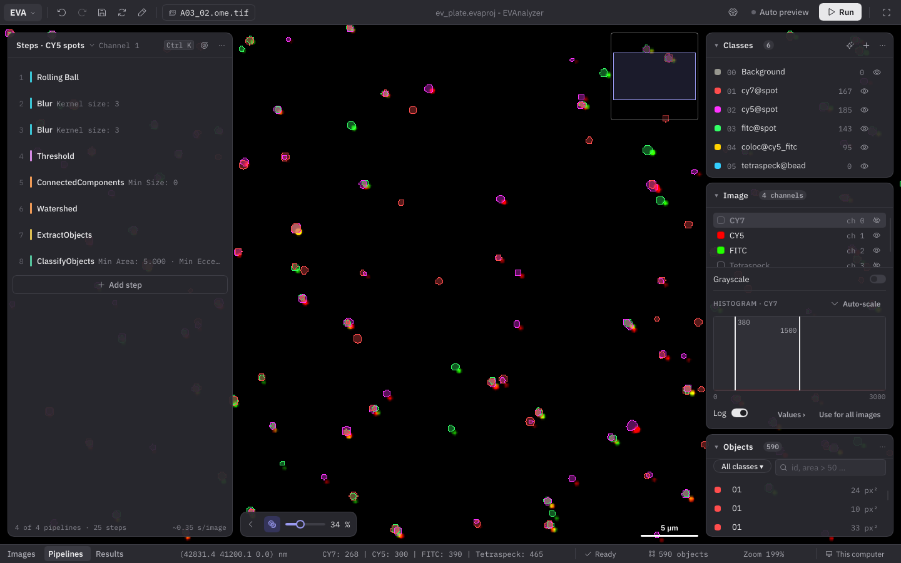
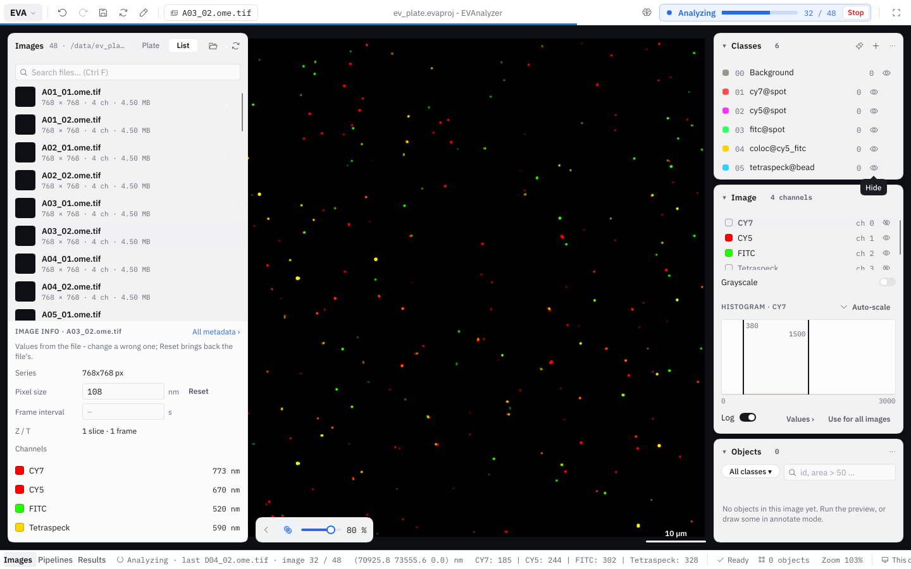
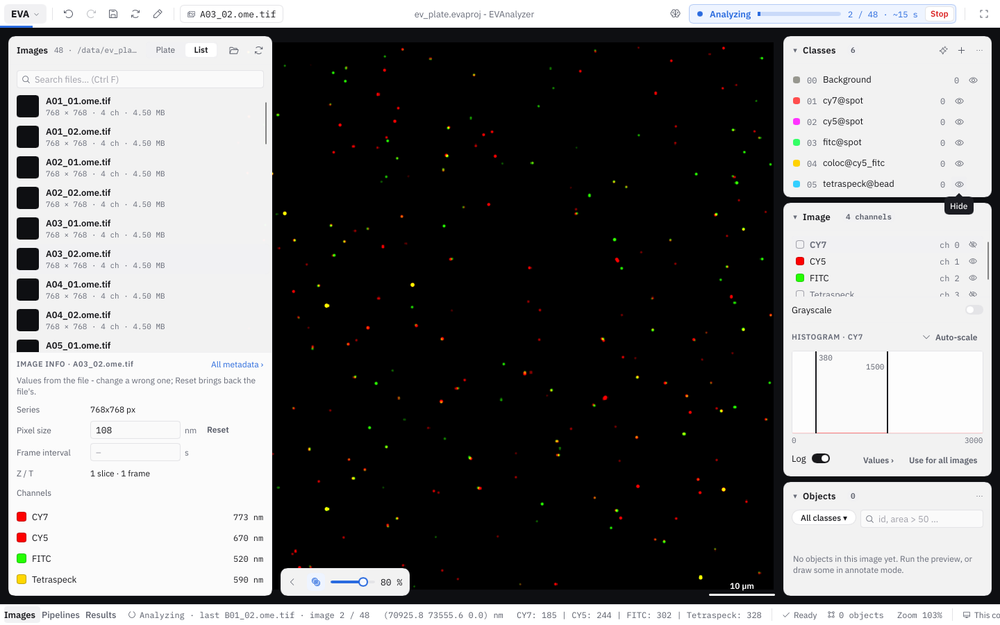

EVAnalyzer keeps the image in the middle of everything. The window has a **top bar**, a **bottom bar**, and between them the image. The panels float over the image instead of sitting beside it, so the image always gets the whole window.

## Start page

As long as no project is open - when EVAnalyzer starts, and after **EVA › New** - the **Start** page fills the window:

| Action | What it does |
| --- | --- |
| **Open image folder…** (`Ctrl+Shift+O`) | The main way in: a new project for the images of a folder. Save it when you like. |
| **Open project…** (`Ctrl+O`) | An `.evaproj` file - its images, pipelines and results. |
| **Empty project** | No images yet - to look at a pipeline or build a simple one. |

Below them, **New project from a template…** starts from the classes, plate settings and pipelines of a [project template](/guide/pipelines/#saving-a-project-as-a-template), and **Connect to a server…** works on a server with [remote control](/remote/remote-control/).

**Recent projects** lists up to 12 projects you opened or saved, with their path, the number of images and pipelines and when you last used them. A project that has moved shows **Locate…**; the **✕** takes it off the list, **Clear list** empties it. Tick **Open the last project when EVAnalyzer starts** to skip the Start page.

After opening images or a project, EVAnalyzer continues in **Images**; after an empty project or a template, in **Pipelines**.

## Top bar

From left to right:

- **EVA** - the [EVA menu](#the-eva-menu).
- **Undo**, **Redo**, **Save**, **Refresh preview** (`F5`) and **Annotate** (switches the [annotate bar](/guide/images/#annotating-the-image) on and off, `A`).
- The **image chip** - the image shown, and for files with several series **Series 2 of 5 ▾** to pick the [series](/guide/images/#series-selection).
- The project's name in the middle.
- **Compare** (only with a [breakpoint image](/guide/pipelines/#breakpoints)), **Debug mode**, **Auto preview** and **Run**. While an analysis runs, **Run** turns into its progress - see [Working while an analysis runs](#working-while-an-analysis-runs).

In **Results** the top bar holds the results' controls instead - see [Results](/guide/results/).

## The EVA menu

Everything that used to be in the menu bar is in the **EVA** menu at the top left:

| Section | Items |
| --- | --- |
| **Project** | **New**, **Open…** (`Ctrl+O`), **Open recent ›**, **New from template…**, **Open images folder…** (`Ctrl+Shift+O`), **Save** (`Ctrl+S`), **Save as…**, **Save as template…**, **Project settings…**, **Cite project**, **View ›** |
| **Tools** | **AI training…**, **Debug mode**, **Connect to server…** (and **Disconnect** while connected) |
| | **Help ›** (**Shortcuts** `F1`, **evanalyzer.org**), **About** |

### View

**EVA › View ›** decides what the workspace shows:

| Item | Key | What it does |
| --- | --- | --- |
| **Steps** (or **Images**), **Classes**, **Image**, **Objects** | `Alt+1` … `Alt+4` | Show or hide that panel. |
| **Hide all panels** / **Show the panels** | `Tab` | Only the image - again: the panels come back. `Tab` does this while no field or button has the keyboard. |
| **Step values on a second line** | | A step's values below its name instead of beside it. |
| **Navigator** | | **Auto** (only zoomed in), **Always** or **Never**. |
| **Colors** | | **Light**, **Dark** or **Dim** - see [Colors](#colors). |

## Bottom bar and modes

The bottom bar switches between the three modes of the window - **Images**, **Pipelines** and **Results** (`Ctrl+1`, `Ctrl+2`, `Ctrl+3`) - and shows the state of what you are doing: the cursor position and pixel value, the number of objects, the zoom, an analysis' progress, and where you work (**This computer** or the server's name, see [Remote Control](/remote/remote-control/)).

| Mode | Left | Right |
| --- | --- | --- |
| **Images** | The [images](/guide/images/) - as a list or as a plate | Classes, objects, image controls |
| **Pipelines** | The [steps](/guide/pipelines/) of the shown pipeline | Classes, objects, image controls |
| **Results** | The [results](/guide/results/) fill the window - or share it with the image | |

Switching modes keeps the image's zoom and position. The bottom bar also reminds you of the panel tricks: _Click a panel's title to fold it · Tab hides all panels · O objects on/off_.

## Floating panels

The panels float over the image and only take the room they need; the image shows through around them. Click a panel's title to fold it to its head, `Alt+1` … `Alt+4` show and hide them one by one, and `Tab` hides them all. Which panels are folded or hidden is remembered.

- **Classes** - the project's [classes](/guide/classification/).
- **Objects** - the objects of the image, as a list or as a [table](/guide/classification/#objects-as-a-table).
- **Image** - channels, overlay, [histogram](/guide/images/#histogram), Z and T, and the [navigator](/guide/images/#navigator).

Dialogs open where they belong - step settings next to the steps, class settings left of the right-hand panels, Settings as a sheet on the right. They don't block the window: the image, the panels and the shortcuts stay usable, and every dialog can be moved by its head. `Esc` closes the open one.

## Command palette

Press `Ctrl+K` (or the **Ctrl K** button in the steps panel's head) to find anything by typing: an action, a step of the pipeline, a setting, a command to add, an image or a class. A setting is found by its name - _"min"_ shows **Min Area · #8 ClassifyObjects · 5** - and opens its step. `↑` `↓` choose, `Enter` runs, `Esc` closes.

## Colors

EVAnalyzer has three color schemes, picked under **EVA › View › Colors**:

- **Light** - white panels on a light grey ground.
- **Dark** - near-black panels; the image behind them is black.
- **Dim** - a softer dark grey, for long sessions in a dark room.

In every scheme the image's background stays black, so fluorescence reads the same. Buttons are black (white in the dark schemes); one indigo marks focus and the selected row. The colors of channels and classes come with your data and are never changed by the scheme.

## Working while an analysis runs

An analysis no longer locks the window. While it runs, **Run** in the top bar turns into its progress - **Analyzing ▬ 12 / 48 · ~2 s** and **Stop** - and the bottom bar names the image it finished last. You can keep looking at images and previewing them meanwhile. The steps are locked while the analysis runs (**Steps are locked while the analysis runs.**); **Unlock** in the steps panel lets you edit them anyway - the running analysis keeps the settings it started with. Switching to another project asks first.

When it is done, **Analysis finished · 48 images** appears over the image, with **Open results**.

On a computer that needs all its memory for the analysis, switch this off in **EVA › Project settings… › Viewport › Edit while an analysis runs**: the window then waits until the analysis is done.

