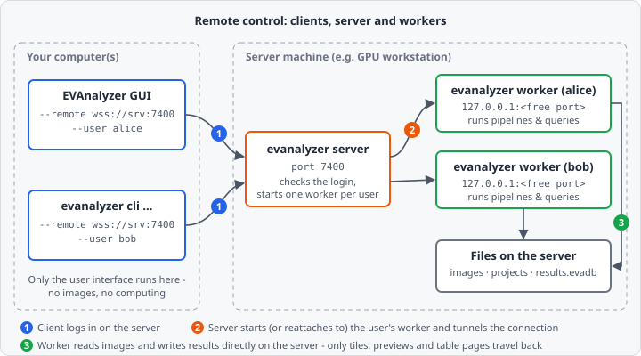

With remote control the EVAnalyzer user interface runs on your own computer, while everything heavy happens on another machine - typically a GPU workstation or an analysis server that already holds the images. Images, projects and results stay on that machine; only image tiles for the viewer, preview results and pages of the results table travel over the network.

Both front ends support it: the [GUI](/getting-started/first-steps/) and the [command line interface](/cli/cli/). They behave exactly as they do locally - only the place where the work happens changes.

## How it works



Three roles take part, all provided by the same `evanalyzer` binary:

| Role       | Command                 | Runs on        | Job                                                                                                                                     |
| ---------- | ----------------------- | -------------- | --------------------------------------------------------------------------------------------------------------------------------------- |
| **Client** | `evanalyzer --remote …` | Your computer  | The normal GUI or CLI. Instead of reading files and running pipelines itself, it sends every request to the server.                     |
| **Server** | `evanalyzer server`     | Server machine | The entry point clients connect to. It checks the login, starts a worker for the user and from then on tunnels the connection to it.    |
| **Worker** | `evanalyzer worker`     | Server machine | One compute instance per user. It opens images, runs previews, analyses and trainings, queries and exports results - all on the server. |

A connection goes through these steps:

1. The client connects to the server (default port `7400`) over an encrypted `wss://` connection and logs in with user name and password.
2. The server starts a worker for this user - or, if one is already running, reattaches to it. The worker only listens on `127.0.0.1` on a free port, so it can't be reached from outside directly; the server passes the connection on to it.
3. From now on client and worker talk directly through this tunnel. The worker reads the images, runs the pipelines and writes the results database on the server's disks.

Each user gets their own worker process, which can only read and write the user's [allowed folders](#allowed-folders). Every login of the same user - a second window, the CLI, a reconnect - lands on the same worker.

## Quick start

### 1. Start the server

On the server machine:

```sh
./evanalyzer server --listen 0.0.0.0:7400
```

Without `--listen` the server only accepts connections from the machine itself (`127.0.0.1:7400`). When listening on every network (`0.0.0.0`), the log lists the addresses clients can use - the host name and every IP address of the machine.

On first start the server creates a self-signed TLS certificate in its [data folder](#server-data-folder) and logs its fingerprint - at every start:

```
Clients connect with wss:// - certificate fingerprint 1E:0F:D0:…:23:5D
```

Give that fingerprint to your users - see [Encryption](#encryption-tls).

Out of the box the server knows a single account, **admin**. Unless you configure a password for it, the server makes up a random one at every start and prints it to the console (only there, not in the log):

```
  Log in as 'admin' with password: …
```

That password is valid until the server stops. To keep a fixed password, or to set up several accounts, use a [configuration file](#server-configuration). The admin's worker is confined to a folder of its own (see [Users](#users)), so it can't reach anything else on the machine until you add [allowed folders](#allowed-folders).

### 2. Connect the GUI

Open **EVA › Connect to server…** (or **Connect to a server…** on the Start page), enter the **Server** (e.g. `wss://workstation:7400`), **User** and **Password**, and click **Connect**. Servers used before are listed under **Recent servers** - click one to fill in the address and user.

On the first connection to a server, EVAnalyzer shows the fingerprint of its certificate (**Is this your server?**). Compare it with the fingerprint your administrator gave you and click **They match - connect** only if they do. The certificate is then remembered on this computer. If the server later presents a different certificate, EVAnalyzer warns (**The server's certificate has changed**) and shows the old and new fingerprints: either the administrator replaced the certificate - or someone is intercepting the connection, in which case don't connect.

The window then switches to the server. **EVA › Connect to other server…** switches to another one, **EVA › Disconnect** returns to this computer. The bottom bar always shows where you work.

You can also connect when starting EVAnalyzer:

```sh
./evanalyzer --remote wss://workstation:7400 --user alice --remote-fingerprint 1E:0F:D0:…:23:5D
```

EVAnalyzer asks for the password in the terminal, then opens the normal window.

Everything you open or save now refers to the server:

- The status bar shows where you are working: **This computer** when local, or a **alice @ workstation:7400** badge when connected. A lock icon shows that the connection is encrypted and the server verified; otherwise the badge says **- unencrypted** or **- server not verified**.
- The file browser, which EVAnalyzer uses for every open and save, lists the server's folders (shown as **Server locations**). Paths you pick are paths on the server.
- Running an analysis, the live preview, AI training and result exports all run on the server.

### 3. Use the CLI remotely

Add the same options to any [CLI command](/cli/cli/):

```sh
./evanalyzer cli --remote wss://workstation:7400 --user alice --remote-fingerprint 1E:0F:… \
  analyze --project /data/experiment-12/experiment.evaproj
```

All paths - `--project`, `--images`, `--db`, `--out` - are paths **on the server**, and output files (such as an exported CSV) are written there as well.

## Analyses run in the background

An analysis belongs to the worker, not to the connection that started it. Closing the window, a dropped network or a laptop going to sleep don't stop it:

- **GUI** - closing the window or choosing **Disconnect** while an analysis runs asks what to do: **Keep running on server** (or **Keep running and disconnect**) leaves it running, **Cancel analysis** stops it. The next time you connect, the GUI follows the running analysis again and reports analyses that ended in the meantime.
- **CLI** - if the connection drops during `analyze`, the analysis keeps running on the server. `evanalyzer cli jobs` lists the running and recently finished analyses, `evanalyzer cli attach` follows the running one again (`--job <id>` for a specific one):

  ```sh
  ./evanalyzer cli --remote wss://workstation:7400 --user alice jobs
  ./evanalyzer cli --remote wss://workstation:7400 --user alice attach
  ```

Each user runs one analysis at a time - a second one is refused until the first has finished. A classifier training survives a disconnect too: the worker saves the model into the project's `models` folder itself. Previews and exports stop with their connection.

A results database records how its analysis ended. One that was cancelled, failed or interrupted (crash, killed worker) shows a warning in the results window and in `evanalyzer cli view`.

### Reconnecting

When the connection drops, a banner at the top of the window says so and the status badge turns into **… - disconnected**. The GUI reconnects by itself - after 2, 5 and 10 seconds, then every 30 seconds, or at once with **Reconnect now** in the banner. It reuses the session it logged in with, so no password is needed as long as the user's worker is still running. Open images and results carry on.

## Server configuration

The server is configured with a TOML file:

```sh
./evanalyzer server --config /etc/evanalyzer/server.toml
```

Each setting is taken from the first of these that sets it: the command-line arguments (`--listen`, `--data-dir`, `--log-level`, and `--ai-devices` / `--gpu-slots` for the workers), the `--config` file, the built-in defaults. The server reads no environment variables and no config file unless you pass `--config`. It reads the files once at startup, so restart it after editing them. Unknown or misspelled keys and impossible values stop the server at startup with an error that names the key.

A complete example with every setting and its default:

```toml
# Address and port to accept clients on. 127.0.0.1 = this machine only;
# 0.0.0.0:7400 accepts connections from every network.
listen = "127.0.0.1:7400"

# Folder the server keeps everything it creates in (certificate, running
# workers, the single user's home) - see Server data folder below.
# Absolute path. Default: /var/lib/evanalyzer for a system service (root on
# Linux), otherwise ~/.evanalyzer/server (Linux) or ~/evanalyzer/server
# (macOS, Windows) of the server's account.
# data_dir = "/var/lib/evanalyzer"

# error, warn, info, debug, trace, off - or per module,
# e.g. "info,evanalyzer_core=debug".
log_level = "info"

[users]
# Who may log in: "single", "linux" or "file" - see Users below.
source = "single"
# Folders every user's worker may read and write, unless the account sets
# its own allowed_dirs. {home} stands for the user's home folder.
default_allowed_dirs = ["{home}"]

[users.single]
username = "admin"
# Hashed password, create one with `evanalyzer hash-password`.
# Default: none - a random password is made up at every start and
# printed to the console.
# password = "$argon2id$v=19$m=19456,t=2,p=1$…"
# Default: <data_dir>/single-user, created on start (see Users below).
# home = "/srv/evanalyzer/admin"
# allowed_dirs = ["{home}", "/data/microscopy"]

[users.linux]
shadow_file = "/etc/shadow"
passwd_file = "/etc/passwd"
# [users.linux.overrides.alice]
# allowed_dirs = ["{home}", "/data/shared"]

[users.file]
# path = "/etc/evanalyzer/users.toml"

[tls]
enabled = true
# cert = "/etc/evanalyzer/cert.pem"
# key = "/etc/evanalyzer/key.pem"
# Not set: a self-signed certificate in <data_dir>/tls.

[workers]
# A worker stops by itself once no client has been connected and no
# analysis has run for this many minutes. At least 1.
idle_timeout_minutes = 120
# Where workers run AI models: "auto" (every GPU, else the CPU), "cpu",
# or GPU numbers like "0,2".
# ai_devices = "auto"
# Parallel AI inferences per GPU, at least 1.
# gpu_slots = 1

[limits]
# Not set: no limit.
# max_workers = 20
# max_connections = 100
```

### Server data folder

Everything the server creates is kept in one folder, its data folder. Set it with `data_dir` in the config file or `--data-dir` on the command line - it must be an absolute path. The log names it at every start (`Data folder: …`).

| Server runs                            | Default data folder     |
| -------------------------------------- | ----------------------- |
| as a system service (root, Linux)      | `/var/lib/evanalyzer/`  |
| as a normal user, Linux                | `~/.evanalyzer/server/` |
| as a normal user, macOS / Windows      | `~/evanalyzer/server/`  |

`~` is the home folder of the account the server runs as.

```
<data folder>/
├── tls/               self-signed certificate and key - back it up, or
│                      clients have to trust a new fingerprint
├── sessions.json      the running workers
└── single-user/       home of the single user (default user setup)
```

The server creates the folders it needs; on Linux and macOS only its own account can read them. Files you write yourself - the config file, the users file, your own certificate - are not in the data folder; the server reads them from the path you give it (`/etc/evanalyzer/` is the usual place).

Each user's settings, templates and crash log are in the EVAnalyzer folder in the user's home on the server - the same folder the app uses on a user's own computer, see [Where EVAnalyzer stores its data](/guide/settings/#where-evanalyzer-stores-its-data).

### Users

`[users] source` chooses where accounts come from:

| `source`           | Accounts                                                                                                       | Home folder                                                     | Worker runs as                                       |
| ------------------ | -------------------------------------------------------------------------------------------------------------- | --------------------------------------------------------------- | ---------------------------------------------------- |
| `single` (default) | One account in `[users.single]`: `admin`, with a random password made up at every start and printed to the console unless `users.single.password` is set | `users.single.home`, default: a folder of its own, `single-user` in the [data folder](#server-data-folder) | the server's account |
| `linux`            | This machine's system users, checked against `/etc/shadow`. The server needs root or membership in the `shadow` group. | from `/etc/passwd`                                              | the user's own account, if the server runs as root |
| `file`             | The `[[user]]` entries of a separate users file, `[users.file] path`. No system accounts needed.                | `home` of each entry                                            | the server's account                                 |

A users file for `source = "file"` lists one `[[user]]` table per account:

```toml
[[user]]
id = "1"                       # stable - change the name, never the id
name = "alice"                 # login name, can be changed freely
password = "$argon2id$v=19$m=19456,t=2,p=1$…"
home = "/srv/evanalyzer/alice" # absolute; the worker's working directory
allowed_dirs = ["{home}", "/data/microscopy/shared"]   # optional

[[user]]
id = "2"
name = "bob"
password = "$2b$12$…"
home = "/srv/evanalyzer/bob"
```

### Allowed folders

A worker can read and write only its user's _allowed folders_ and the user's [EVAnalyzer folder](/guide/settings/#where-evanalyzer-stores-its-data) in their home, which holds settings and templates. The allowed folders come from:

- the account's own `allowed_dirs`: `users.single.allowed_dirs`, an `allowed_dirs` entry in the users file, or `[users.linux.overrides.<name>]`;
- otherwise `users.default_allowed_dirs`, which defaults to `["{home}"]`.

`{home}` stands for the user's home folder. For example, this gives everyone their home plus a shared data folder:

```toml
[users]
default_allowed_dirs = ["{home}", "/data/microscopy"]
```

### Passwords

Create a password entry with EVAnalyzer itself:

```sh
./evanalyzer hash-password                      # asks twice, hidden; prints the hash
echo 'PASSWORD' | ./evanalyzer hash-password    # for scripts
```

It prints an Argon2id hash with a random salt. Use it as the value of `password = "..."`. Hashes made with other tools are accepted too:

| Format                      | Looks like                       | Generate with                                                     |
| --------------------------- | -------------------------------- | ----------------------------------------------------------------- |
| Argon2id (recommended)      | `$argon2id$v=19$m=…`             | `evanalyzer hash-password`                                        |
| bcrypt                      | `$2b$12$…` (also `$2a$`, `$2y$`) | `htpasswd -nbBC 12 "" 'PASSWORD' \| cut -d: -f2` (`apache2-utils`) |
| yescrypt                    | `$y$…`                           | `mkpasswd -m yescrypt` (`whois`)                                  |
| sha512-crypt / sha256-crypt | `$6$…` / `$5$…`                  | `openssl passwd -6`                                               |
| plain text                  | `plain:PASSWORD`                 | testing only - the server warns at startup                        |

Anyone who can read the hashes can try to crack them offline, so make the files readable only by the server's account (`chmod 600`). The server warns at startup if other accounts can read the users file.

### Encryption (TLS)

Connections between clients and the server are encrypted by default (`wss://`). Workers listen on `127.0.0.1` only and are reached unencrypted.

- **Self-signed certificate (default).** The server creates it on first start in `tls/` in its [data folder](#server-data-folder) and logs its fingerprint at every start. Users confirm the fingerprint once in the GUI, or pass it with `--remote-fingerprint` on the command line - without it, the command-line client refuses to connect and prints the fingerprint it was shown. Keep that folder (include it in backups) and the fingerprint stays the same.
- **Certificate from a public authority** (e.g. Let's Encrypt): set `tls.cert` and `tls.key`. Clients connecting by that host name need no fingerprint. A certificate from your organisation's own CA works too, with the fingerprint, like a self-signed one.
- **Without encryption**: `tls.enabled = false`, and clients use `ws://`. Only for a server behind something that encrypts already (reverse proxy, VPN, SSH tunnel) or for tests on one machine - the server warns when it listens on the network without TLS, and the client's status bar shows **unencrypted**.

For tests or a network you fully trust, clients can skip the certificate check with `--no-tls-verification`: still encrypted, but anyone in between could pose as the server and read the password. The status bar then shows **server not verified**.

### Workers

A worker keeps running when its client disconnects or logs out, and when the server restarts (the server finds it again through `sessions.json` in its [data folder](#server-data-folder)). It stops by itself once no client has been connected and no analysis has run for `workers.idle_timeout_minutes` (default 2 hours); the user's next login starts a new one. A reboot of the machine ends all workers: the server then forgets them, and each user's next login starts a new one.

The server starts each worker with the user's home as working directory and an environment cleared of everything except what the OS needs.

### Limits

`[limits]` protects the machine from more work than it can do:

- `max_workers` - users working at the same time. A login that would start one more worker is refused with "try again later"; users whose worker is already running can always log in.
- `max_connections` - open client connections, all users together (one GUI or CLI is one connection).

## Running the server as a service (Linux)

1. **Install** the release archive, e.g. to `/opt/evanalyzer` (the bundled libraries must stay next to the binary):

   ```sh
   sudo mkdir -p /opt/evanalyzer
   sudo tar xzf evanalyzer-linux-x86_64.tar.gz -C /opt/evanalyzer
   ```

2. **Configure** `/etc/evanalyzer/server.toml`. Set at least `listen = "0.0.0.0:7400"` and the users. A server running as root uses `/var/lib/evanalyzer` as its data folder anyway; with its own account (`User=evanalyzer` below) also set it, so it matches the unit's `StateDirectory`:

   ```toml
   data_dir = "/var/lib/evanalyzer"
   ```

3. **Create** `/etc/systemd/system/evanalyzer.service`:

   ```ini
   [Unit]
   Description=EVAnalyzer server
   Wants=network-online.target
   After=network-online.target

   [Service]
   ExecStart=/opt/evanalyzer/evanalyzer server --config /etc/evanalyzer/server.toml
   # Runs as its own account - right for users.source = "single" or "file".
   # For users.source = "linux" remove these two lines: that needs root.
   User=evanalyzer
   Group=evanalyzer
   # Creates /var/lib/evanalyzer, the data folder, owned by the account above.
   StateDirectory=evanalyzer
   StateDirectoryMode=0700
   # Workers - and the analyses running in them - survive a restart of the
   # server: stop only the server process.
   KillMode=process
   Restart=on-failure
   RestartSec=5

   [Install]
   WantedBy=multi-user.target
   ```

4. **Start** it:

   ```sh
   sudo useradd --system --no-create-home --shell /usr/sbin/nologin evanalyzer  # not for "linux" users
   sudo chown -R root:evanalyzer /etc/evanalyzer && sudo chmod 640 /etc/evanalyzer/*.toml
   sudo systemctl daemon-reload
   sudo systemctl enable --now evanalyzer
   journalctl -u evanalyzer -f        # the log - including the TLS fingerprint
   ```

   Open port 7400/tcp in the firewall (e.g. `sudo ufw allow 7400/tcp`).

With `User=evanalyzer`, workers run as that account: it needs read/write access to the users' home folders and allowed folders. `systemctl restart evanalyzer` keeps running workers and analyses. To stop everything at once, e.g. before updating the binary, use `sudo systemctl kill --signal=SIGTERM evanalyzer` - this stops the workers too, and with them any running analysis.

## Connecting without a server

For a quick one-user setup you can skip the server and start a worker by hand. The worker then authenticates clients with a token instead of a user login:

```sh
# On the server machine
./evanalyzer worker --listen 0.0.0.0:7400 --root /data --root /scratch
```

If no `--token` is given, the worker generates one and prints it at startup. Connect with that token instead of `--user`:

```sh
# On your computer
./evanalyzer --remote ws://server-name:7400 --remote-token <token>
```

The worker speaks plain `ws://` - only use it on a trusted network or through an SSH tunnel. `--root` limits which folders the client may browse and use; without it, the client can reach every file the worker process can (a warning is printed at startup).

## Command-line options

### Client options

These options work for the GUI and every `cli` command:

| Option                          | Description                                                                                                                                                       |
| ------------------------------- | ----------------------------------------------------------------------------------------------------------------------------------------------------------------- |
| `--remote <URL>`                | Server or worker to work on instead of this computer, e.g. `wss://workstation:7400` (`ws://` if the server runs without TLS).                                     |
| `--user <USER>`                 | User to log in as on an `evanalyzer server`. Requires `--remote`.                                                                                                 |
| `--password <PASSWORD>`         | Password for `--user`. If omitted, it is asked for (hidden) in the terminal. Note that command-line arguments are visible to other users of the same computer. |
| `--remote-fingerprint <SHA256>` | SHA-256 fingerprint of the server's TLS certificate, as the server logs it at startup. Needed for the server's own self-signed certificate.                         |
| `--no-tls-verification`         | Accept any certificate without checking it. Only for tests and trusted networks; can't be combined with `--remote-fingerprint`.                                   |
| `--remote-token <TOKEN>`        | Connect directly to an `evanalyzer worker` with the token it printed, instead of `--user`.                                                                       |
| `--log-level <FILTER>`          | What to log: `error`, `warn`, `info` (default), `debug`, `trace`, `off`, or per module, e.g. `info,evanalyzer_core=debug`.                                       |

`--remote` needs either `--user` (server) or `--remote-token` (worker); the two can't be combined.

### `evanalyzer server`

| Option                   | Default          | Description                                                       |
| ------------------------ | ---------------- | ----------------------------------------------------------------- |
| `--config <FILE>`        | -                | [Configuration file](#server-configuration) (TOML).               |
| `--listen <ADDR>`        | `127.0.0.1:7400` | Address and port to accept clients on.                            |
| `--data-dir <DIR>`       | see [Server data folder](#server-data-folder) | Folder the server keeps its state in: certificate, running workers, the single user's home. |

### `evanalyzer worker`

| Option                     | Default          | Description                                                                                       |
| -------------------------- | ---------------- | ------------------------------------------------------------------------------------------------- |
| `--listen <ADDR>`          | `127.0.0.1:7400` | Address to listen on.                                                                             |
| `--token <TOKEN>`          | generated        | Token clients must present. Generated and printed if not set.                                     |
| `--root <FOLDER>`          | -                | Folder clients may browse and use. Repeat for several folders. Without it, nothing is restricted. |
| `--home <FOLDER>`          | this account's   | Home folder of the user this worker serves; the user's [EVAnalyzer folder](/guide/settings/#where-evanalyzer-stores-its-data) (settings, templates) is inside it. |
| `--idle-timeout <MINUTES>` | -                | Stop once no client has been connected and no analysis has run for this long.                     |

Workers started by `evanalyzer server` get all of these from the server - you only start a worker by hand for the [direct connection](#connecting-without-a-server).

### `evanalyzer hash-password`

Prints an Argon2id hash of a password for the server's config or users file. Asks for the password twice (hidden), or reads one line from stdin when it is not a terminal.

## Security

- A logged-in user's worker can read and write only the user's [allowed folders](#allowed-folders). Keep them as narrow as your users need.
- Set a password for the **admin** account (or switch to `linux` or `file` users) when the server should run permanently - the random password changes at every restart.
- Distribute the certificate fingerprint over a channel you trust, and don't use `--no-tls-verification` outside of tests.
- Make the config and users files readable only by the server's account.
- Treat worker tokens like passwords, and use `--root` on a hand-started worker.
- Prefer the password prompt over `--password` - command-line arguments show up in the process list.

## Requirements and limitations

- **Compatible versions.** Client and server must speak the same remote protocol version. Their EVAnalyzer versions may differ. If the protocol versions don't match, the connection is refused with a message naming both versions.
- **Paths refer to the server.** Projects reference images by their path on the server, so a project created remotely opens locally only if the same paths exist there.
- **One analysis per user.** A second analysis is refused while the first is still running.
- **Previews and exports don't survive a dropped connection** - analyses and trainings do.
